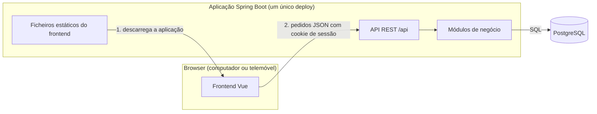
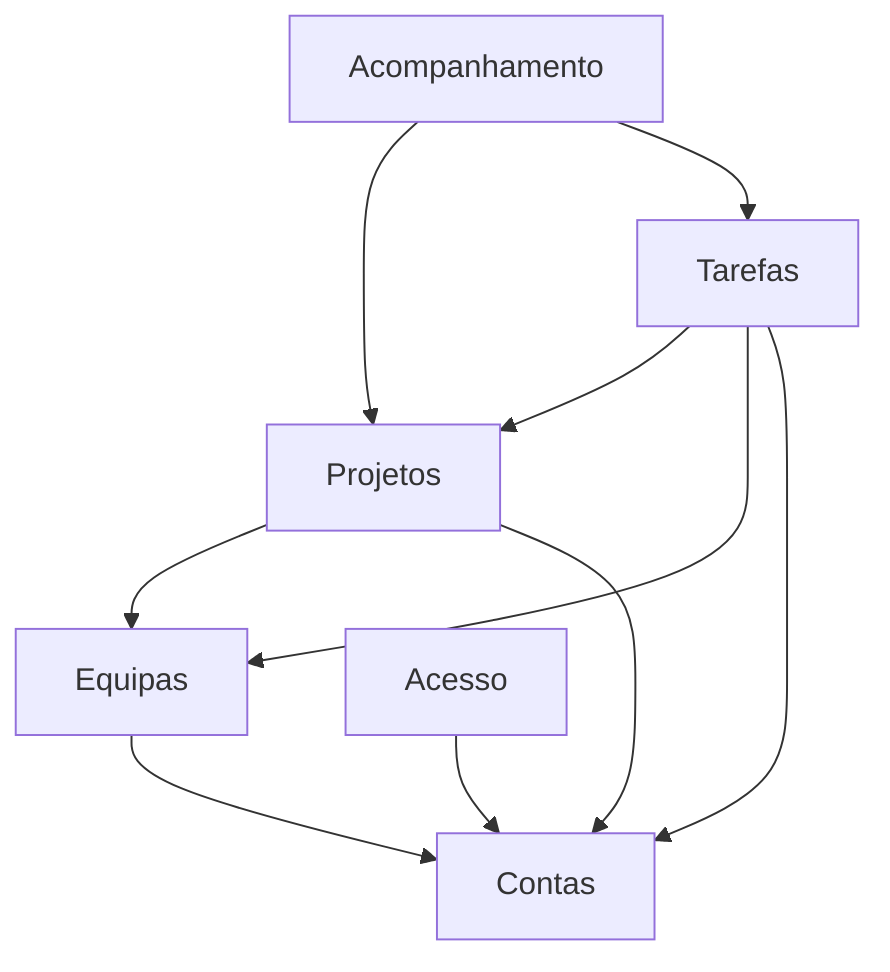
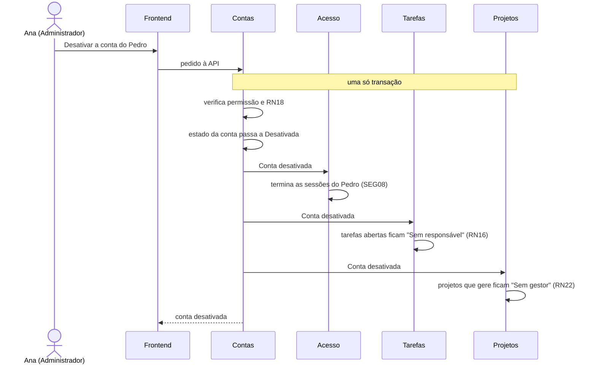
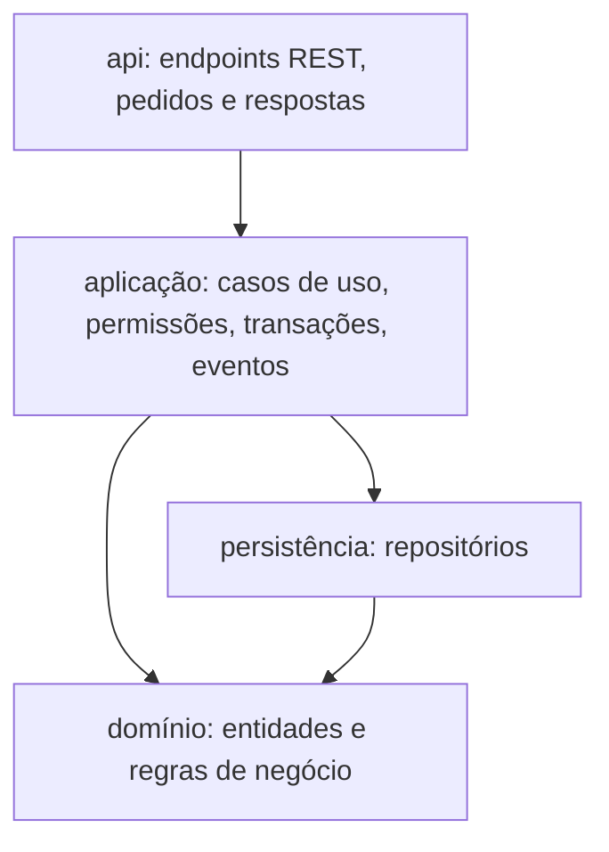

# Arquitetura da Matriz

> **Versão:** 0.3 (Ficha PL 02, Exercício 3: convenções da API)
> **Estado:** proposta. Todas as decisões deste documento têm origem **D** (decisão da equipa) e têm de ser validadas pelo Product Owner.

Documentos relacionados:

- [requirements.md](requirements.md): requisitos, regras de negócio, permissões e âmbito do MVP.
- [user-stories.md](user-stories.md): histórias do MVP e critérios de aceitação.
- [constraints.md](constraints.md): restrições, pressupostos, segurança e decisões pendentes.
- [database.md](database.md): modelo de dados e decisões de modelação (DA08 a DA14).

As decisões de arquitetura têm o prefixo **DA**. Cada uma indica a decisão pendente (DP) que resolve. A origem C, D ou P tem o significado de [requirements.md](requirements.md#como-ler-este-documento).

---

## 1. Contexto

Fatores que pesam na escolha da arquitetura:

| Fator | Fonte | O que implica |
|-------|-------|---------------|
| Prazo curto: entrega no Módulo 6 (18 ou 19 de novembro de 2026). | R03, R05 | Pouco tempo para infraestrutura. A arquitetura tem de ser simples de montar e de operar. |
| Equipa pequena, sem equipas autónomas por área. | P14 | Deploys independentes não trazem ganho. |
| Volume pequeno: 300 utilizadores, 20 em simultâneo, 10 000 tarefas. | P05, RNF03, RNF04 | Uma instância chega. Não é preciso escalar partes do sistema em separado. |
| Regras que atravessam várias áreas. | RN09, RN14, RN16, RN17, RN22, RN23 | Uma ação numa área altera dados de outra e tem de ser tudo ou nada. Ex.: desativar uma conta liberta as tarefas e deixa projetos "Sem gestor". |
| Vistas que juntam dados de várias áreas. | RF09, RF27, RF28 | A lista de projetos mostra o progresso e os atrasos, calculados a partir das tarefas. |
| Permissões verificadas em cada operação. | RF03, SEG01, SEG02 | A autorização fica no backend, junto das regras. |
| Sessões que terminam ao sair e ao desativar a conta. | SEG07, SEG08 | O servidor tem de controlar as sessões. |
| Critérios verificáveis por testes automáticos, com data fixa. | RNF06, RNF07 | Regras isoladas da web e da base de dados. A data atual tem de ser substituível nos testes. |
| Browser em computador e telemóvel, sem tempo real. | RNF01, P11, LIM02 | Aplicação web responsiva. Sem atualização automática das páginas. |
| A Aula 03 implementa interface, API e base de dados. | Ficha PL 03 | Frontend que consome uma API REST documentada em OpenAPI. |

---

## 2. Comparação das alternativas

| Critério | Monólito | Monólito modular | Microservices |
|----------|----------|------------------|---------------|
| Complexidade | Baixa no início. Cresce sem controlo, porque não há fronteiras. | Baixa. Exige disciplina nas fronteiras entre módulos. | Alta: rede, contratos entre serviços, falhas parciais, monitorização. |
| Escalabilidade | Escala a aplicação inteira. Chega para P05. | Igual ao monólito. Chega para P05. | Escala cada serviço. Sem necessidade no MVP (RNF03, RNF04). |
| Manutenção | Piora com o tempo: regras espalhadas pelos controllers. | Boa: cada regra vive num só módulo. | Boa em cada serviço, difícil no conjunto. |
| Deploy | Um só. | Um só. | Um por serviço, com versões de contrato. |
| Custos | Baixos. | Baixos. | Altos: mais infraestrutura e mais tempo da equipa. |
| Autonomia das equipas | Baixa. Sem impacto com uma equipa pequena (P14). | Média. | Alta. Sem utilidade com uma equipa pequena. |
| Regras entre áreas (RN16, RN17, RN22, RN23) | Uma transação local. | Uma transação local, com eventos internos. | Transações distribuídas ou consistência eventual. Desativar uma conta e libertar as tarefas deixa de ser tudo ou nada. |
| Vistas combinadas (RF09, RF27, RF28) | Uma consulta à base de dados. | Uma consulta, através da interface pública dos módulos. | Composição de vários serviços ou cópias de dados. |
| Integridade referencial | Chaves estrangeiras na base de dados. | Chaves estrangeiras na base de dados. | Perde-se entre serviços. A relação passa a ser lógica. |
| Adequação ao calendário (R03) | Boa. | Boa. | Má: o tempo vai para infraestrutura e não para as 18 histórias. |

**Conclusão:** microservices resolvem problemas que a Matriz não tem (escala seletiva, equipas autónomas) e criam um que tem: as regras RN16, RN17, RN22 e RN23 deixariam de ser atómicas. Entre as duas opções de monólito, o custo é quase o mesmo, mas o monólito modular deixa claro onde vive cada regra.

---

## 3. DA01: monólito modular

**Origem:** D · **Resolve:** DP02

**Decisão.** A Matriz é uma única aplicação, com um único deploy, organizada em módulos por área de negócio (secção 5). Os módulos comunicam por chamadas locais e partilham uma base de dados, mas cada tabela tem um único módulo dono.

**Justificação.**

1. O calendário (R03) e a equipa pequena (P14) pedem a opção com menos infraestrutura.
2. O volume de referência (P05) cabe numa instância. RNF03 e RNF04 não exigem escalar partes em separado.
3. As regras RN16, RN17, RN22 e RN23 alteram contas, equipas, projetos e tarefas numa só ação. Numa aplicação única, isso é uma transação local.
4. A lista de projetos (RF09) junta dados de projetos e de tarefas (RF27, RF28). Com uma base de dados, é uma consulta.
5. Os módulos dão fronteiras claras às regras e aos dados, o que facilita os testes por área (RNF07) e a revisão do código gerado com IA (IA04).

**Alternativas rejeitadas.**

- Monólito sem módulos: o mesmo custo de arranque, mas com regras e acessos a dados espalhados pelos controllers. É o risco descrito nos slides do Módulo 2.
- Microservices: ver secção 2.

**Consequências.**

- (+) Um deploy, uma base de dados, uma transação por operação.
- (+) Cada regra de negócio tem um sítio previsível.
- (+) Se um dia for preciso, um módulo com fronteiras limpas pode passar a serviço.
- (-) Toda a aplicação é publicada de cada vez que algo muda. Aceitável no MVP.
- (-) As fronteiras dependem de disciplina. Ver riscos na secção 12.

---

## 4. Visão geral



O backend serve o frontend compilado e a API na mesma origem. O browser só fala com a aplicação. A base de dados não é acessível de fora.

---

## 5. Componentes e responsabilidades

### 5.1 Módulos do backend

| Módulo | Responsabilidade | Dono dos dados | Requisitos e regras | Histórias |
|--------|------------------|----------------|---------------------|-----------|
| **Acesso** | Entrar e sair. Verificar a palavra-passe. Criar e terminar sessões. Garantir que cada pedido tem sessão válida e conta ativa. Limitar tentativas falhadas. | Sessões | RF01, SEG01, SEG03, SEG04, SEG05, SEG07, SEG08, SEG09 | US01 |
| **Contas** | Criar, editar, desativar e reativar contas. Mudar o papel. Garantir um Administrador ativo. | Utilizador: nome, email, palavra-passe protegida, papel, estado | RF02, RN04, RN16, RN18, RN23, RN28, RN29, RNF05 | US02, US14, US18 |
| **Equipas** | Criar e editar equipas. Adicionar e remover pessoas. Dizer a que equipas pertence cada pessoa. | Equipa, pertença a equipas | RF05, RF06, RN02, RN03, RN17, RN26, RN29 | US03 |
| **Projetos** | Criar, editar, mudar o estado e arquivar projetos. Gerir o gestor e o valor "Sem gestor". Dizer que projetos cada pessoa vê e se um projeto aceita alterações. | Projeto | RF07, RF08, RN01, RN05 a RN10, RN21, RN22, RN27, RN29 | US04, US13, US17 |
| **Tarefas** | Criar, editar, apagar e atribuir tarefas. Mudar o estado. "As minhas tarefas" e filtros. Definir o que é uma tarefa atrasada. | Tarefa | RF12 a RF17, RF28 (marcação), RN11 a RN15, RN19, RN20, RN24, RN25, RN29 | US05 a US08, US10, US11, US16 |
| **Acompanhamento** | Só leitura. Lista de projetos visíveis com progresso e nº de tarefas atrasadas. Resumo de cada projeto. Não guarda dados. | Nenhum | RF09, RF27, RF28 (contagem) | US09, US10, US12, US15 |

O módulo Acompanhamento existe para que Projetos não dependa de Tarefas (ver secção 6). Pede a Projetos os projetos visíveis e a Tarefas os totais de cada projeto.

### 5.2 Componentes transversais (Comum)

Não têm regras de negócio. Todos os módulos podem usá-los.

| Componente | Responsabilidade | Requisitos |
|------------|------------------|------------|
| Utilizador atual | Identidade, papel e equipas de quem faz o pedido, obtidos da sessão. Nunca vêm do pedido do cliente. | SEG02 |
| Relógio da organização | Dá a data atual no fuso horário da organização. Nos testes, é substituído por uma data fixa (2026-11-10). | RNF06, P12, DP08 |
| Erros e validação | Formato único das respostas de erro e mensagens em português. | SEG06, RNF02 |

### 5.3 Frontend

| Responsabilidade | Requisitos |
|------------------|------------|
| Ecrãs do MVP: entrada, lista de projetos, projeto (tarefas, filtros, progresso), "As minhas tarefas", gestão de contas, gestão de equipas. O detalhe fica para o Exercício 4. | DP05, US01 a US18 |
| Navegação e encaminhamento para a página de entrada quando a sessão deixa de ser válida. | SEG01, SEG07 |
| Validação dos formulários para ajudar o utilizador. A validação que conta é a do backend. | SEG06 |
| Mostrar só as ações que o papel permite. Isto é conforto, não proteção: a proteção é a do backend. | SEG02 |
| Layout responsivo, a partir de 360 px. | RNF01 |
| Textos em português. O texto escrito pelos utilizadores é sempre mostrado como texto. | RNF02, SEG06 |

### 5.4 Base de dados

Um esquema PostgreSQL. Cada tabela tem um módulo dono, o único que escreve nela. As chaves estrangeiras entre tabelas de módulos diferentes são permitidas, porque garantem a integridade. O modelo de dados está em [database.md](database.md).

---

## 6. Dependências entre módulos



A seta indica quem chama quem. Todos os módulos usam também os componentes de Comum (omitidos no diagrama).

| Dependência | Porquê |
|-------------|--------|
| Tarefas → Projetos | Só projetos "Ativo" aceitam tarefas (RN08). Projetos fechados não se alteram (RN09). O gestor do projeto tem permissões sobre as tarefas. |
| Tarefas → Equipas, Contas | O responsável tem de pertencer à equipa, ter conta ativa e papel Gestor ou Membro (RN14). |
| Projetos → Equipas, Contas | O gestor tem de pertencer à equipa e ter papel Gestor (RN21). Equipa sem Gestor não tem projetos novos (RN27). |
| Equipas → Contas | Só Gestor e Membro com conta ativa pertencem a equipas (RN26). |
| Acesso → Contas | Conta desativada não entra (SEG05). |

**Regras:**

1. Não há ciclos.
2. Um módulo só usa a interface pública de outro. Nunca usa os repositórios de outro módulo nem escreve nas suas tabelas.
3. Quando um módulo tem de reagir a uma ação de um módulo de que depende, usa um evento interno (secção 7). Ex.: Tarefas reage à desativação de uma conta sem que Contas conheça Tarefas.
4. As permissões verificam-se na camada de aplicação de cada módulo, em cada operação (SEG02).

---

## 7. Regras entre módulos: eventos internos (DA06)

Os eventos são publicados e tratados dentro da aplicação, de forma síncrona e na mesma transação. Não há broker de mensagens. Se um tratamento falhar, a operação inteira é anulada, por isso as regras continuam atómicas.

| Evento | Publicado por | Quem reage | O que acontece | Regra |
|--------|---------------|------------|----------------|-------|
| Conta desativada | Contas | Acesso | Termina todas as sessões da conta. | SEG08 |
| | | Tarefas | As tarefas abertas da pessoa ficam "Sem responsável". As concluídas mantêm o nome. | RN16 |
| | | Projetos | Os projetos que gere ficam "Sem gestor". | RN22 |
| Papel mudado | Contas | Projetos | Se deixou de ser Gestor, os projetos que gere ficam "Sem gestor". | RN22, RN23 |
| | | Equipas | Se passou a Observador ou Administrador, sai de todas as equipas. Publica "Pessoa removida da equipa" para cada uma. | RN23, RN26 |
| Pessoa removida da equipa | Equipas | Tarefas | As tarefas abertas da pessoa nos projetos dessa equipa ficam "Sem responsável". | RN17 |
| | | Projetos | Os projetos dessa equipa que a pessoa gere ficam "Sem gestor". | RN22 |

Estas alterações automáticas aplicam-se também a projetos "Concluído" e "Arquivado" (exceção de RN09, caso E22). Por isso, quem reage usa uma operação interna própria, separada das operações dos utilizadores, que não aplica a verificação de RN09.

Exemplo: desativar a conta do Pedro (US14).



---

## 8. Estrutura interna de cada módulo

Cada módulo tem as mesmas camadas. A arquitetura hexagonal completa seria exagerada para este MVP. Fica uma só porta explícita: o Relógio da organização, porque os testes precisam de uma data fixa (RNF06).



| Camada | O que contém | O que não contém |
|--------|--------------|------------------|
| api | Endpoints, validação do formato dos dados, conversão de e para JSON. | Regras de negócio. |
| aplicação | Um caso de uso por operação. Verificação de permissões (SEG02). Limites da transação. Publicação de eventos. | Detalhes de HTTP ou de SQL. |
| domínio | Entidades e regras (RN). Pode ser testado sem servidor nem base de dados (RNF07). | Dependências de web ou de base de dados. |
| persistência | Acesso às tabelas de que o módulo é dono. Consultas com parâmetros, nunca texto concatenado (SEG06). | Tabelas de outros módulos. |

Organização proposta do repositório:

```
.
├── README.md
├── AGENTS.md
├── openapi.yaml          contrato da API (Exercício 3)
├── docs/
├── backend/              aplicação Spring Boot, um pacote por módulo da secção 5.1
└── frontend/             aplicação Vue
```

Os nomes dos pacotes e as convenções de código entram no AGENTS.md quando for atualizado com a stack.

---

## 9. Decisões técnicas

Todas têm origem **D**. As decisões de modelação de dados (DA08 a DA14) estão em [database.md, secção 9](database.md#9-decisões-de-modelação). As convenções da API (DA15 a DA20) estão na secção 13.

| ID | Decisão | Resolve | Alternativas consideradas | Consequências |
|----|---------|---------|---------------------------|---------------|
| DA01 | Monólito modular. | DP02 | Monólito sem módulos, microservices. | Secção 3. |
| DA02 | Backend em Java com Spring Boot 4, API REST com JSON. Frontend em Vue 3 com TypeScript e Vite. O backend serve o frontend compilado. Um repositório com as pastas `backend/` e `frontend/`. | DP01 | Thymeleaf (páginas no servidor), React, Angular. | Um deploy e a mesma origem: não é preciso configurar CORS em produção. Em desenvolvimento, o Vite reencaminha `/api` para o backend. As versões exatas e as bibliotecas adicionais fixam-se na Ficha 03, com aprovação (AGENTS.md). |
| DA03 | Base de dados relacional PostgreSQL. | DP03 (parcial) | H2 ou SQLite, MongoDB. | Chaves estrangeiras e constraints (UNIQUE no email, RN04, e no nome da equipa, RN03). O modelo físico está em database.md. A ordenação sem acentos de RN24 usa uma collation ICU (DA14). |
| DA04 | Autenticação com sessão no servidor e cookie HttpOnly, com Spring Security. Proteção CSRF ativa. Palavras-passe guardadas com hash adaptativo. | DP06 (parcial) | Token JWT sem estado. | Sair (SEG07) e desativar (SEG08) terminam a sessão no servidor. O armazenamento das sessões tem de permitir terminar todas as sessões de uma conta. Ficam em aberto na DP06: regras da palavra-passe, duração e expiração da sessão, mecanismo de SEG09. |
| DA05 | Bloqueio otimista em Projeto e Tarefa: cada registo tem um número de versão. Gravar sobre uma versão antiga é recusado. | DP13 | O último a gravar ganha (manter LIM11). | Resolve LIM11. Campo `version` no modelo de dados (database.md) e resposta 409 na API (Exercício 3). As alterações automáticas da secção 7 também mudam a versão. Exige cenários novos em US16 e US17. |
| DA06 | Regras entre módulos com eventos internos síncronos, na mesma transação, sem broker. | DP02 | Chamadas diretas entre módulos (criam ciclos), broker de mensagens (consistência eventual e mais infraestrutura). | Secção 7. O fluxo fica menos visível no código: a tabela da secção 7 é a referência. |
| DA07 | Uma única instância do backend no MVP. | | Várias instâncias. | Chega para P05 (RNF03, RNF04). O alojamento fica para DP10. |

---

## 10. Requisitos não funcionais e de segurança

| ID | Como a arquitetura responde |
|----|-----------------------------|
| RNF01 | Frontend responsivo. Verificação a 360 px no Exercício 4 e na Ficha 03. |
| RNF02 | Textos da interface e mensagens de erro em português. |
| RNF03, RNF04 | Uma instância e PostgreSQL chegam para P05. Progresso e atrasos calculados na base de dados. Os índices para consultas por projeto, estado e responsável definem-se no Exercício 2. |
| RNF05 | O módulo Contas não tem operação de apagar. |
| RNF06 | A data atual vem sempre do Relógio da organização. |
| RNF07 | Regras no domínio, testáveis sem servidor. As ferramentas ficam para DP09. |
| SEG01 | Todos os pedidos à API passam pelo Acesso. Sem sessão válida, o pedido é recusado e o frontend mostra a página de entrada. |
| SEG02 | Permissões verificadas na camada de aplicação de cada módulo. |
| SEG03 | Hash adaptativo (DA04). |
| SEG04, SEG05 | Módulo Acesso. |
| SEG06 | Validação no backend. Consultas com parâmetros. O frontend nunca insere texto dos utilizadores como HTML. |
| SEG07, SEG08 | Sessão no servidor (DA04) e evento "Conta desativada" (secção 7). |
| SEG09 | Fica no módulo Acesso. O mecanismo depende da DP06. |
| PRIV01 | A arquitetura não acrescenta dados pessoais. A sessão guarda o identificador da conta enquanto está ativa. Se a DP06 exigir registar tentativas de entrada, o dado acrescenta-se ao PRIV01. |
| P11, LIM02 | Sem tempo real. O frontend atualiza os dados depois das ações do próprio utilizador e ao abrir cada página. |

---

## 11. Estado das decisões pendentes

| DP | Estado | Onde ou quando |
|----|--------|----------------|
| DP01 | Resolvida | DA02 |
| DP02 | Resolvida | DA01, DA06 |
| DP03 | Resolvida | DA03 e [database.md](database.md) (DA08 a DA14) |
| DP04 | Parcial: convenções e lista de endpoints | Secção 13 e [openapi.yaml](../openapi.yaml). As restantes operações detalham-se na Ficha 03. |
| DP05 | Pendente | Exercício 4 |
| DP06 | Parcial: mecanismo escolhido | DA04. O resto antes de implementar US01. |
| DP07 | Pendente | Antes de implementar US02. Afeta Contas e Acesso. |
| DP08 | Pendente | Só afeta a configuração do Relógio da organização. |
| DP13 | Resolvida | DA05 |

DP09 a DP12 mantêm as fases de [constraints.md](constraints.md#4-decisões-técnicas-pendentes).

---

## 12. Pressupostos e riscos

### 12.1 Pressupostos

Esta arquitetura apoia-se em P05, P11, P12 e no pressuposto novo P14 (equipa pequena, sem equipas autónomas por área). Estão registados em [constraints.md, secção 2](constraints.md#2-pressupostos-assumidos).

### 12.2 Riscos

| Risco | Mitigação |
|-------|-----------|
| As fronteiras entre módulos degradam-se e o monólito modular aproxima-se de um monólito confuso. | Regras da secção 6 no AGENTS.md. Revisão das dependências em cada revisão de código. Teste automático de arquitetura na Ficha 03 (ferramenta por decidir). |
| Os eventos internos escondem o fluxo das regras. | A tabela da secção 7 é a referência. Cada evento tem testes com os cenários das histórias (US03, US14, US18). |
| As alterações automáticas da secção 7 falham em projetos fechados por causa de RN09. | Operação interna própria, sem a verificação de RN09. Coberto pelo caso E22. |

---

## 13. API

O contrato está em [openapi.yaml](../openapi.yaml). Nesta fase documenta três operações. As restantes detalham-se na Ficha 03, com as convenções desta secção.

### 13.1 Convenções

Todas têm origem **D**.

| ID | Decisão | Porquê | Alternativa rejeitada |
|----|---------|--------|-----------------------|
| DA15 | Base `/api`, sem versão no caminho. JSON com nomes em camelCase, com os termos do glossário (DA08). | Há um único cliente, o frontend do mesmo deploy (DA02). | `/api/v1`. |
| DA16 | Erros no formato Problem Details (RFC 9457), com um `code` estável e uma mensagem em português em `detail`. Os erros de validação trazem a lista de campos em `errors`. | Formato padrão, suportado pelo Spring. O frontend decide pelo `code` e mostra o `detail` (RNF02). | Formato próprio. |
| DA17 | 400: dados inválidos. 401: sem sessão válida. 403: sem permissão ou projeto não visível. 404: o recurso não existe. 409: conflito com o estado atual (projeto fechado, versão antiga). As verificações seguem esta ordem: 401, 404, 403, 400, 409. | Respostas previsíveis para os cenários de recusa das histórias. O 403 para projetos não visíveis corresponde ao "Acesso recusado" de US12. Como não há projetos confidenciais (P13), mostrar que o projeto existe não é um risco. | 404 para projetos não visíveis. 422 para regras de negócio. |
| DA18 | Sem paginação no MVP. As listas vêm dentro de `items`. | O volume de P05 cabe numa resposta. Com `items`, a paginação pode entrar mais tarde sem partir o contrato. | Paginação desde já. |
| DA19 | Uma operação para cada linha diferente da matriz de permissões. Mudar o estado de uma tarefa (`PUT /tasks/{taskId}/status`) é separado de editar a tarefa (`PATCH /tasks/{taskId}`), porque o responsável muda o estado mas não edita (RN15). O mesmo para o estado do projeto e o estado da conta. | Cada operação verifica uma só regra de permissão (SEG02). | Um único `PATCH` com verificação campo a campo. |
| DA20 | A versão do bloqueio otimista (DA05) vai no corpo dos pedidos que alteram tarefas ou projetos. Apagar uma tarefa não leva versão. Uma versão antiga devolve 409 `VERSION_CONFLICT`. | Simples para o frontend e coerente com DA05. | Cabeçalhos `ETag` e `If-Match`, com 412. |

### 13.2 Endpoints previstos

As operações marcadas com **contrato** estão detalhadas em `openapi.yaml`. As outras são a lista de trabalho para a Ficha 03.

| Método | Caminho | O que faz | Histórias | Estado |
|--------|---------|-----------|-----------|--------|
| POST | `/session` | Entrar. | US01 | Ficha 03 (DP06) |
| DELETE | `/session` | Sair. | US01 | Ficha 03 |
| GET | `/session` | Utilizador atual: nome, papel e equipas. | US01 | Ficha 03 |
| GET | `/users` | Lista de contas. | US02 | Ficha 03 |
| POST | `/users` | Criar conta. | US02 | Ficha 03 (DP07) |
| PATCH | `/users/{userId}` | Editar nome e email. Mudar o papel. | US02, US18 | Ficha 03 |
| PUT | `/users/{userId}/status` | Desativar ou reativar. | US14 | Ficha 03 |
| GET | `/teams` | Lista de equipas. | US03 | Ficha 03 |
| POST | `/teams` | Criar equipa. | US03 | Ficha 03 |
| PATCH | `/teams/{teamId}` | Mudar o nome. | US03 | Ficha 03 |
| GET | `/teams/{teamId}/members` | Quem pertence à equipa. Serve também para escolher o responsável e o gestor. | US03, US06, US17 | Ficha 03 |
| PUT | `/teams/{teamId}/members/{userId}` | Adicionar uma pessoa. | US03 | Ficha 03 |
| DELETE | `/teams/{teamId}/members/{userId}` | Remover uma pessoa. | US03 | Ficha 03 |
| GET | `/projects` | Lista de projetos visíveis, com progresso e atrasos. | US09, US10, US12, US15 | **Contrato** |
| POST | `/projects` | Criar projeto. | US04 | Ficha 03 |
| GET | `/projects/{projectId}` | Detalhe do projeto, com progresso e atrasos. | US09, US10 | Ficha 03 |
| PATCH | `/projects/{projectId}` | Editar o projeto. O Administrador muda o gestor. | US17 | Ficha 03 |
| PUT | `/projects/{projectId}/status` | Mudar o estado e arquivar. | US13 | Ficha 03 |
| GET | `/projects/{projectId}/tasks` | Tarefas do projeto, com filtros por responsável, estado e atraso. | US10, US11 | Ficha 03 |
| POST | `/projects/{projectId}/tasks` | Criar tarefa. | US05 | **Contrato** |
| PATCH | `/tasks/{taskId}` | Editar a tarefa. Atribuir, mudar ou retirar o responsável. | US06, US16 | Ficha 03 |
| DELETE | `/tasks/{taskId}` | Apagar a tarefa. | US16 | Ficha 03 |
| PUT | `/tasks/{taskId}/status` | Mudar o estado. | US07, US17 | **Contrato** |
| GET | `/me/tasks` | "As minhas tarefas", com o filtro "Incluir concluídas". | US08 | Ficha 03 |

Todas as histórias US01 a US18 têm pelo menos um endpoint.

A confirmação de RN10 (concluir um projeto com tarefas abertas) é feita no frontend, com o número de tarefas abertas calculado a partir do progresso (total menos concluídas).
