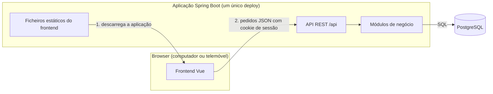
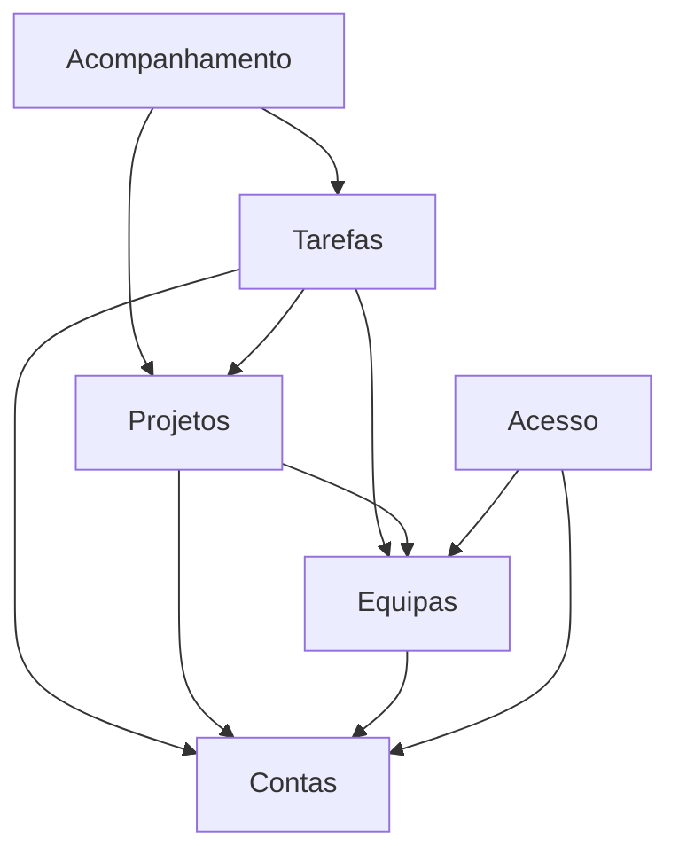
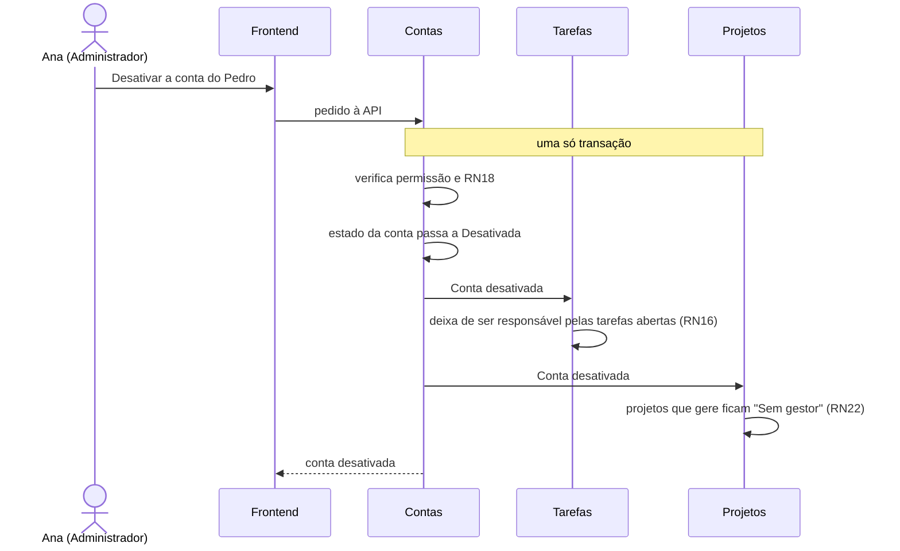
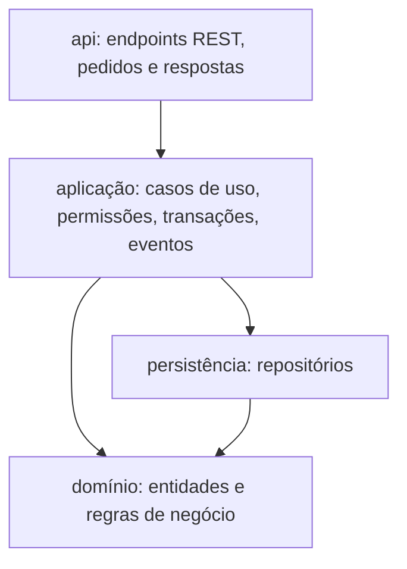

# Arquitetura da Matriz

> **Versão:** 0.7 (conciliação com o âmbito da Ficha PL 03, exercício 1)
> **Estado:** proposta. Todas as decisões deste documento têm origem **D** (decisão da equipa) e têm de ser validadas pelo Product Owner.

Documentos relacionados:

- [requirements.md](requirements.md): requisitos, regras de negócio, permissões e âmbito do MVP.
- [user-stories.md](user-stories.md): histórias do MVP e critérios de aceitação.
- [constraints.md](constraints.md): restrições, pressupostos, segurança e decisões pendentes.
- [database.md](database.md): modelo de dados e decisões de modelação (DA08 a DA14, DA29, DA32).

As decisões de arquitetura têm o prefixo **DA**. Cada uma indica a decisão pendente (DP) que resolve. A origem C, D ou P tem o significado de [requirements.md](requirements.md#como-ler-este-documento).

---

## 1. Contexto

Fatores que pesam na escolha da arquitetura:

| Fator | Fonte | O que implica |
|-------|-------|---------------|
| Prazo curto: entrega no Módulo 6 (18 ou 19 de novembro de 2026). | R03, R05 | Pouco tempo para infraestrutura. A arquitetura tem de ser simples de montar e de operar. |
| Equipa pequena, sem equipas autónomas por área. | P14 | Deploys independentes não trazem ganho. |
| Volume pequeno: 300 utilizadores, 20 em simultâneo, 10 000 tarefas. | P05, RNF03, RNF04 | Uma instância chega. Não é preciso escalar partes do sistema em separado. |
| Regras que atravessam várias áreas. | RN09, RN14, RN16, RN17, RN22, RN23, RN31 | Uma ação numa área altera dados de outra e tem de ser tudo ou nada. Ex.: desativar uma conta liberta as tarefas e deixa projetos "Sem gestor"; eliminar um projeto elimina as suas tarefas. |
| Vistas que juntam dados de várias áreas. | RF09, RF27, RF28, RF29 | A lista de projetos e o painel inicial mostram o progresso, os atrasos e as contagens, calculados a partir das tarefas. |
| Permissões verificadas em cada operação. | RF03, SEG01, SEG02 | A autorização fica no backend, junto das regras. |
| Sessões que terminam ao sair e ao desativar a conta. | SEG07, SEG08 | O servidor tem de controlar as sessões. |
| Critérios verificáveis por testes automáticos, com data fixa. | RNF06, RNF07 | Regras isoladas da web e da base de dados. A data atual tem de ser substituível nos testes. |
| Browser em computador e telemóvel, sem tempo real. | RNF01, P11, LIM02 | Aplicação web responsiva. Sem atualização automática das páginas. |
| A Aula 03 implementa interface, API e base de dados, com o âmbito mínimo da Ficha PL 03. | Ficha PL 03, R08 | Frontend que consome uma API REST documentada em OpenAPI. Dados de demonstração reproduzíveis e pelo menos três testes automáticos. |

---

## 2. Comparação das alternativas

| Critério | Monólito | Monólito modular | Microservices |
|----------|----------|------------------|---------------|
| Complexidade | Baixa no início. Cresce sem controlo, porque não há fronteiras. | Baixa. Exige disciplina nas fronteiras entre módulos. | Alta: rede, contratos entre serviços, falhas parciais, monitorização. |
| Escalabilidade | Escala a aplicação inteira. Chega para P05. | Igual ao monólito. Chega para P05. | Escala cada serviço. Sem necessidade no MVP (RNF03, RNF04). |
| Manutenção | Piora com o tempo: regras espalhadas pelos controllers. | Boa: cada regra vive num só módulo. | Boa em cada serviço, difícil no conjunto. |
| Deploy | Um só. | Um só. | Um por serviço, com versões de contrato. |
| Custos | Baixos. | Baixos. | Altos: mais infraestrutura e mais tempo da equipa. |
| Autonomia das equipas | Baixa. Sem impacto com uma equipa pequena (P14). | Média. | Alta. Sem utilidade com uma equipa pequena. |
| Regras entre áreas (RN16, RN17, RN22, RN23) | Uma transação local. | Uma transação local, com eventos internos. | Transações distribuídas ou consistência eventual. Desativar uma conta e libertar as tarefas deixa de ser tudo ou nada. |
| Vistas combinadas (RF09, RF27, RF28) | Uma consulta à base de dados. | Uma consulta, através da interface pública dos módulos. | Composição de vários serviços ou cópias de dados. |
| Integridade referencial | Chaves estrangeiras na base de dados. | Chaves estrangeiras na base de dados. | Perde-se entre serviços. A relação passa a ser lógica. |
| Adequação ao calendário (R03) | Boa. | Boa. | Má: o tempo vai para infraestrutura e não para as 22 histórias. |

**Conclusão:** microservices resolvem problemas que a Matriz não tem (escala seletiva, equipas autónomas) e criam um que tem: as regras RN16, RN17, RN22 e RN23 deixariam de ser atómicas. Entre as duas opções de monólito, o custo é quase o mesmo, mas o monólito modular deixa claro onde vive cada regra.

---

## 3. DA01: monólito modular

**Origem:** D · **Resolve:** DP02

**Decisão.** A Matriz é uma única aplicação, com um único deploy, organizada em módulos por área de negócio (secção 5). Os módulos comunicam por chamadas locais e partilham uma base de dados, mas cada tabela tem um único módulo dono.

**Justificação.**

1. O calendário (R03) e a equipa pequena (P14) pedem a opção com menos infraestrutura.
2. O volume de referência (P05) cabe numa instância. RNF03 e RNF04 não exigem escalar partes em separado.
3. As regras RN16, RN17, RN22 e RN23 alteram contas, equipas, projetos e tarefas numa só ação. Numa aplicação única, isso é uma transação local.
4. A lista de projetos (RF09) junta dados de projetos e de tarefas (RF27, RF28). Com uma base de dados, é uma consulta.
5. Os módulos dão fronteiras claras às regras e aos dados, o que facilita os testes por área (RNF07) e a revisão do código gerado com IA (IA04).

**Alternativas rejeitadas.**

- Monólito sem módulos: o mesmo custo de arranque, mas com regras e acessos a dados espalhados pelos controllers. É o risco descrito nos slides do Módulo 2.
- Microservices: ver secção 2.

**Consequências.**

- (+) Um deploy, uma base de dados, uma transação por operação.
- (+) Cada regra de negócio tem um sítio previsível.
- (+) Se um dia for preciso, um módulo com fronteiras limpas pode passar a serviço.
- (-) Toda a aplicação é publicada de cada vez que algo muda. Aceitável no MVP.
- (-) As fronteiras dependem de disciplina. Ver riscos na secção 12.

---

## 4. Visão geral



O backend serve o frontend compilado e a API na mesma origem. O browser só fala com a aplicação. A base de dados não é acessível de fora.

---

## 5. Componentes e responsabilidades

### 5.1 Módulos do backend

| Módulo | Responsabilidade | Dono dos dados | Requisitos e regras | Histórias |
|--------|------------------|----------------|---------------------|-----------|
| **Acesso** | Entrar e sair. Verificar a palavra-passe. Criar e terminar sessões. Garantir que cada pedido tem sessão válida e conta ativa. Obrigar a definir uma palavra-passe nova quando a atual é temporária. Limitar tentativas falhadas. | Sessões e contadores de tentativas, em memória | RF01, SEG01, SEG03, SEG04, SEG05, SEG07, SEG08, SEG09, DA25, DA26, DA35 | US01 |
| **Contas** | Criar, editar, desativar e reativar contas. Mudar o papel. Dar e repor o acesso com uma palavra-passe temporária. Garantir um Administrador ativo. | Utilizador: nome, email, palavra-passe protegida e indicação de palavra-passe temporária, papel, estado | RF02, RN04, RN16, RN18, RN23, RN28, RN29, RNF05, DA25 | US02, US14, US18 |
| **Equipas** | Criar e editar equipas. Adicionar e remover pessoas. Dizer a que equipas pertence cada pessoa. | Equipa, pertença a equipas | RF05, RF06, RN02, RN03, RN17, RN23, RN26, RN29, RN32 | US03, US18 |
| **Projetos** | Criar, editar, mudar o estado, arquivar e eliminar projetos. Gerir o gestor e o valor "Sem gestor". Dizer que projetos cada pessoa vê, pesquisar pelo nome e dizer se um projeto aceita alterações. | Projeto | RF07, RF08, RF40, RF41, RN01, RN05 a RN10, RN21, RN22, RN23, RN27, RN29, RN31, RN32, RN34 | US04, US13, US17, US20, US22 |
| **Tarefas** | Criar, editar e apagar tarefas. Associar e remover responsáveis. Mudar o estado. Comentários. "As minhas tarefas" e filtros. Definir o que é uma tarefa atrasada. | Tarefa, responsáveis da tarefa, comentário | RF12 a RF17, RF19, RF28 (marcação), RN11 a RN17, RN19, RN20, RN24, RN25, RN29, RN30, RN32 | US05 a US08, US10, US11, US16, US19 |
| **Acompanhamento** | Só leitura. Lista de projetos visíveis com progresso e nº de tarefas atrasadas. Resumo de cada projeto. Painel inicial com as contagens por estado. Não guarda dados. | Nenhum | RF09, RF27, RF28 (contagem), RF29, RN33 | US09, US10, US12, US15, US21, US22 |

O módulo Acompanhamento existe para que Projetos não dependa de Tarefas (ver secção 6). Pede a Projetos os projetos visíveis e a Tarefas os totais de cada projeto.

### 5.2 Componentes transversais (Comum)

Não têm regras de negócio. Todos os módulos podem usá-los.

| Componente | Responsabilidade | Requisitos |
|------------|------------------|------------|
| Utilizador atual | Identidade, papel, estado e equipas de quem faz o pedido. A sessão guarda só o identificador da conta; o resto lê-se da base de dados em cada pedido, por isso mudar o papel, as equipas ou desativar a conta tem efeito no pedido seguinte. Nunca vem do pedido do cliente. | SEG02, SEG08, RN17, RN23 |
| Relógio da organização | Dá a data atual e a data e hora atuais no fuso horário da organização. O fuso é `Europe/Lisbon` (DA24). Nos testes, é substituído por uma data fixa (2026-11-10). | RNF06, P12, DA24 |
| Erros e validação | Formato único das respostas de erro e mensagens em português. | SEG06, RNF02 |

### 5.3 Frontend

| Responsabilidade | Requisitos |
|------------------|------------|
| Ecrãs do MVP: entrada, definir palavra-passe nova (DA25), painel inicial, lista de projetos, projeto (tarefas, filtros, progresso), tarefa (responsáveis e comentários), "As minhas tarefas", gestão de contas, gestão de equipas. A navegação e os ecrãs estão em [ui/README.md](ui/README.md). | DP05, US01 a US22 |
| Navegação e encaminhamento para a página de entrada quando a sessão deixa de ser válida. | SEG01, SEG07 |
| Validação dos formulários para ajudar o utilizador. A validação que conta é a do backend. | SEG06 |
| Mostrar só as ações que o papel permite. Isto é conforto, não proteção: a proteção é a do backend. | SEG02 |
| Layout responsivo, a partir de 360 px. | RNF01 |
| Textos em português. O texto escrito pelos utilizadores é sempre mostrado como texto. | RNF02, SEG06 |

### 5.4 Base de dados

Um esquema PostgreSQL. Cada tabela tem um módulo dono, o único que escreve nela. As chaves estrangeiras entre tabelas de módulos diferentes são permitidas, porque garantem a integridade. O modelo de dados está em [database.md](database.md).

---

## 6. Dependências entre módulos



A seta indica quem chama quem. Todos os módulos usam também os componentes de Comum (omitidos no diagrama).

| Dependência | Porquê |
|-------------|--------|
| Tarefas → Projetos | Só projetos "Ativo" aceitam tarefas e comentários (RN08, RN30). Projetos fechados não se alteram (RN09). O gestor do projeto tem permissões sobre as tarefas. Tarefas reage à eliminação de um projeto por evento (secção 7). |
| Tarefas → Equipas, Contas | Cada responsável tem de pertencer à equipa, ter conta ativa e papel Gestor ou Membro (RN14). Só quem pertence à equipa comenta (RN30). |
| Projetos → Equipas, Contas | O gestor tem de ter conta ativa, pertencer à equipa e ter papel Gestor (RN21). Equipa sem Gestor com conta ativa não tem projetos novos (RN27). |
| Equipas → Contas | Só Gestor e Membro com conta ativa pertencem a equipas (RN26). |
| Acesso → Contas | Conta desativada não entra (SEG05). Em cada pedido, confirma que a conta continua ativa (SEG08, DA35). |
| Acesso → Equipas | O utilizador autenticado inclui as equipas a que pertence (`GET /session`, US01). Acrescentada na Ficha PL 03 (I1). |

**Regras:**

1. Não há ciclos.
2. Um módulo só usa a interface pública de outro. Nunca usa os repositórios de outro módulo nem escreve nas suas tabelas.
3. Quando um módulo tem de reagir a uma ação de um módulo de que depende, usa um evento interno (secção 7). Ex.: Tarefas reage à desativação de uma conta sem que Contas conheça Tarefas.
4. As permissões verificam-se na camada de aplicação de cada módulo, em cada operação (SEG02).

---

## 7. Regras entre módulos: eventos internos (DA06)

Os eventos são publicados e tratados dentro da aplicação, de forma síncrona e na mesma transação. Não há broker de mensagens. Se um tratamento falhar, a operação inteira é anulada, por isso as regras continuam atómicas.

| Evento | Publicado por | Quem reage | O que acontece | Regra |
|--------|---------------|------------|----------------|-------|
| Conta desativada | Contas | Tarefas | A pessoa deixa de ser responsável pelas tarefas abertas. As concluídas mantêm o nome. | RN16 |
| | | Projetos | Os projetos que gere ficam "Sem gestor". | RN22 |
| Papel mudado | Contas | Projetos | Se deixou de ser Gestor, os projetos que gere ficam "Sem gestor". | RN22, RN23 |
| | | Equipas | Se passou a Observador ou Administrador, sai de todas as equipas. Publica "Pessoa removida da equipa" para cada uma. | RN23, RN26 |
| Pessoa removida da equipa | Equipas | Tarefas | A pessoa deixa de ser responsável pelas tarefas abertas nos projetos dessa equipa. | RN17 |
| | | Projetos | Os projetos dessa equipa que a pessoa gere ficam "Sem gestor". | RN22 |
| Projeto eliminado | Projetos | Tarefas | As tarefas não eliminadas do projeto ficam eliminadas, com a mesma data e hora. Os responsáveis e os comentários ficam guardados. | RN31, RN32 |

Estas alterações automáticas aplicam-se também a projetos "Concluído" e "Arquivado" (exceção de RN09, casos E22 e E45). Por isso, quem reage usa uma operação interna própria, separada das operações dos utilizadores, que não aplica a verificação de RN09.

Exemplo: desativar a conta do Pedro (US14).



O Acesso não precisa de reagir ao evento: no pedido seguinte do Pedro, vê que a conta está desativada, termina a sessão e responde 401 (SEG08, DA35).

---

## 8. Estrutura interna de cada módulo

Cada módulo tem as mesmas camadas. A arquitetura hexagonal completa seria exagerada para este MVP. Fica uma só porta explícita: o Relógio da organização, porque os testes precisam de uma data fixa (RNF06).



| Camada | O que contém | O que não contém |
|--------|--------------|------------------|
| api | Endpoints, validação do formato dos dados, conversão de e para JSON. | Regras de negócio. |
| aplicação | Um caso de uso por operação. Verificação de permissões (SEG02). Limites da transação. Publicação de eventos. | Detalhes de HTTP ou de SQL. |
| domínio | Entidades e regras (RN). Pode ser testado sem servidor nem base de dados (RNF07). | Dependências de web ou de base de dados. |
| persistência | Acesso às tabelas de que o módulo é dono. Consultas com parâmetros, nunca texto concatenado (SEG06). | Tabelas de outros módulos. |

Organização proposta do repositório:

```
.
├── README.md
├── AGENTS.md
├── openapi.yaml          contrato da API
├── docs/
├── compose.yaml          PostgreSQL local (DA30)
├── .env.example          configuração com valores fictícios (DA30)
├── backend/              aplicação Spring Boot com Maven (DA28)
│   ├── pom.xml, mvnw
│   └── src/
│       ├── main/java/pt/matriz/
│       │   ├── common/          Comum (secção 5.2)
│       │   ├── access/          Acesso
│       │   ├── accounts/        Contas
│       │   ├── teams/           Equipas
│       │   ├── projects/        Projetos
│       │   ├── tasks/           Tarefas
│       │   └── tracking/        Acompanhamento
│       ├── main/resources/db/changelog/   changelogs Liquibase: esquema e dados de demonstração (DA30)
│       └── test/java/pt/matriz/           testes (DA31)
└── frontend/             aplicação Vue com Vite
```

Em cada módulo, a interface pública (o serviço que os outros módulos chamam e os seus tipos) fica no pacote raiz do módulo. As camadas ficam em subpacotes: `api`, `application`, `domain` e `persistence`. Os outros módulos não usam esses subpacotes (secção 6, regra 2). Os comandos de build e de testes entram no AGENTS.md no exercício 2 da Ficha 03, quando o projeto existir.

---

## 9. Decisões técnicas

Todas têm origem **D**. As decisões de modelação de dados (DA08 a DA14, DA29 e DA32) estão em [database.md, secção 9](database.md#9-decisões-de-modelação). As convenções da API (DA15 a DA20, DA27 e DA33) estão na secção 13. As decisões de interface (DA21 a DA23, DA34 e DA36) estão em [ui/README.md](ui/README.md#6-decisões-de-interface).

| ID | Decisão | Resolve | Alternativas consideradas | Consequências |
|----|---------|---------|---------------------------|---------------|
| DA01 | Monólito modular. | DP02 | Monólito sem módulos, microservices. | Secção 3. |
| DA02 | Backend em Java com Spring Boot 4, API REST com JSON. Frontend em Vue 3 com TypeScript e Vite. O backend serve o frontend compilado. Um repositório com as pastas `backend/` e `frontend/`. | DP01 | Thymeleaf (páginas no servidor), React, Angular. | Um deploy e a mesma origem: não é preciso configurar CORS em produção. Em desenvolvimento, o Vite reencaminha `/api` para o backend. As versões exatas e as bibliotecas adicionais fixam-se na Ficha 03, com aprovação (AGENTS.md). |
| DA03 | Base de dados relacional PostgreSQL. | DP03 (com DA08 a DA14) | H2 ou SQLite, MongoDB. | Chaves estrangeiras e constraints (UNIQUE no email, RN04, e no nome da equipa, RN03). O modelo físico está em database.md. A ordenação sem acentos de RN24 usa uma collation ICU (DA14). |
| DA04 | Autenticação com sessão no servidor e cookie HttpOnly, com Spring Security. Proteção CSRF ativa. Palavras-passe guardadas com hash adaptativo. | DP06 (parcial) | Token JWT sem estado. | Sair (SEG07) e desativar (SEG08) terminam a sessão no servidor. Desativar não exige procurar as sessões da conta: o pedido seguinte é recusado (DA35). O resto da DP06 está em DA26. |
| DA05 | Bloqueio otimista em Projeto e Tarefa: cada registo tem um número de versão. Gravar sobre uma versão antiga é recusado. | DP13 | O último a gravar ganha (manter LIM11). | Resolve LIM11. Campo `version` no modelo de dados (database.md). Vale para todas as alterações de tarefas e projetos, com resposta 409 `VERSION_CONFLICT` (DA20). As alterações automáticas da secção 7 também mudam a versão. Cenários de exemplo em US07, US16 e US17 (E30, E31). |
| DA06 | Regras entre módulos com eventos internos síncronos, na mesma transação, sem broker. | DP02 | Chamadas diretas entre módulos (criam ciclos), broker de mensagens (consistência eventual e mais infraestrutura). | Secção 7. O fluxo fica menos visível no código: a tabela da secção 7 é a referência. |
| DA07 | Uma única instância do backend no MVP. | | Várias instâncias. | Chega para P05 (RNF03, RNF04). O alojamento fica para DP10. |
| DA35 | Em cada pedido com sessão, o Acesso lê a conta da base de dados. Se a conta estiver desativada ou já não existir, invalida a sessão e responde 401. Não há registo de sessões por conta. | SEG08 (mecanismo), Ficha 03 (I1) | Registo de sessões (SessionRegistry do Spring Security) para o evento "Conta desativada" expirar logo todas as sessões. | Cumpre SEG08 e o cenário "sessão aberta" de US14 (E16): o pedido seguinte é recusado e a pessoa vê a página de entrada. A sessão de uma conta desativada fica em memória até ao pedido seguinte ou aos 30 minutos de inatividade, sem permitir nada. O evento "Conta desativada" deixa de ter reação do Acesso (secção 7). |
| DA28 | Java 21 (LTS). Build com Maven e Maven Wrapper (`mvnw`) no backend e npm no frontend. Pacote base `pt.matriz`, com um subpacote por módulo da secção 5.1 e `common` (secção 8). Bibliotecas do backend: Spring Web MVC, Spring Security, Bean Validation, Spring Data JPA, Liquibase, driver PostgreSQL e Spring Modulith (só a verificação das fronteiras). Frontend: Vue 3, TypeScript, Vite e Vue Router; os pedidos usam `fetch`, sem biblioteca extra. Em desenvolvimento correm o backend e o servidor do Vite; para entregar, o build do frontend vai para os recursos estáticos do backend e sai um único `.jar`. | Ficha 03 (pormenores de DA02) | Java 25. Gradle (Kotlin DSL). ArchUnit sem Spring Modulith. JDBC sem JPA. Axios e Pinia. | Java 21 é a versão instalada na máquina de desenvolvimento e é suportada pelo Spring Boot 4. As versões exatas das bibliotecas fixam-se no exercício 2, com aprovação, e ficam no README. JPA dá o bloqueio otimista de DA05 com `@Version`. Um teste do Spring Modulith confirma que não há ciclos nem acessos a subpacotes de outros módulos (secção 12.2). Os eventos de DA06 usam `@EventListener` síncrono, não os listeners assíncronos do Spring Modulith. |
| DA30 | O esquema é criado por changesets Liquibase, a partir de um changelog principal em `db/changelog`, executados no arranque. Os dados de demonstração são changesets com o contexto `demo`, que só corre no perfil `demo`: as pessoas e os projetos de partida de [user-stories.md](user-stories.md), com emails `empresa.example`, palavras-passe de demonstração indicadas no README e `must_change_password` falso. A configuração vem de variáveis de ambiente, com `.env.example` de valores fictícios; o `.env` fica fora do Git. PostgreSQL local com Docker Compose. | Ficha 03, exercício 2 | `ddl-auto` do Hibernate (não é reproduzível e pode apagar dados). Flyway. Seed em código Java em cada arranque. | O Liquibase é a ferramenta que a equipa conhece melhor. Cada changeset corre uma só vez, por isso o seed não apaga nem repete dados. O primeiro Administrador de DA25 só é criado se não existir nenhum. As verificações manuais usam as mesmas pessoas que os cenários das histórias. Exige Docker para a base de dados local e para os testes (DA31). |
| DA31 | Testes com JUnit Jupiter, Spring Boot Test (MockMvc) e Testcontainers com PostgreSQL. Na Ficha 03: pelo menos um teste de validação, um de autorização e um de criação com consulta posterior (R08), mais o teste de arquitetura de DA28. O Relógio da organização é substituído por uma data fixa. | DP09 (parcial) | H2 em memória (não tem a collation ICU de DA14 nem o `unaccent` de DA32). Só verificação manual. | Os testes usam o mesmo PostgreSQL da aplicação. A estratégia completa, a cobertura e os testes do frontend ficam para o Módulo 4 (DP09). |
| DA24 | Fuso horário fixo `Europe/Lisbon`, definido na configuração da aplicação. O Administrador não o muda no MVP. | DP08 | Fuso configurável pelo Administrador. | O Relógio da organização lê o fuso da configuração. Mantém-se LIM09. |
| DA25 | O Administrador define uma palavra-passe temporária ao criar a conta e ao repor o acesso, e entrega-a à pessoa fora da aplicação. Na entrada seguinte, a pessoa tem de definir uma palavra-passe nova antes de usar a aplicação. | DP07 | Ligação de ativação por email (exige envio de emails, e RF34 é Could). | `password_hash` obrigatório e campo `must_change_password` (database.md). Endpoints `PUT /users/{userId}/password` e `PUT /session/password` (secção 13). Repor o acesso limpa o contador de tentativas desse email (SEG09 c). A primeira conta de Administrador é criada no arranque da aplicação, a partir da configuração, com palavra-passe temporária; sem ela, RN18 não se cumpre. Cenários em US01 e US02 (E36). |
| DA26 | Palavra-passe com 12 a 128 caracteres, sem regras de composição, guardada com bcrypt. A sessão termina após 30 minutos sem pedidos e o identificador de sessão muda ao entrar. Sessões em memória (DA07), com o cookie `JSESSIONID`. Limite de tentativas: as falhas contam-se por par email e endereço IP, só em memória. Com 5 falhas em 15 minutos, esse par espera 15 minutos, com a mesma mensagem para emails que existem e que não existem. | DP06 (resto) | Bloquear a conta depois de N falhas: deixa bloquear contas de outras pessoas (constraints.md, secção 5.2). | Cumpre SEG09 (a), (b) e (c). Reiniciar a aplicação termina as sessões e limpa os contadores. Dado pessoal novo em memória (PRIV01). LIM14. Cenários em US01 (E35, E37). |

---

## 10. Requisitos não funcionais e de segurança

| ID | Como a arquitetura responde |
|----|-----------------------------|
| RNF01 | Frontend responsivo. Verificação a 360 px no wireframe ([ui/README.md](ui/README.md)) e na Ficha 03. |
| RNF02 | Textos da interface e mensagens de erro em português. |
| RNF03, RNF04 | Uma instância e PostgreSQL chegam para P05. Progresso e atrasos calculados na base de dados. Os índices para consultas por projeto, estado e responsável estão em database.md, secção 8. |
| RNF05 | Nenhum módulo apaga dados. Projetos, tarefas, pertenças a equipas e responsáveis usam eliminação lógica (DA29). |
| RNF06 | A data atual vem sempre do Relógio da organização, no fuso de DA24. |
| RNF07 | Regras no domínio, testáveis sem servidor. As ferramentas ficam para DP09. |
| SEG01 | Todos os pedidos à API passam pelo Acesso. Sem sessão válida, o pedido é recusado e o frontend mostra a página de entrada. |
| SEG02 | Permissões verificadas na camada de aplicação de cada módulo. |
| SEG03 | Hash bcrypt (DA04, DA26). |
| SEG04, SEG05 | Módulo Acesso. |
| SEG06 | Validação no backend. Consultas com parâmetros. O frontend nunca insere texto dos utilizadores como HTML. |
| SEG07, SEG08 | Sessão no servidor (DA04) e evento "Conta desativada" (secção 7). |
| SEG09 | Módulo Acesso, com o mecanismo de DA26. |
| PRIV01 | A arquitetura não acrescenta dados pessoais. A sessão guarda o identificador da conta enquanto está ativa. Os contadores de tentativas (DA26) guardam email e endereço IP só em memória, até 15 minutos, e estão em PRIV01. |
| P11, LIM02 | Sem tempo real. O frontend atualiza os dados depois das ações do próprio utilizador e ao abrir cada página. |

---

## 11. Estado das decisões pendentes

| DP | Estado | Onde ou quando |
|----|--------|----------------|
| DP01 | Resolvida | DA02 |
| DP02 | Resolvida | DA01, DA06 |
| DP03 | Resolvida | DA03 e [database.md](database.md) (DA08 a DA14) |
| DP04 | Resolvida | Secção 13 e [openapi.yaml](../openapi.yaml) 0.3.0, com as 34 operações (Ficha 03, exercício 1). |
| DP05 | Resolvida | [ui/README.md](ui/README.md) 0.4: navegação, wireframe da lista de projetos e descrição de todos os ecrãs do MVP (Ficha 03, exercício 1). O layout final faz-se na implementação, com os mesmos componentes. |
| DP06 | Resolvida | DA04, DA26 |
| DP07 | Resolvida | DA25 |
| DP08 | Resolvida | DA24 |
| DP09 | Parcial: ferramentas e testes mínimos da Ficha 03 | DA31. O resto no Módulo 4. |
| DP13 | Resolvida | DA05 |

DP10 a DP12 mantêm as fases de [constraints.md](constraints.md#4-decisões-técnicas-pendentes).

---

## 12. Pressupostos e riscos

### 12.1 Pressupostos

Esta arquitetura apoia-se em P05, P11, P12 e no pressuposto novo P14 (equipa pequena, sem equipas autónomas por área). Estão registados em [constraints.md, secção 2](constraints.md#2-pressupostos-assumidos).

### 12.2 Riscos

| Risco | Mitigação |
|-------|-----------|
| As fronteiras entre módulos degradam-se e o monólito modular aproxima-se de um monólito confuso. | Regras da secção 6 no AGENTS.md. Revisão das dependências em cada revisão de código. Teste automático de arquitetura na Ficha 03, com o Spring Modulith (DA28). |
| Os eventos internos escondem o fluxo das regras. | A tabela da secção 7 é a referência. Cada evento tem testes com os cenários das histórias (US03, US14, US18). |
| As alterações automáticas da secção 7 falham em projetos fechados por causa de RN09. | Operação interna própria, sem a verificação de RN09. Coberto pelo caso E22. |
| O âmbito da Ficha 03 e o exemplo de OpenAPI da Aula 02 divergem do MVP: vários responsáveis por tarefa, comentários, pesquisa, apagar projetos, proprietário do projeto, títulos de 3 a 150 caracteres. | Resolvido no exercício 1 da Ficha 03. Vários responsáveis, comentários, pesquisa, painel e eliminar projetos entraram em requirements.md (secção 8.2). O proprietário do projeto corresponde ao gestor (RN27). Os títulos de 3 a 150 caracteres e a paginação do exemplo não foram adotados (RN11, DA18). |
| Uma consulta sem o filtro de eliminação mostra dados eliminados (RN32). | Filtro num único ponto do repositório de cada módulo (DA29). Cenários de US16 e US20 nos testes. |
| O âmbito (22 histórias) é maior do que o tempo disponível (R03). | Plano por prioridade em [implementation-plan.md](implementation-plan.md): primeiro o âmbito da Ficha 03 (R08), depois o resto do MVP. |

---

## 13. API

O contrato está em [openapi.yaml](../openapi.yaml) (versão 0.3.1) e documenta as 34 operações do MVP, com as convenções desta secção. Uma operação nova ou alterada entra primeiro no contrato.

### 13.1 Convenções

Todas têm origem **D**.

| ID | Decisão | Porquê | Alternativa rejeitada |
|----|---------|--------|-----------------------|
| DA15 | Base `/api`, sem versão no caminho. JSON com nomes em camelCase, com os termos do glossário (DA08). | Há um único cliente, o frontend do mesmo deploy (DA02). | `/api/v1`. |
| DA16 | Erros no formato Problem Details (RFC 9457), com um `code` estável e uma mensagem em português em `detail`. Os erros de validação trazem a lista de campos em `errors`. A lista de códigos está em `openapi.yaml` (`Problem.code`). | Formato padrão, suportado pelo Spring. O frontend decide pelo `code` e mostra o `detail` (RNF02). | Formato próprio. |
| DA17 | 400: formato ou valores do pedido inválidos (obrigatórios, limites, formato do email, datas, valores de lista, prazo no passado). 401: sem sessão válida ou credenciais erradas. 403: sem permissão, recurso não visível ou palavra-passe nova por definir; ao ler, a mensagem é "Não tem acesso a esta página.", ao alterar é "Não tem permissão para esta operação.". 404: o recurso não existe. 409: recusa que depende do que está guardado (email ou nome de equipa repetido, transição de estado, último Administrador, gestor, responsável ou pessoa da equipa inválidos, equipa sem Gestor, projeto fechado, versão antiga). 429: demasiadas tentativas de entrada (DA26). As verificações seguem esta ordem: 401, 404, 403, 400, 409. | Respostas previsíveis para os cenários de recusa das histórias. A separação entre 400 e 409 diz ao frontend se o problema está no formulário ou na situação atual. O 403 para projetos não visíveis corresponde ao "Acesso recusado" de US12. Como não há projetos confidenciais (P13), mostrar que o projeto existe não é um risco. | 404 para projetos não visíveis. 422 para regras de negócio. |
| DA18 | Sem paginação no MVP. As listas vêm dentro de `items`. | O volume de P05 cabe numa resposta. Com `items`, a paginação pode entrar mais tarde sem partir o contrato. | Paginação desde já. |
| DA19 | Uma operação para cada linha diferente da matriz de permissões. Mudar o estado de uma tarefa (`PUT /tasks/{taskId}/status`) é separado de editar a tarefa (`PATCH /tasks/{taskId}`), porque o responsável muda o estado mas não edita (RN15). O mesmo para o estado do projeto e o estado da conta. | Cada operação verifica uma só regra de permissão (SEG02). | Um único `PATCH` com verificação campo a campo. |
| DA20 | A versão do bloqueio otimista (DA05) vai no corpo dos pedidos que alteram tarefas ou projetos. Não levam versão: apagar uma tarefa, eliminar um projeto, associar ou remover responsáveis e comentar. Associar e remover responsáveis aumentam a versão da tarefa; comentar não. Uma versão antiga devolve 409 `VERSION_CONFLICT`. | Simples para o frontend e coerente com DA05. | Cabeçalhos `ETag` e `If-Match`, com 412. |
| DA27 | A lista de projetos vem ordenada por nome, sem distinguir maiúsculas nem acentos (collation de DA14). | A especificação não define ordem. Por nome é a mais previsível numa lista de até 200 projetos (P05). | Ordem por data de fim prevista. |
| DA33 | A lista de tarefas de um projeto usa a ordem de "As minhas tarefas" (RN24): prazo, com as tarefas sem prazo no fim, prioridade, título e ordem de criação. | A especificação não define ordem. Mostra primeiro o que é mais urgente e é igual nas duas listas de tarefas. | Ordem de criação. |

### 13.2 Endpoints previstos

Todas as operações estão detalhadas em `openapi.yaml`.

| Método | Caminho | O que faz | Histórias | Estado |
|--------|---------|-----------|-----------|--------|
| POST | `/session` | Entrar. | US01 | Contrato |
| DELETE | `/session` | Sair. | US01 | Contrato |
| GET | `/session` | Utilizador atual: nome, papel e equipas. | US01 | Contrato |
| PUT | `/session/password` | Definir uma palavra-passe nova (primeira entrada e acesso reposto, DA25). | US01 | Contrato |
| GET | `/users` | Lista de contas. | US02 | Contrato |
| POST | `/users` | Criar conta, com palavra-passe temporária (DA25). | US02 | Contrato |
| PATCH | `/users/{userId}` | Editar nome e email. Mudar o papel. | US02, US18 | Contrato |
| PUT | `/users/{userId}/status` | Desativar ou reativar. | US14 | Contrato |
| PUT | `/users/{userId}/password` | Definir uma palavra-passe temporária: repor o acesso (DA25). | US02 | Contrato |
| GET | `/teams` | Lista de equipas. | US03 | Contrato |
| POST | `/teams` | Criar equipa. | US03 | Contrato |
| PATCH | `/teams/{teamId}` | Mudar o nome. | US03 | Contrato |
| GET | `/teams/{teamId}/members` | Quem pertence à equipa, com o papel e o estado da conta. Serve também para escolher os responsáveis e o gestor elegíveis. | US03, US06, US17 | Contrato |
| PUT | `/teams/{teamId}/members/{userId}` | Adicionar uma pessoa. | US03 | Contrato |
| DELETE | `/teams/{teamId}/members/{userId}` | Remover uma pessoa. | US03 | Contrato |
| GET | `/projects` | Lista de projetos visíveis, com progresso e atrasos. Filtro por estado e pesquisa pelo nome (`q`, RN34). | US09, US10, US12, US15, US22 | Contrato |
| POST | `/projects` | Criar projeto. | US04 | Contrato |
| GET | `/projects/{projectId}` | Detalhe do projeto, com progresso e atrasos. | US09, US10 | Contrato |
| PATCH | `/projects/{projectId}` | Editar nome, descrição e datas. | US17 | Contrato |
| PUT | `/projects/{projectId}/manager` | Mudar o gestor. Só o Administrador; aceite também em projetos fechados (RN09, RN21). | US17 | Contrato |
| PUT | `/projects/{projectId}/status` | Mudar o estado e arquivar. | US13 | Contrato |
| DELETE | `/projects/{projectId}` | Eliminar o projeto (eliminação lógica, RN31, DA29). | US20 | Contrato |
| GET | `/dashboard` | Painel inicial: projetos visíveis com as contagens por estado e os totais (RN33). | US21 | Contrato |
| GET | `/projects/{projectId}/tasks` | Tarefas do projeto, com filtros por responsável, estado, prioridade e atraso. | US10, US11 | Contrato |
| POST | `/projects/{projectId}/tasks` | Criar tarefa. | US05 | Contrato |
| PATCH | `/tasks/{taskId}` | Editar a tarefa: título, descrição, prazo e prioridade. | US16 | Contrato |
| GET | `/tasks/{taskId}` | Detalhe da tarefa, com os responsáveis. Serve também para abrir de novo a tarefa depois de um conflito de versão. | US07, US16 | Contrato |
| DELETE | `/tasks/{taskId}` | Apagar a tarefa (eliminação lógica, RN19, DA29). | US16 | Contrato |
| PUT | `/tasks/{taskId}/assignees/{userId}` | Associar um responsável. A mesma pessoa duas vezes é recusada (RN14). | US06 | Contrato |
| DELETE | `/tasks/{taskId}/assignees/{userId}` | Remover um responsável. | US06 | Contrato |
| GET | `/tasks/{taskId}/comments` | Comentários da tarefa, do mais antigo para o mais recente. | US19 | Contrato |
| POST | `/tasks/{taskId}/comments` | Comentar a tarefa. O autor e a data e hora vêm do backend (RN30). | US19 | Contrato |
| PUT | `/tasks/{taskId}/status` | Mudar o estado. | US07, US17 | Contrato |
| GET | `/me/tasks` | "As minhas tarefas", com o filtro "Incluir concluídas". | US08 | Contrato |

Todas as histórias US01 a US22 têm pelo menos um endpoint (34 operações).

A confirmação de RN10 (concluir um projeto com tarefas abertas) é feita no frontend, com o número de tarefas abertas calculado a partir do progresso (total menos concluídas). A confirmação de RN31 (eliminar um projeto) usa o total de tarefas, que vem no mesmo resumo.
