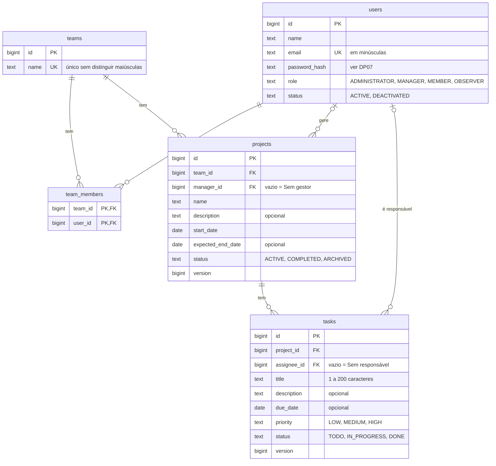

# Modelo de dados da Matriz

> **Versão:** 0.1 (Ficha PL 02, Exercício 2)
> **Estado:** proposta. As decisões deste documento têm origem **D** e têm de ser validadas pelo Product Owner.

Documentos relacionados:

- [requirements.md](requirements.md): modelo de domínio (secção 4), definições (secção 2) e regras de negócio (secção 6).
- [architecture.md](architecture.md): módulos e decisões técnicas. A base de dados é PostgreSQL (DA03).
- [constraints.md](constraints.md): pressupostos, privacidade e decisões pendentes.

Este documento descreve o modelo lógico relacional. O SQL e as migrations ficam para a Ficha 03.

---

## 1. Princípios

1. Só se guarda o que o MVP precisa. Cada entidade e cada atributo vem do modelo de domínio (requirements.md, secção 4). Os únicos atributos técnicos são o identificador (DA09) e a versão (DA05).
2. Não se guardam valores que se podem calcular (DA12).
3. A base de dados garante o que depende só de uma linha ou de uma chave. As regras que dependem de outras tabelas ou da data atual ficam no módulo dono (secção 6).
4. Nada se apaga, exceto tarefas (RN19). Contas, equipas e projetos não têm operação de apagar (RN16, RNF05, LIM10).

---

## 2. Glossário

Os nomes técnicos estão em inglês (DA08). São os mesmos na base de dados, no código e na API. As colunas usam `snake_case`.

| Termo da especificação | Nome técnico |
|------------------------|--------------|
| Utilizador | `users` |
| Equipa | `teams` |
| Pertencer a uma equipa | `team_members` |
| Projeto | `projects` |
| Tarefa | `tasks` |
| Gestor do projeto | `projects.manager_id` |
| Responsável | `tasks.assignee_id` |
| "Sem gestor" | `projects.manager_id` vazio (nulo) |
| "Sem responsável" | `tasks.assignee_id` vazio (nulo) |
| Papel: Administrador, Gestor, Membro, Observador | `ADMINISTRATOR`, `MANAGER`, `MEMBER`, `OBSERVER` |
| Estado da conta: Ativa, Desativada | `ACTIVE`, `DEACTIVATED` |
| Estado do projeto: Ativo, Concluído, Arquivado | `ACTIVE`, `COMPLETED`, `ARCHIVED` |
| Estado da tarefa: Por fazer, Em curso, Concluída | `TODO`, `IN_PROGRESS`, `DONE` |
| Prioridade: Baixa, Média, Alta | `LOW`, `MEDIUM`, `HIGH` |

A interface mostra sempre os termos em português (RNF02).

---

## 3. Entidades e atributos

Tipos conceptuais: **inteiro** (identificador gerado pela base de dados), **texto**, **data** (dia de calendário, sem hora), **valor de lista** (um dos valores do glossário).

### 3.1 `users` (Utilizador)

Módulo dono: Contas. Fonte: RF02, RN04, RN16, RN18, RN28.

| Atributo | Tipo | Obrigatório | Restrições | Fonte |
|----------|------|:-----------:|------------|-------|
| `id` | inteiro | Sim | Chave primária. | DA09 |
| `name` | texto | Sim | Até 100 caracteres (RN29). | RN04 |
| `email` | texto | Sim | Único. Guardado em minúsculas. Até 254 caracteres (RN29). | RN04, DA10 |
| `password_hash` | texto | Ver DP07 | Só o resultado do hash, nunca a palavra-passe (SEG03). | RF01, SEG03 |
| `role` | valor de lista | Sim | `ADMINISTRATOR`, `MANAGER`, `MEMBER`, `OBSERVER`. | RN04 |
| `status` | valor de lista | Sim | `ACTIVE` ou `DEACTIVATED`. Valor inicial `ACTIVE`. | RN16, RN28 |

`password_hash` pode ficar vazio até a pessoa ter acesso, se a DP07 escolher um mecanismo em que a conta nasce sem palavra-passe.

### 3.2 `teams` (Equipa)

Módulo dono: Equipas. Fonte: RF05, RN03, LIM10.

| Atributo | Tipo | Obrigatório | Restrições | Fonte |
|----------|------|:-----------:|------------|-------|
| `id` | inteiro | Sim | Chave primária. | DA09 |
| `name` | texto | Sim | Único, sem distinguir maiúsculas. Até 100 caracteres (RN29). | RN03, DA10 |

### 3.3 `team_members` (pertença a uma equipa)

Módulo dono: Equipas. Fonte: RF06, RN02, RN26. Entidade associativa da relação N:M entre utilizadores e equipas.

| Atributo | Tipo | Obrigatório | Restrições | Fonte |
|----------|------|:-----------:|------------|-------|
| `team_id` | inteiro | Sim | Chave estrangeira para `teams`. Parte da chave primária. | RF06 |
| `user_id` | inteiro | Sim | Chave estrangeira para `users`. Parte da chave primária. | RF06 |

A chave primária (`team_id`, `user_id`) impede que a mesma pessoa seja adicionada duas vezes à mesma equipa.

### 3.4 `projects` (Projeto)

Módulo dono: Projetos. Fonte: RF07, RF08, RN01, RN06, RN07, RN21, RN22, DA05.

| Atributo | Tipo | Obrigatório | Restrições | Fonte |
|----------|------|:-----------:|------------|-------|
| `id` | inteiro | Sim | Chave primária. | DA09 |
| `team_id` | inteiro | Sim | Chave estrangeira para `teams`. Não muda depois da criação. | RN01, RN21 |
| `manager_id` | inteiro | Não | Chave estrangeira para `users`. Vazio quer dizer "Sem gestor". | RN21, RN22 |
| `name` | texto | Sim | Até 100 caracteres (RN29). | RN06 |
| `description` | texto | Não | Até 1000 caracteres (RN29). | RN06 |
| `start_date` | data | Sim | | RN06 |
| `expected_end_date` | data | Não | Não pode ser anterior a `start_date`. | RN06 |
| `status` | valor de lista | Sim | `ACTIVE`, `COMPLETED`, `ARCHIVED`. Valor inicial `ACTIVE`. | RN07 |
| `version` | inteiro | Sim | Valor inicial 0. Aumenta em cada alteração. | DA05 |

### 3.5 `tasks` (Tarefa)

Módulo dono: Tarefas. Fonte: RF12 a RF15, RN11 a RN14, RN19, RN20, DA05.

| Atributo | Tipo | Obrigatório | Restrições | Fonte |
|----------|------|:-----------:|------------|-------|
| `id` | inteiro | Sim | Chave primária. Dá também a ordem de criação (RN24). | DA09 |
| `project_id` | inteiro | Sim | Chave estrangeira para `projects`. | RN20 |
| `assignee_id` | inteiro | Não | Chave estrangeira para `users`. Vazio quer dizer "Sem responsável". | RN14, RN16 |
| `title` | texto | Sim | 1 a 200 caracteres, sem espaços nas pontas. | RN11, DA11 |
| `description` | texto | Não | Até 2000 caracteres (RN29). | RN11 |
| `due_date` | data | Não | | RN11, RN13 |
| `priority` | valor de lista | Sim | `LOW`, `MEDIUM`, `HIGH`. Valor inicial `MEDIUM`. | RN11 |
| `status` | valor de lista | Sim | `TODO`, `IN_PROGRESS`, `DONE`. Valor inicial `TODO`. | RN12 |
| `version` | inteiro | Sim | Valor inicial 0. Aumenta em cada alteração. | DA05 |

As datas são dias de calendário sem hora, porque a organização tem um só fuso horário (P12). A comparação com a data atual usa o Relógio da organização (RNF06).

---

## 4. Relacionamentos

| Relação | Cardinalidade | Obrigatoriedade | Implementação | Fonte |
|---------|:-------------:|-----------------|---------------|-------|
| Utilizador pertence a Equipa | N:M | Opcional dos dois lados. Só Gestor e Membro pertencem a equipas. | `team_members` | RN02, RN26, P03 |
| Equipa tem Projeto | 1:N | Cada projeto tem exatamente uma equipa. Uma equipa pode não ter projetos. | `projects.team_id` | RN01 |
| Utilizador é gestor de Projeto | 0..1:N | Um projeto tem no máximo um gestor ("Sem gestor" quando não tem). | `projects.manager_id` | RN21, RN22 |
| Projeto tem Tarefa | 1:N | Cada tarefa pertence a exatamente um projeto. | `tasks.project_id` | RN20 |
| Utilizador é responsável por Tarefa | 0..1:N | Uma tarefa tem no máximo um responsável. | `tasks.assignee_id` | RN14 |

Nenhuma chave estrangeira apaga em cascata. Como contas, equipas e projetos não se apagam, a base de dados recusa qualquer tentativa de apagar um registo que ainda é referido. Apagar uma tarefa (RN19) não afeta outras tabelas, porque nada aponta para tarefas.

---

## 5. Diagrama ER

Os tipos `bigint`, `text` e `date` são os do PostgreSQL. Os limites de comprimento estão na RN29 e na secção 9.

---

## 6. Regras de integridade

### 6.1 Garantidas pela base de dados

| Regra | Como |
|-------|------|
| RN01, RN20 | `projects.team_id` e `tasks.project_id` obrigatórios, com chave estrangeira. |
| RN03, DA10 | Nome da equipa obrigatório e único, comparado em minúsculas. |
| RN04, DA10 | Email obrigatório e único, guardado em minúsculas. Nome e papel obrigatórios. |
| RN06 | Nome, equipa e data de início obrigatórios. `expected_end_date` não pode ser anterior a `start_date`. |
| RN07, RN11, RN12 | Valores iniciais: projeto `ACTIVE`, tarefa `TODO`, prioridade `MEDIUM`. |
| RN11 | Título com 1 a 200 caracteres. |
| RN14 (máximo um responsável), RN21 (máximo um gestor) | Uma só coluna, `assignee_id` e `manager_id`. |
| RNF05, RN16 | Chaves estrangeiras sem cascata: uma conta referida não pode ser apagada. |
| Papéis, estados e prioridades | Só aceitam os valores do glossário (DA13). |
| Mesma pessoa duas vezes na mesma equipa | Chave primária de `team_members`. |

### 6.2 Garantidas pelo módulo dono

Estas regras dependem de outras tabelas, da data atual ou do utilizador que faz o pedido. Ficam no domínio, onde se testam sem base de dados (RNF07).

| Regra | Módulo | Porque não fica na base de dados |
|-------|--------|----------------------------------|
| RN05, RN21, RN27 (gestor pertence à equipa e tem papel Gestor) | Projetos | Depende de `team_members` e de `users`. |
| RN07 (transições de estado do projeto) | Projetos | Depende do estado anterior. |
| RN08, RN09 (projeto fechado não aceita alterações) | Projetos, Tarefas | Depende do estado do projeto. |
| RN11 (espaços nas pontas, normalização) | Tarefas | Tratamento do texto antes de gravar (DA11). |
| RN13 (prazo não anterior à data atual) | Tarefas | Depende da data atual e só se aplica quando o prazo muda. |
| RN14 (responsável ativo, da equipa, Gestor ou Membro) | Tarefas | Depende de `users` e de `team_members`. |
| RN18 (pelo menos um Administrador ativo) | Contas | Depende das outras contas. |
| RN26 (só Gestor e Membro com conta ativa em equipas) | Equipas | Depende de `users`. |
| RN16, RN17, RN22, RN23 (alterações automáticas) | Vários | Eventos internos (architecture.md, secção 7). |

---

## 7. Valores calculados (DA12)

Não se guardam. Calculam-se em cada leitura, a partir de `tasks`.

| Valor | Cálculo | Fonte |
|-------|---------|-------|
| Tarefa aberta | `status` é `TODO` ou `IN_PROGRESS`. | Definições |
| Tarefa atrasada | Tarefa aberta com `due_date` anterior à data atual. Sem `due_date`, nunca está atrasada. | Definições, RF28 |
| Progresso do projeto | Tarefas `DONE` ÷ total de tarefas × 100, arredondado para baixo. Sem tarefas: "Sem tarefas". | Definições, RF27 |
| Nº de tarefas atrasadas do projeto | Contagem das tarefas atrasadas. | RF28 |

A ordenação de "As minhas tarefas" (RN24) usa, por esta ordem: `due_date` com as tarefas sem prazo no fim, prioridade (`HIGH`, `MEDIUM`, `LOW`), título sem distinguir maiúsculas nem acentos (DA14) e, por fim, `id`.

---

## 8. Índices

Volume de referência: 300 utilizadores, 200 projetos, 10 000 tarefas (P05). Os índices servem as consultas mais frequentes (RNF04).

| Índice | Consultas | Histórias |
|--------|-----------|-----------|
| `tasks (project_id, status)` | Tarefas de um projeto, filtros, progresso, atrasos. | US09, US10, US11 |
| `tasks (assignee_id, status)` | "As minhas tarefas". Tarefas abertas de uma pessoa (RN16, RN17). | US08, US14 |
| `projects (team_id)` | Projetos visíveis de uma pessoa. | US12 |
| `projects (manager_id)` | Projetos de um gestor (RN22). | US14, US18 |
| `team_members (user_id)` | Equipas de uma pessoa. A chave primária já cobre a pesquisa por equipa. | US03, US12 |
| Únicos: `users (email)`, `teams` por nome em minúsculas | RN03, RN04 e entrada na aplicação. | US01, US02, US03 |

O teste de carga de RNF04 confirma se chegam.

---

## 9. Decisões de modelação

Todas têm origem **D**.

| ID | Decisão | Alternativas | Consequências |
|----|---------|--------------|---------------|
| DA08 | Nomes técnicos em inglês, iguais na base de dados, no código e na API, com o glossário da secção 2. | Nomes em português. | A interface traduz os valores (RNF02). O glossário é a referência. |
| DA09 | Identificadores inteiros gerados pela base de dados. | UUID. | O `id` dá a ordem de criação (RN24) sem coluna extra. Os IDs são previsíveis, mas cada pedido verifica permissões (SEG02). |
| DA10 | Email e nome de equipa únicos sem distinguir maiúsculas. O email é guardado em minúsculas. | Comparação exata. | Clarifica RN03 e RN04. "Marta@empresa.example" e "marta@empresa.example" são a mesma conta. A entrada aceita qualquer forma. |
| DA11 | Os textos são normalizados (Unicode NFC) antes de gravar. Os limites contam códigos Unicode. | Contar caracteres visíveis. | Clarifica RN11. Letras acentuadas e emojis simples contam 1. Emojis compostos (bandeiras, famílias) contam mais (LIM13). |
| DA12 | Valores calculados não se guardam: progresso, atraso, contagens. "Sem gestor" e "Sem responsável" são o campo vazio. | Guardar totais por projeto. | Sem risco de valores desatualizados. Com o volume de P05 e os índices da secção 8, o cálculo é rápido. |
| DA13 | Papéis, estados e prioridades guardados como texto, com restrição de valores permitidos. | Tipos `ENUM` do PostgreSQL. | Acrescentar um valor é uma migration simples. |
| DA14 | A ordem alfabética de RN24 usa uma collation ICU do PostgreSQL que ignora maiúsculas e acentos, aplicada só nessa consulta. | Ordenar no backend. | A ordenação fica na consulta e funciona com paginação. Exige PostgreSQL com suporte ICU, a confirmar na Ficha 03. |

**Comprimentos máximos (RN29).** A especificação só definia o limite do título (RN11). Como SEG06 exige validar limites, os restantes ficaram na RN29:

| Campo | Máximo |
|-------|:------:|
| Nome de pessoa | 100 |
| Email | 254 |
| Nome de equipa | 100 |
| Nome de projeto | 100 |
| Descrição de projeto | 1000 |
| Descrição de tarefa | 2000 |

Os nomes ignoram os espaços nas pontas e não podem ficar vazios, como o título (RN11).

---

## 10. Privacidade

Os dados pessoais guardados correspondem à tabela de PRIV01 (constraints.md, secção 3.2). O modelo não acrescenta nenhum.

| Dado de PRIV01 | Onde |
|----------------|------|
| Nome | `users.name` |
| Email | `users.email` |
| Palavra-passe (protegida) | `users.password_hash` |
| Papel e equipas | `users.role`, `team_members` |
| Responsável e gestor | `tasks.assignee_id`, `projects.manager_id` |
| Texto livre | `projects.name`, `projects.description`, `tasks.title`, `tasks.description` |

---

## 11. Fora deste modelo

| Item | Motivo |
|------|--------|
| Sessões | Dependem do resto da DP06. Se as sessões ficarem na base de dados, as tabelas são as da biblioteca escolhida. |
| Dados do limite de tentativas (SEG09) | Dependem da DP06. Se forem guardados, entram em PRIV01. |
| Comentários, atribuição a várias pessoas, proprietário do projeto | Existem no exemplo da Aula 02, mas não no MVP: comentários são RF19 (Should), uma tarefa tem no máximo um responsável (RN14) e um projeto pertence a uma equipa com um gestor (RN01, RN21). |
| Histórico e registo de ações | RF20 e RF39, versão 1.1. |
| Datas de criação e de alteração | Nenhum requisito do MVP as usa. A ordem de criação vem do `id`. |
