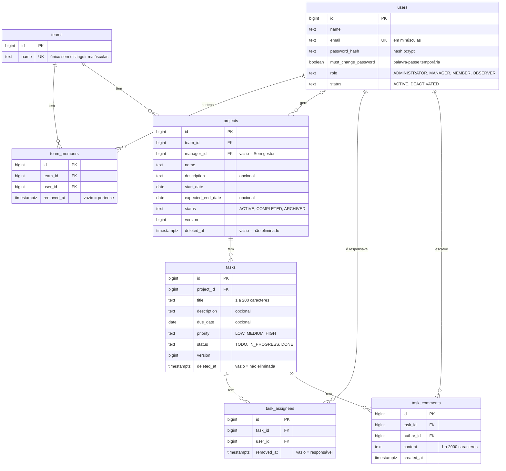

# Modelo de dados da Matriz

> **Versão:** 0.3 (conciliação com o âmbito da Ficha PL 03, exercício 1)
> **Estado:** proposta. As decisões deste documento têm origem **D** e têm de ser validadas pelo Product Owner.

Documentos relacionados:

- [requirements.md](requirements.md): modelo de domínio (secção 4), definições (secção 2) e regras de negócio (secção 6).
- [architecture.md](architecture.md): módulos e decisões técnicas. A base de dados é PostgreSQL (DA03). As migrations seguem DA30.
- [constraints.md](constraints.md): pressupostos, privacidade e decisões pendentes.

Este documento descreve o modelo lógico relacional. O SQL fica nos changesets Liquibase do backend (DA30), escritas a partir deste modelo no exercício 2 da Ficha 03. Mudar o modelo exige atualizar este documento na mesma alteração.

---

## 1. Princípios

1. Só se guarda o que o MVP precisa. Cada entidade e cada atributo vem do modelo de domínio (requirements.md, secção 4). Os únicos atributos que não vêm do modelo de domínio são o identificador (DA09), a versão (DA05), a indicação de palavra-passe temporária (DA25) e as datas de eliminação e de remoção (DA29).
2. Não se guardam valores que se podem calcular (DA12).
3. A base de dados garante o que depende só de uma linha ou de uma chave. As regras que dependem de outras tabelas ou da data atual ficam no módulo dono (secção 6).
4. Nada se apaga (RN32). Projetos e tarefas eliminados ficam marcados em `deleted_at`. A pertença a uma equipa (RF06, RN17, RN23) e a associação de um responsável a uma tarefa (RF13, RN16, RN17), quando são retiradas, ficam marcadas em `removed_at` (DA29). Contas e equipas não têm operação de eliminar (RN16, RNF05, LIM10). Os comentários não se apagam (RN30).

---

## 2. Glossário

Os nomes técnicos estão em inglês (DA08). São os mesmos na base de dados, no código e na API. As colunas usam `snake_case`.

| Termo da especificação | Nome técnico |
|------------------------|--------------|
| Utilizador | `users` |
| Equipa | `teams` |
| Pertencer a uma equipa | `team_members` |
| Projeto | `projects` |
| Tarefa | `tasks` |
| Responsável (associação a uma tarefa) | `task_assignees` |
| Comentário | `task_comments` |
| Gestor do projeto | `projects.manager_id` |
| "Sem gestor" | `projects.manager_id` vazio (nulo) |
| "Sem responsável" | Tarefa sem nenhuma linha ativa (`removed_at` vazio) em `task_assignees` |
| Eliminado (projeto, tarefa) | `deleted_at` preenchido (DA29) |
| Removido (pertença a equipa, responsável) | `removed_at` preenchido (DA29) |
| Papel: Administrador, Gestor, Membro, Observador | `ADMINISTRATOR`, `MANAGER`, `MEMBER`, `OBSERVER` |
| Estado da conta: Ativa, Desativada | `ACTIVE`, `DEACTIVATED` |
| Estado do projeto: Ativo, Concluído, Arquivado | `ACTIVE`, `COMPLETED`, `ARCHIVED` |
| Estado da tarefa: Por fazer, Em curso, Concluída | `TODO`, `IN_PROGRESS`, `DONE` |
| Prioridade: Baixa, Média, Alta | `LOW`, `MEDIUM`, `HIGH` |

A interface mostra sempre os termos em português (RNF02).

---

## 3. Entidades e atributos

Tipos conceptuais: **inteiro** (identificador gerado pela base de dados), **texto**, **data** (dia de calendário, sem hora), **data e hora** (instante com fuso horário, mostrado no fuso da organização, DA24), **valor de lista** (um dos valores do glossário), **booleano** (verdadeiro ou falso).

### 3.1 `users` (Utilizador)

Módulo dono: Contas. Fonte: RF02, RN04, RN16, RN18, RN28.

| Atributo | Tipo | Obrigatório | Restrições | Fonte |
|----------|------|:-----------:|------------|-------|
| `id` | inteiro | Sim | Chave primária. | DA09 |
| `name` | texto | Sim | Até 100 caracteres (RN29). | RN04 |
| `email` | texto | Sim | Único. Guardado em minúsculas. Até 254 caracteres (RN29). | RN04, DA10 |
| `password_hash` | texto | Sim | Hash bcrypt da palavra-passe, nunca a palavra-passe (SEG03, DA26). | RF01, SEG03 |
| `must_change_password` | booleano | Sim | Verdadeiro quando a palavra-passe é temporária. Valor inicial verdadeiro. | DA25 |
| `role` | valor de lista | Sim | `ADMINISTRATOR`, `MANAGER`, `MEMBER`, `OBSERVER`. | RN04 |
| `status` | valor de lista | Sim | `ACTIVE` ou `DEACTIVATED`. Valor inicial `ACTIVE`. | RN16, RN28 |

A conta nasce com uma palavra-passe temporária definida pelo Administrador. A primeira conta de Administrador é criada no arranque da aplicação, a partir da configuração (DA25). Repor o acesso volta a pôr `must_change_password` a verdadeiro.

### 3.2 `teams` (Equipa)

Módulo dono: Equipas. Fonte: RF05, RN03, LIM10.

| Atributo | Tipo | Obrigatório | Restrições | Fonte |
|----------|------|:-----------:|------------|-------|
| `id` | inteiro | Sim | Chave primária. | DA09 |
| `name` | texto | Sim | Único, sem distinguir maiúsculas. Até 100 caracteres (RN29). | RN03, DA10 |

### 3.3 `team_members` (pertença a uma equipa)

Módulo dono: Equipas. Fonte: RF06, RN02, RN26. Entidade associativa da relação N:M entre utilizadores e equipas.

| Atributo | Tipo | Obrigatório | Restrições | Fonte |
|----------|------|:-----------:|------------|-------|
| `id` | inteiro | Sim | Chave primária. | DA09 |
| `team_id` | inteiro | Sim | Chave estrangeira para `teams`. | RF06 |
| `user_id` | inteiro | Sim | Chave estrangeira para `users`. | RF06 |
| `removed_at` | data e hora | Não | Preenchido quando a pessoa sai da equipa. Vazio quer dizer que pertence. | RN17, RN23, RN32, DA29 |

Um índice único em (`team_id`, `user_id`), só nas linhas com `removed_at` vazio, impede que a mesma pessoa pertença duas vezes à mesma equipa. Voltar a adicionar uma pessoa que saiu cria uma linha nova.

### 3.4 `projects` (Projeto)

Módulo dono: Projetos. Fonte: RF07, RF08, RF41, RN01, RN06, RN07, RN21, RN22, RN31, RN32, DA05.

| Atributo | Tipo | Obrigatório | Restrições | Fonte |
|----------|------|:-----------:|------------|-------|
| `id` | inteiro | Sim | Chave primária. | DA09 |
| `team_id` | inteiro | Sim | Chave estrangeira para `teams`. Não muda depois da criação. | RN01, RN21 |
| `manager_id` | inteiro | Não | Chave estrangeira para `users`. Vazio quer dizer "Sem gestor". | RN21, RN22 |
| `name` | texto | Sim | Até 100 caracteres (RN29). | RN06 |
| `description` | texto | Não | Até 1000 caracteres (RN29). | RN06 |
| `start_date` | data | Sim | | RN06 |
| `expected_end_date` | data | Não | Não pode ser anterior a `start_date`. | RN06 |
| `status` | valor de lista | Sim | `ACTIVE`, `COMPLETED`, `ARCHIVED`. Valor inicial `ACTIVE`. | RN07 |
| `version` | inteiro | Sim | Valor inicial 0. Aumenta em cada alteração. | DA05 |
| `deleted_at` | data e hora | Não | Preenchido quando o projeto é eliminado. Vazio quer dizer que não está eliminado. | RN31, RN32, DA29 |

### 3.5 `tasks` (Tarefa)

Módulo dono: Tarefas. Fonte: RF12, RF14, RF15, RN11 a RN13, RN19, RN20, RN32, DA05.

| Atributo | Tipo | Obrigatório | Restrições | Fonte |
|----------|------|:-----------:|------------|-------|
| `id` | inteiro | Sim | Chave primária. Dá também a ordem de criação (RN24). | DA09 |
| `project_id` | inteiro | Sim | Chave estrangeira para `projects`. | RN20 |
| `title` | texto | Sim | 1 a 200 caracteres, sem espaços nas pontas. | RN11, DA11 |
| `description` | texto | Não | Até 2000 caracteres (RN29). | RN11 |
| `due_date` | data | Não | | RN11, RN13 |
| `priority` | valor de lista | Sim | `LOW`, `MEDIUM`, `HIGH`. Valor inicial `MEDIUM`. | RN11 |
| `status` | valor de lista | Sim | `TODO`, `IN_PROGRESS`, `DONE`. Valor inicial `TODO`. | RN12 |
| `version` | inteiro | Sim | Valor inicial 0. Aumenta em cada alteração, incluindo associar e remover responsáveis. | DA05 |
| `deleted_at` | data e hora | Não | Preenchido quando a tarefa é apagada ou o seu projeto é eliminado. Vazio quer dizer que não está eliminada. | RN19, RN31, RN32, DA29 |

As datas são dias de calendário sem hora, porque a organização tem um só fuso horário (P12). A comparação com a data atual usa o Relógio da organização (RNF06).

### 3.6 `task_assignees` (responsável de uma tarefa)

Módulo dono: Tarefas. Fonte: RF13, RN14, RN16, RN17. Entidade associativa da relação N:M entre tarefas e utilizadores.

| Atributo | Tipo | Obrigatório | Restrições | Fonte |
|----------|------|:-----------:|------------|-------|
| `id` | inteiro | Sim | Chave primária. | DA09 |
| `task_id` | inteiro | Sim | Chave estrangeira para `tasks`. | RF13 |
| `user_id` | inteiro | Sim | Chave estrangeira para `users`. | RF13 |
| `removed_at` | data e hora | Não | Preenchido quando o responsável é retirado. Vazio quer dizer que é responsável. | RN16, RN17, RN32, DA29 |

Um índice único em (`task_id`, `user_id`), só nas linhas com `removed_at` vazio, impede que a mesma pessoa seja associada duas vezes à mesma tarefa (RN14, E40). Associar de novo uma pessoa retirada cria uma linha nova. Quando a tarefa é eliminada, as associações ficam como estão.

### 3.7 `task_comments` (Comentário)

Módulo dono: Tarefas. Fonte: RF19, RN30.

| Atributo | Tipo | Obrigatório | Restrições | Fonte |
|----------|------|:-----------:|------------|-------|
| `id` | inteiro | Sim | Chave primária. Desempata a ordem de comentários com a mesma data e hora. | DA09 |
| `task_id` | inteiro | Sim | Chave estrangeira para `tasks`. | RN30 |
| `author_id` | inteiro | Sim | Chave estrangeira para `users`. É sempre quem está autenticado. | RN30, SEG02 |
| `content` | texto | Sim | 1 a 2000 caracteres, sem espaços nas pontas. | RN30, DA11 |
| `created_at` | data e hora | Sim | Vem do Relógio da organização. | RN30, RNF06 |

Os comentários não se editam nem se apagam (RN30), por isso não têm `version` nem `deleted_at`. Deixam de aparecer quando a tarefa é eliminada.

---

## 4. Relacionamentos

| Relação | Cardinalidade | Obrigatoriedade | Implementação | Fonte |
|---------|:-------------:|-----------------|---------------|-------|
| Utilizador pertence a Equipa | N:M | Opcional dos dois lados. Só Gestor e Membro pertencem a equipas. | `team_members` | RN02, RN26, P03 |
| Equipa tem Projeto | 1:N | Cada projeto tem exatamente uma equipa. Uma equipa pode não ter projetos. | `projects.team_id` | RN01 |
| Utilizador é gestor de Projeto | 0..1:N | Um projeto tem no máximo um gestor ("Sem gestor" quando não tem). | `projects.manager_id` | RN21, RN22 |
| Projeto tem Tarefa | 1:N | Cada tarefa pertence a exatamente um projeto. | `tasks.project_id` | RN20 |
| Utilizador é responsável por Tarefa | N:M | Opcional dos dois lados. Uma tarefa pode ter vários responsáveis ou nenhum. | `task_assignees` | RN14 |
| Tarefa tem Comentário | 1:N | Cada comentário pertence a exatamente uma tarefa. | `task_comments.task_id` | RN30 |
| Utilizador é autor de Comentário | 1:N | Cada comentário tem exatamente um autor. | `task_comments.author_id` | RN30 |

Nenhuma chave estrangeira apaga em cascata. Nenhuma linha é apagada (RN32). Eliminar um projeto ou uma tarefa preenche `deleted_at` e retirar uma associação preenche `removed_at` (DA29), por isso as linhas que dependem deles ficam guardadas. A base de dados recusa qualquer tentativa de apagar um registo que ainda é referido.

---

## 5. Diagrama ER

Os tipos `bigint`, `text`, `date` e `timestamptz` são os do PostgreSQL. Os limites de comprimento estão na RN29 e na secção 9.

---

## 6. Regras de integridade

### 6.1 Garantidas pela base de dados

| Regra | Como |
|-------|------|
| RN01, RN20 | `projects.team_id` e `tasks.project_id` obrigatórios, com chave estrangeira. |
| RN03, DA10 | Nome da equipa obrigatório e único, comparado em minúsculas. |
| RN04, DA10 | Email obrigatório e único, guardado em minúsculas. Nome e papel obrigatórios. |
| RN06 | Nome, equipa e data de início obrigatórios. `expected_end_date` não pode ser anterior a `start_date`. |
| RN07, RN11, RN12 | Valores iniciais: projeto `ACTIVE`, tarefa `TODO`, prioridade `MEDIUM`. |
| RN11 | Título com 1 a 200 caracteres. |
| RN30 | Comentário com tarefa, autor, data e hora e texto obrigatórios. Texto com 1 a 2000 caracteres. |
| RN29 | Comprimentos máximos dos nomes, do email e das descrições, como rede de segurança. O módulo dono valida antes (secção 6.2). |
| RN21 (máximo um gestor) | Uma só coluna, `manager_id`. |
| RN14 (a mesma pessoa uma só vez por tarefa) | Índice único parcial de `task_assignees` (linhas com `removed_at` vazio). |
| RNF05, RN16, RN32 | Chaves estrangeiras sem cascata: um registo referido não pode ser apagado. |
| Papéis, estados e prioridades | Só aceitam os valores do glossário (DA13). |
| Mesma pessoa duas vezes na mesma equipa | Índice único parcial de `team_members` (linhas com `removed_at` vazio). |

### 6.2 Garantidas pelo módulo dono

Estas regras dependem de outras tabelas, da data atual ou do utilizador que faz o pedido. Ficam no domínio, onde se testam sem base de dados (RNF07).

| Regra | Módulo | Porque não fica na base de dados |
|-------|--------|----------------------------------|
| RN05, RN21, RN27 (gestor com conta ativa, da equipa e com papel Gestor) | Projetos | Depende de `team_members` e de `users`. |
| RN07 (transições de estado do projeto) | Projetos | Depende do estado anterior. |
| RN08, RN09 (projeto fechado não aceita alterações) | Projetos, Tarefas | Depende do estado do projeto. |
| RN04 (formato do email) | Contas | Validação do pedido, antes de gravar. |
| RN11 (espaços nas pontas, normalização) | Tarefas | Tratamento do texto antes de gravar (DA11). |
| RN29 (comprimentos depois de retirar os espaços e normalizar) | Módulo dono de cada campo | O limite conta-se depois do tratamento do texto (DA11). |
| RN13 (prazo não anterior à data atual) | Tarefas | Depende da data atual e só se aplica quando o prazo muda. |
| RN14 (responsável ativo, da equipa, Gestor ou Membro) | Tarefas | Depende de `users` e de `team_members`. |
| RN18 (pelo menos um Administrador ativo) | Contas | Depende das outras contas. |
| RN26 (só Gestor e Membro com conta ativa em equipas) | Equipas | Depende de `users`. |
| RN30 (quem comenta, projeto fechado, espaços nas pontas) | Tarefas | Depende do utilizador, das equipas e do estado do projeto. |
| RN31 (quem elimina um projeto) | Projetos | Depende do utilizador e do gestor do projeto. |
| RN32 (registos eliminados e associações removidas tratados como inexistentes) | Equipas, Projetos, Tarefas | Cada consulta do módulo filtra `deleted_at` e `removed_at` vazios, num único ponto (DA29). |
| RN16, RN17, RN22, RN23, RN31 (alterações automáticas) | Vários | Eventos internos (architecture.md, secção 7). |

---

## 7. Valores calculados (DA12)

Não se guardam. Calculam-se em cada leitura, a partir de `tasks`, sempre sem as tarefas eliminadas (RN32).

| Valor | Cálculo | Fonte |
|-------|---------|-------|
| Tarefa aberta | `status` é `TODO` ou `IN_PROGRESS`. | Definições |
| Tarefa atrasada | Tarefa aberta com `due_date` anterior à data atual. Sem `due_date`, nunca está atrasada. | Definições, RF28 |
| Progresso do projeto | Tarefas `DONE` ÷ total de tarefas × 100, arredondado para baixo. Sem tarefas: "Sem tarefas". | Definições, RF27 |
| Nº de tarefas atrasadas do projeto | Contagem das tarefas atrasadas. | RF28 |
| Contagens por estado do projeto e totais do painel | Contagem das tarefas `TODO`, `IN_PROGRESS` e `DONE` de cada projeto, e a soma dos projetos do painel. | RF29, RN33 |

A ordenação de "As minhas tarefas" (RN24) usa, por esta ordem: `due_date` com as tarefas sem prazo no fim, prioridade (`HIGH`, `MEDIUM`, `LOW`), título sem distinguir maiúsculas nem acentos (DA14) e, por fim, `id`.

A lista de tarefas de um projeto usa a mesma ordem (DA33). A lista de projetos é ordenada por nome, com a mesma collation (DA27). A pesquisa pelo nome segue DA32.

---

## 8. Índices

Volume de referência: 300 utilizadores, 200 projetos, 10 000 tarefas (P05). Os índices servem as consultas mais frequentes (RNF04).

| Índice | Consultas | Histórias |
|--------|-----------|-----------|
| `tasks (project_id, status)` | Tarefas de um projeto, filtros, progresso, atrasos. | US09, US10, US11 |
| `task_assignees (user_id)` | "As minhas tarefas". Tarefas de uma pessoa (RN16, RN17). O índice único já cobre a pesquisa por tarefa. | US08, US14 |
| `task_comments (task_id)` | Comentários de uma tarefa. | US19 |
| `projects (team_id)` | Projetos visíveis de uma pessoa. | US12 |
| `projects (manager_id)` | Projetos de um gestor (RN22). | US14, US18 |
| `team_members (user_id)` | Equipas de uma pessoa. O índice único já cobre a pesquisa por equipa. | US03, US12 |
| Únicos: `users (email)`, `teams` por nome em minúsculas | RN03, RN04 e entrada na aplicação. | US01, US02, US03 |

O teste de carga de RNF04 confirma se chegam. Com o volume de P05, os registos eliminados não justificam índices parciais, exceto os dois índices únicos de associação.

---

## 9. Decisões de modelação

Todas têm origem **D**.

| ID | Decisão | Alternativas | Consequências |
|----|---------|--------------|---------------|
| DA08 | Nomes técnicos em inglês, iguais na base de dados, no código e na API, com o glossário da secção 2. | Nomes em português. | A interface traduz os valores (RNF02). O glossário é a referência. |
| DA09 | Identificadores inteiros gerados pela base de dados. | UUID. | O `id` dá a ordem de criação (RN24) sem coluna extra. Os IDs são previsíveis, mas cada pedido verifica permissões (SEG02). |
| DA10 | Email e nome de equipa únicos sem distinguir maiúsculas. O email é guardado em minúsculas. | Comparação exata. | Clarifica RN03 e RN04. "Marta@empresa.example" e "marta@empresa.example" são a mesma conta. A entrada aceita qualquer forma. |
| DA11 | Os textos são normalizados (Unicode NFC) antes de gravar. Os limites contam códigos Unicode. | Contar caracteres visíveis. | Clarifica RN11. Letras acentuadas e emojis simples contam 1. Emojis compostos (bandeiras, famílias) contam mais (LIM13). |
| DA12 | Valores calculados não se guardam: progresso, atraso, contagens. "Sem gestor" é o campo vazio. "Sem responsável" é a tarefa sem linhas ativas em `task_assignees`. | Guardar totais por projeto. | Sem risco de valores desatualizados. Com o volume de P05 e os índices da secção 8, o cálculo é rápido. |
| DA13 | Papéis, estados e prioridades guardados como texto, com restrição de valores permitidos. | Tipos `ENUM` do PostgreSQL. | Acrescentar um valor é uma migration simples. |
| DA29 | Eliminação lógica (soft delete): `projects` e `tasks` têm a coluna `deleted_at`; `team_members` e `task_assignees` têm a coluna `removed_at`. Eliminar ou remover preenche-a com a data e hora atuais, em vez de apagar a linha. As associações têm um `id` próprio e índices únicos parciais, para a mesma pessoa poder sair e voltar. Cada módulo filtra estes registos num único ponto do seu repositório. Um registo eliminado responde como inexistente (404). | Apagar as linhas, em cascata. Mover para tabelas de arquivo. Apagar só as associações. | Cumpre RN32 e a decisão de nunca apagar dados. Os responsáveis e os comentários ficam guardados sem regras extra. Não é um histórico (RF20): não há forma de o consultar na aplicação. Os dados pessoais ficam guardados sem prazo (LIM15, DP11). Esquecer o filtro numa consulta mostra dados eliminados: os cenários de US16 e US20 cobrem esse risco. |
| DA32 | A pesquisa de projetos (RN34) compara o nome e o texto pesquisado em minúsculas e sem acentos, com a extensão `unaccent` do PostgreSQL e `LIKE`. Os caracteres `%` e `_` do texto pesquisado são tratados como texto. | Collation ICU não determinística com `LIKE` (depende da versão do PostgreSQL). Pesquisa no frontend. | A pesquisa respeita a visibilidade, porque é feita no backend. Com 200 projetos (P05) não precisa de índice. A migration inicial ativa a extensão `unaccent`. |
| DA14 | A ordem alfabética de RN24, da lista de tarefas (DA33) e da lista de projetos (DA27) usa uma collation ICU do PostgreSQL que ignora maiúsculas e acentos, aplicada só nessas consultas. | Ordenar no backend. | A ordenação fica na consulta e funciona com paginação. Exige PostgreSQL com suporte ICU, a confirmar na Ficha 03. |

**Comprimentos máximos (RN29).** A especificação só definia o limite do título (RN11). Como SEG06 exige validar limites, os restantes ficaram na RN29:

| Campo | Máximo |
|-------|:------:|
| Nome de pessoa | 100 |
| Email | 254 |
| Nome de equipa | 100 |
| Nome de projeto | 100 |
| Descrição de projeto | 1000 |
| Descrição de tarefa | 2000 |

Os nomes ignoram os espaços nas pontas e não podem ficar vazios, como o título (RN11).

---

## 10. Privacidade

Os dados pessoais guardados correspondem à tabela de PRIV01 (constraints.md, secção 3.2). O modelo não acrescenta nenhum. Os contadores de tentativas de entrada (DA26) também estão em PRIV01, mas só existem em memória e não fazem parte deste modelo.

| Dado de PRIV01 | Onde |
|----------------|------|
| Nome | `users.name` |
| Email | `users.email` |
| Palavra-passe (protegida) | `users.password_hash` |
| Papel e equipas | `users.role`, `team_members` |
| Responsáveis e gestor | `task_assignees`, `projects.manager_id` |
| Autor, data e hora e texto dos comentários | `task_comments.author_id`, `task_comments.created_at`, `task_comments.content` |
| Texto livre | `projects.name`, `projects.description`, `tasks.title`, `tasks.description`, `task_comments.content` |

Os projetos e as tarefas eliminados e as associações removidas mantêm estes dados (RN32, LIM15).

---

## 11. Fora deste modelo

| Item | Motivo |
|------|--------|
| Sessões | Ficam em memória (DA07, DA26). |
| Contadores de tentativas (SEG09) | Ficam em memória, até 15 minutos (DA26). Estão em PRIV01. |
| Proprietário do projeto | Existe no exemplo da Aula 02. Na Matriz, o papel equivalente é o gestor do projeto, que é quem o cria quando é Gestor (RN21, RN27). |
| Recuperar registos eliminados | Não há operação na aplicação (RN19, RN31). |
| Histórico e registo de ações | RF20 e RF39, versão 1.1. |
| Datas de criação e de alteração | Nenhum requisito do MVP as usa, exceto a data e hora dos comentários (RN30). A ordem de criação vem do `id`. |
