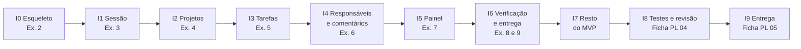

# Plano de implementação da Matriz

> **Versão:** 0.3 (Ficha PL 05: incremento I9)
> **Estado:** em curso. O estado de cada incremento atualiza-se no fim do incremento, na mesma alteração.

Documentos relacionados:

- [requirements.md](requirements.md): âmbito do MVP (secção 8.2), regras de negócio e permissões.
- [user-stories.md](user-stories.md): critérios de aceitação de cada história.
- [architecture.md](architecture.md): módulos, eventos, decisões técnicas (DA28, DA30, DA31) e endpoints.
- [database.md](database.md): tabelas, restrições e índices.
- [../openapi.yaml](../openapi.yaml): contrato da API.
- [ui/README.md](ui/README.md): navegação, ecrãs e comportamento comum.

---

## 1. Como se trabalha cada incremento

Cada incremento é uma vertical slice: atravessa a base de dados, a API, as regras e a interface, e termina com um comportamento que se pode usar e verificar (slides do Módulo 3).

```
 Analisar  ──►  Planear  ──►  Implementar  ──►  Testar  ──►  Rever
 código e       ficheiros,     passos           testes e     diff e
 documentos     erros,         pequenos         percurso     critérios
                verificação                     manual
```

1. Antes de implementar, o agente apresenta a análise e o plano do incremento (AGENTS.md). A pessoa valida.
2. Implementa-se o incremento, com os testes previstos.
3. Executam-se as verificações e revê-se o diff.
4. O incremento fica "pronto para revisão". Só uma pessoa o marca como concluído (user-stories.md, secção 4).
5. A pessoa faz o commit, com mensagem clara e os IDs relacionados.

Se uma descoberta invalidar o plano, explica-se o impacto antes de continuar.

---

## 2. Conciliação com a Ficha PL 03

| # | A Ficha PL 03 pede | Resolução | IDs |
|---|--------------------|-----------|-----|
| G1 | Vários responsáveis por tarefa, sem duplicados | Aceite. RN14 alterada. | RF13, RN14, US06, E40, E41 |
| G2 | Eliminar projetos sem deixar dados órfãos | Aceite, com eliminação lógica em cascata. Os dados nunca se apagam. | RF41, RN31, RN32, US20, DA29 |
| G3 | Comentários com autor e data | Aceite. RF19 passou a Must. | RF19, RN30, US19 |
| G4 | Pesquisar projetos pelo nome | Aceite. | RF40, RN34, US22, DA32 |
| G5 | Filtrar tarefas por estado e prioridade | Aceite. RF16 ganhou o filtro por prioridade. | RF16, US11 |
| G6 | Painel inicial com contagens por estado | Aceite. RF29 passou a Must e o painel é a página inicial. | RF29, RN33, US21, DA21 |
| G7 | Proprietário do projeto inferido no backend | Já coberto: é o gestor do projeto. | RN21, RN27 |
| G8 | Título de 3 a 150 caracteres, paginação | Valores do exemplo da Aula 02. Mantêm-se RN11 e DA18. | RN11, DA18 |
| G9 | Pelo menos três testes automáticos | DP09 parcialmente resolvida. | DA31 |
| G10 | Contas de demonstração por seed | Seed no perfil `demo`, com as pessoas de partida das histórias. | DA30 |

O MVP completo mantém-se: as 22 histórias. O âmbito da ficha (R08) vem primeiro; o resto do MVP fica para o fim.

---

## 3. Decisões

**Confirmadas:** DA01 a DA41. As da Ficha PL 03 são DA28 (Java 21, Maven, pacotes, bibliotecas), DA29 (eliminação lógica), DA30 (Liquibase, seed, configuração, Docker Compose), DA31 (testes), DA32 (pesquisa), DA33 (ordem das tarefas), DA34 (endereço da API no frontend), DA35 (sessões de contas desativadas) e DA36 (estilo visual). A da Ficha PL 04 é DA37 (estratégia de testes). As da Ficha PL 05 são DA38 (imagem Docker e Compose), DA39 (pipeline), DA40 (ambientes e alojamento) e DA41 (versões e releases).

**Ficam para a implementação, com aprovação:**

| Decisão | Quando |
|---------|--------|
| Versões exatas do Spring Boot, das bibliotecas, do PostgreSQL e do Node | I0 |
| Formato dos changesets Liquibase (YAML, XML ou SQL formatado) | I0 |
| Ponto de mudança entre tabela e cartões (DA22) | I2. Fixado: 720 px (ui/README.md). |

---

## 4. Incrementos



O exercício 7 (frontend) não fica só no I5: cada incremento entrega a sua parte da interface, ligada à API real, sem mocks. O I5 fecha o painel e revê a interface toda face ao wireframe.

| Inc. | Objetivo | Histórias | Ficha PL 03 | Estado |
|------|----------|-----------|-------------|--------|
| I0 | Projeto executável, esquema e seed | | Ex. 2 | Concluído |
| I1 | Entrar, sair, utilizador autenticado | US01 | Ex. 3 | Pronto para revisão |
| I2 | Gestão de projetos | US04, US12, US15, US17 (editar), US20, US22 | Ex. 4 | Pronto para revisão |
| I3 | Gestão de tarefas | US05, US07 (gestor), US10, US11 (sem o filtro por responsável), US16 | Ex. 5 | Pronto para revisão |
| I4 | Responsáveis e comentários | US06, US07 (responsáveis), US11 (filtro por responsável), US19 | Ex. 6 | Pronto para revisão |
| I5 | Painel e progresso | US09, US21 | Ex. 7 | Pronto para revisão |
| I6 | Verificação, revisão e entrega da Ficha 03 | | Ex. 8, Ex. 9 | Pronto para revisão |
| I7 | Resto do MVP | US02, US03, US08, US13, US14, US17 (gestor), US18 | | Pronto para revisão |
| I8 | Testes, Code Review e Security Review | | Ficha PL 04, ex. 1 a 5 | Pronto para revisão |
| I9 | Containers, pipeline, ambiente publicado e versão candidata | | Ficha PL 05, ex. 1 a 6 | Em curso |

### I0 Esqueleto e persistência (exercício 2)

**Componentes previstos**

- `backend/`: projeto Maven com `mvnw` (DA28), `pt.matriz.MatrizApplication`, os pacotes dos módulos vazios e `common` com o Relógio da organização (DA24) e o tratamento de erros em Problem Details (DA16).
- `backend/src/main/resources/application.yaml`, com valores lidos de variáveis de ambiente, e o perfil `demo`.
- `backend/src/main/resources/db/changelog/`: changelog principal; changesets do esquema completo de database.md (incluindo `unaccent`, DA32, e a collation ICU, DA14); changesets de demonstração com o contexto `demo` (DA30).
- `compose.yaml` (PostgreSQL) e `.env.example` com valores fictícios. `.env` no `.gitignore`.
- `frontend/`: Vue 3, TypeScript, Vite e Vue Router; `src/api` com o endereço `/api` (DA34); proxy do Vite para o backend.
- Teste de arquitetura do Spring Modulith (DA28).

**Critérios de aceitação**

- A aplicação arranca e liga à base de dados. O esquema é criado pelo Liquibase.
- Com o perfil `demo`, existem as pessoas e os projetos de partida de user-stories.md (pelo menos dois utilizadores com acessos diferentes).
- Reiniciar o backend não apaga nem repete os dados de demonstração.
- Nenhuma credencial real no repositório (IA01, PRIV03).
- O teste de arquitetura passa.

**Verificação:** arrancar com os comandos do README; consultar as tabelas; reiniciar e voltar a consultar; executar os testes. Os comandos ficam no README.md e no AGENTS.md.

### I1 Sessão e acesso (exercício 3)

**Componentes previstos**

- Módulo `access`: configuração do Spring Security (sessão, cookie, CSRF, DA04), `POST`, `GET` e `DELETE /session`, `PUT /session/password`, limite de tentativas em memória (DA26), criação do primeiro Administrador a partir da configuração (DA25).
- Módulo `accounts`: entidade e repositório de `users`, interface pública para ler uma conta.
- `common`: Utilizador atual, lido da base de dados em cada pedido.
- Frontend: páginas Entrada e Definir palavra-passe nova, guarda de rotas, `AppNavBar`, tratamento de 401 e de 403 `PASSWORD_CHANGE_REQUIRED` (ui/README.md, secção 10).

**Critérios de aceitação:** cenários de US01. A palavra-passe só existe como hash bcrypt (SEG03).

**Verificação:** testes de credenciais válidas e inválidas, pedido sem sessão (401) e palavra-passe temporária (403). Percurso manual com dois utilizadores diferentes. Ficha, caso 01.

### I2 Gestão de projetos (exercício 4)

**Componentes previstos**

- Módulo `teams`: interface pública para saber a que equipas pertence uma pessoa (visibilidade, RN26).
- Módulo `projects`: criar, consultar, editar, eliminar (lógico, RN31) e listar com pesquisa e filtro, com as permissões de requirements.md §3.1.
- Módulo `tracking`: lista e detalhe com progresso e atrasos.
- Módulo `tasks`: só a contagem de tarefas por projeto, para o progresso.
- Frontend: ecrã Projetos (`SearchBox`, `StatusFilter`, `ProjectList`), formulário de projeto, detalhe do projeto (dados), `ConfirmDialog` para eliminar.

**Critérios de aceitação:** cenários de US04, US12, US15, US17 (editar), US20 e US22.

**Primeiro marco da ficha:** entrar, criar um projeto, vê-lo na lista e voltar a consultá-lo depois de recarregar a página e de reiniciar o backend.

**Verificação (os três testes exigidos pela ficha, DA31):**

1. Validação: nome só com espaços é recusado com 400 (RN06).
2. Autorização: a Marta (Membro) não cria projetos e o Pedro não abre "Fornecedores" (403, SEG02).
3. Persistência: criar um projeto e consultá-lo depois com um novo pedido.

Ficha, casos 02, 04, 08 e 09.

### I3 Gestão de tarefas (exercício 5)

**Componentes previstos**

- Módulo `tasks`: criar, consultar, editar, mudar o estado, apagar (lógico) e listar com filtros e com a ordem de DA33; bloqueio otimista (DA05); tarefa atrasada (RN13, Relógio).
- Frontend: lista de tarefas no detalhe do projeto, filtros, formulário de tarefa, detalhe da tarefa (dados, estado, editar, apagar).

**Critérios de aceitação:** cenários de US05, US10 e US16; de US07, os que não dependem de responsáveis (gestor e Administrador, projeto fechado, versão antiga); de US11, os filtros por estado, prioridade e atraso. Títulos só com espaços recusados (E21). Listas e contagens atualizadas sem recarregar. Os cenários que precisam de responsáveis ficam no I4.

**Verificação:** testes de validação do título e do prazo, de permissão do Membro e de conflito de versão. Percurso do slide do Módulo 3: criar uma tarefa, vê-la na lista, recarregar, dados inválidos, recusa da API sem permissão. Ficha, casos 03, 04, 05 e 09.

### I4 Responsáveis e comentários (exercício 6)

**Componentes previstos**

- Módulo `teams`: `GET /teams/{id}/members` (pessoas elegíveis).
- Módulo `tasks`: associar e remover responsáveis (`task_assignees`, RN14), comentários (`task_comments`, RN30).
- Frontend: `AssigneePicker`, `CommentList`, `CommentForm` no detalhe da tarefa.

**Critérios de aceitação:** cenários de US06 e US19, os cenários de US07 com responsáveis (RN15) e o filtro por responsável de US11. A mesma pessoa não fica duplicada (E40). O autor e a data vêm do backend (E43). Comentários e responsáveis mantêm-se depois de abrir de novo a tarefa.

**Verificação:** testes de associação repetida, responsável fora da equipa, comentário vazio e autor ignorado. Ficha, casos 06, 07 e 08.

### I5 Painel e progresso (exercício 7)

**Componentes previstos**

- Módulo `tracking`: `GET /dashboard` (RN33).
- Frontend: painel inicial como página inicial (DA21), `TaskCounts`, `ProgressBar`, `OverdueBadge`. Revisão de todos os ecrãs face ao wireframe, a 360 px (RNF01) e com os estados da secção 10 de ui/README.md.

**Critérios de aceitação:** cenários de US09 e US21. As contagens mudam depois de criar, editar ou apagar, sem recarregar.

**Verificação:** percurso completo pela interface, com a API e a base de dados reais. Ficha, caso 05.

### I6 Verificação, revisão e entrega da Ficha 03 (exercícios 8 e 9)

- [`docs/verification.md`](verification.md): casos 01 a 09 da ficha, com resultado esperado, observado e evidência; testes automáticos e verificações manuais separados; o que não foi possível executar; três exemplos de utilização da IA.
- Investigação de bugs com reprodução, evidência, causa, correção limitada e teste de regressão.
- Uma refatoração, se trouxer benefício, num passo separado.
- OpenAPI, documentos, README.md e AGENTS.md iguais à implementação real.
- Execução a partir de uma cópia limpa, seguindo o README. Versão entregue identificada em Git.

### I7 Resto do MVP

Não é pedido pela Ficha PL 03: completa o MVP das Fichas PL 01 e 02. A entrega da Ficha PL 03 fica identificada pela tag `ficha-pl03`. Foi feito de uma só vez, em quatro partes:

| Parte | O quê | Histórias | Componentes |
|-------|-------|-----------|-------------|
| I7a | "As minhas tarefas" | US08 | `GET /me/tasks` (Tarefas, com os nomes dos projetos ativos dados pelos Projetos); ecrã As minhas tarefas. |
| I7b | Estado do projeto e gestor | US13, US17 (gestor) | `PUT /projects/{id}/status` e `PUT /projects/{id}/manager`; formulários "Mudar estado para" (com a confirmação de RN10) e "Mudar gestor" no detalhe do projeto. |
| I7c | Equipas | US03 | `POST /teams`, `PATCH /teams/{id}`, `PUT` e `DELETE /teams/{id}/members/{userId}`; evento "Pessoa removida da equipa"; ecrã Equipas. |
| I7d | Contas | US02, US14, US18 | `/users` e as suas operações; eventos "Conta desativada", "Papel mudado" e "Acesso reposto"; ecrã Contas. |

**Regras automáticas (architecture.md, secção 7):** quem reage aos eventos usa operações internas próprias, que se aplicam também a projetos fechados (exceção de RN09): retirar a pessoa das tarefas abertas (RN16, RN17), deixar os projetos "Sem gestor" (RN22) e tirar das equipas quem passa a Observador ou Administrador (RN23, RN26).

**Critérios de aceitação:** cenários de US02, US03, US08, US13, US14, US17 (gestor) e US18, com os casos E5, E6, E9, E10, E14, E19, E22, E25, E28, E29, E33 e E39.

**Verificação:** testes `AccountApiTests`, `TeamApiTests`, `ProjectStatusApiTests` e `MyTasksApiTests`; percursos no browser a 360 e 1280 px; verificações manuais em `docs/verification.md`, secção 12.

---

### I8 Testes e revisão de qualidade e segurança (Ficha PL 04)

Não acrescenta funcionalidades. Define a estratégia de testes (DA37, resolve DP09), acrescenta os testes que faltavam e revê o último incremento. A entrega fica identificada pela tag `ficha-pl04`.

| Ex. | O quê | Resultado |
|-----|-------|-----------|
| 1 | Plano de testes a partir dos requisitos, com uma matriz de cenários feita por um agente que não viu o código | [test-plan.md](test-plan.md) |
| 2 | Testes unitários da regra do título (RN11) | `TaskTitleRulesTests` |
| 3 | Teste de integração de criar e consultar uma tarefa, com verificação na base de dados | `TaskApiTests` (2 testes novos) |
| 4 | Testes E2E com Playwright: criar tarefa, fluxo do projeto e acesso recusado | `frontend/e2e/` (3 testes) |
| 5 | Code Review do I7, Security Review com duas contas de demonstração, ESLint, Semgrep e `npm audit`; correções aprovadas com teste de regressão | [quality-security-review.md](quality-security-review.md), `AccessControlApiTests` |

**Critérios de aceitação (da ficha):** pelo menos um teste unitário, um de integração e um E2E; resultados de execuções reais e reproduzíveis; um cenário de autorização entre dois utilizadores de demonstração validado; recomendações da IA revistas e alterações registadas.

**Verificação:** [verification.md](verification.md), secção 13.

**Depois da entrega (passo 2b):** testes unitários para todas as branches das regras de negócio, cobertura com JaCoCo e dois testes E2E (o percurso do Membro e o ecrã de 360 px). Sem alterações ao código de produção. Resultados em [verification.md](verification.md), secção 14.

### I9 Entrega: containers, pipeline, ambiente publicado e versão candidata (Ficha PL 05)

Não acrescenta funcionalidades. Prepara a Matriz para ser construída, testada, documentada e entregue de forma reproduzível (DA38 a DA41, resolve DP10) e fecha os pendentes F5 e F6 da Ficha PL 04 e o finding F13. A entrega fica identificada pelas tags `v1.0.0-rc.1` e `ficha-pl05`.

| Passo | Ex. | O quê | Resultado |
|-------|-----|-------|-----------|
| 1 | 1 | Análise do projeto e plano; decisões DA38 a DA41; finding F13 | Este incremento, [architecture.md](architecture.md), [quality-security-review.md](quality-security-review.md) 0.3 |
| 2 | 2 | Imagem Docker da aplicação; saúde com o Actuator; porta e memória configuráveis | `Dockerfile`, `.dockerignore` |
| 3 | 3 | Compose com a aplicação e a base de dados; validações da ficha, persistência e E2E contra o container | `compose.yaml`, `.env.example`, evidências em `docs/verification/` |
| 4 | | Correções F5, F6 e F13 e Content Security Policy, com testes de regressão | quality-security-review.md, [test-plan.md](test-plan.md) |
| 5 | 4 | Pipeline com testes, build, imagem, E2E e análise de segurança; falha controlada num pull request | `.github/workflows/ci.yml`, `.github/dependabot.yml` |
| 6 | | Ambiente publicado no Render, com a base de dados no Neon; entrega contínua depois da CI | `render.yaml`, `.github/workflows/validate-published.yml`, `docs/deployment.md` |
| 7 | 5 | README, AGENTS, arquitetura, troubleshooting, CHANGELOG, notas da versão e versão `1.0.0-rc.1` | `CHANGELOG.md`, `RELEASE_NOTES.md`, `docs/troubleshooting.md` |
| 8 | 6 | Validação a partir de um clone limpo, revisão final por um agente independente, relatório, tags e release | [verification.md](verification.md), secção 15 |

**Diferenças conscientes face aos exemplos do Módulo 5.** A ficha pede que se respeitem a arquitetura e as tecnologias da Matriz e que não se introduzam componentes desnecessários.

| Exemplo dos slides | Na Matriz | Motivo |
|--------------------|-----------|--------|
| Containers separados para o frontend (Vite) e o backend (FastAPI) | Uma imagem com o `.jar`, que serve o frontend | Um deploy e a mesma origem (DA02, DA28, DA38). |
| Endpoint `/health` | `/actuator/health/liveness` e `/actuator/health/readiness` | Spring Boot; separa liveness de readiness, como nos slides de troubleshooting (DA38). |
| `docs/openapi.json` gerado a partir do código | `openapi.yaml` na raiz | O contrato é escrito antes do código desde a Ficha PL 02 ([architecture.md](architecture.md), secção 13). |
| ADR em `docs/decisions/` | Decisões DA em architecture.md | Cada tipo de informação tem um único documento ([README.md](../README.md)). |
| `docs/incidents/` | `docs/troubleshooting.md` | Diagnóstico e incidentes no mesmo documento. |
| Pytest e `npm test` | `./mvnw verify`, `npm run test:unit` e `npm run test:e2e` | Estratégia de testes da Matriz (DA37). |

**Critérios de aceitação (da ficha):** os containers arrancam e mantêm o comportamento validado; com o Compose, a aplicação é acessível, os componentes comunicam, os dados persistem depois de recriar os containers e os logs não têm erros críticos por resolver; a pipeline falha quando um teste falha, só constrói a imagem depois das verificações, usa permissões mínimas, não expõe segredos e tem uma execução aprovada no GitHub; a documentação corresponde ao código; a versão está identificada com Semantic Versioning; há um relatório de validação. Nenhuma credencial em ficheiros versionados.

**Verificação:** [verification.md](verification.md), secção 15.

## 5. Riscos do plano

| Risco | Mitigação |
|-------|-----------|
| O tempo até ao Módulo 6 não chega para as 22 histórias (R03). | O âmbito da ficha vem primeiro (I0 a I6). O I7 é o que fica de fora se faltar tempo, registado como limitação. |
| Os testes com Testcontainers não correm na máquina de desenvolvimento. | O I0 confirma o Docker logo no início. |
| O tempo até à entrega final (18 ou 19 de novembro, R03) não chega para o I9 todo. | Os exercícios obrigatórios (passos 2 a 5) vêm primeiro. Se faltar tempo, a CSP e a validação do ambiente publicado ficam como limitação. |
| Uma consulta esquece o filtro de eliminação (RN32). | Filtro num único ponto por módulo (DA29) e cenários de US16 e US20 nos testes. |
