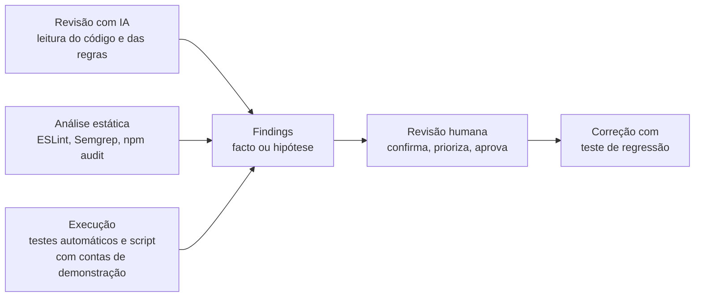

# Code Review e Security Review da Matriz

> **Versão:** 0.1 (Ficha PL 04, exercício 5)
> **Estado:** findings registados e revistos. As correções propostas (secção 6) esperam pela aprovação da equipa.

Documentos relacionados:

- [test-plan.md](test-plan.md): cenários de teste, incluindo os de autorização (CT11 a CT32).
- [verification.md](verification.md): resultados das execuções (secção 13.4).
- [constraints.md](constraints.md): requisitos de segurança (SEG) e de privacidade (PRIV).
- [architecture.md](architecture.md): convenções de erro (DA16, DA17) e estratégia de testes (DA37).

---

## 1. Âmbito e método

| Revisão | Âmbito | Prompt |
|---------|--------|--------|
| Code Review | Último incremento: diff do I7, `ficha-pl03..f39ea94` (59 ficheiros; contas, equipas, estado e gestor do projeto, "As minhas tarefas"). Bugs, validações, tratamento de erros, testes em falta. | `PromptCodeReview.txt` dos anexos |
| Security Review | Acesso a projetos e tarefas, com duas contas de demonstração (IDOR / Broken Access Control). Também injeção, segredos, dependências e configuração. Categorias do OWASP Top 10 2021. | `PromptSecurityReview.txt` e `PromptSecurityChallenge.txt` dos anexos |

Regras seguidas: cada finding indica ficheiro, evidência, impacto, severidade e correção proposta; um finding só é **Confirmado** quando foi reproduzido numa execução real; os outros são **Suspeita** (leitura do código) e ficam assinalados. Nenhum código de produção foi alterado durante a revisão.

---

## 2. Verificações executadas

| Verificação | Como | Resultado |
|-------------|------|-----------|
| Controlo de acesso às tarefas entre equipas | `AccessControlApiTests` (10 testes, CT13 a CT19, CT21, CT31, CT32), com `./mvnw test -Dtest=AccessControlApiTests` | 10 passam. Ler, editar, mudar o estado, apagar, comentar e associar responsáveis em tarefas de outra equipa dá 403; sem sessão dá 401; sem token CSRF dá 403; nada fica gravado. |
| Autorização com duas contas de demonstração | [`verification/autorizacao-demo.sh`](verification/autorizacao-demo.sh) contra o backend com o perfil `demo`; saída em [`verification/autorizacao-demo.txt`](verification/autorizacao-demo.txt) | O Pedro (Membro da Logística Norte) recebe 403 em todos os pedidos de leitura e alteração sobre Fornecedores (equipa Compras). A Ana confirma que a tarefa, os comentários e a equipa ficaram iguais. Revelou F1 e F2. |
| Análise estática do frontend | ESLint (configuração base do create-vue, mais `vue/no-v-html` como erro), `npm run lint` | 60 ficheiros, 0 erros, 0 avisos. A regra contra `v-html` foi confirmada com um ficheiro de prova (dá erro). |
| Análise estática do código todo | Semgrep 1.185 com as regras abertas do repositório `semgrep-rules`: Java (124 regras), TypeScript (32), JavaScript de browser (10), YAML (91) e segredos | 0 findings nas regras de código. Segredos: 1 resultado, falso positivo (secção 3, F12). Os ficheiros `.vue` não são analisados pelo Semgrep. |
| Dependências do frontend | `npm audit` e `npm audit --omit=dev` | Produção: 0 vulnerabilidades. Desenvolvimento: 7 moderadas no Windows (9 na execução em Linux), todas na mesma cadeia (F7). |
| Injeção de SQL | Leitura de todas as consultas (`*Queries.java`) | Todas usam parâmetros. Onde o SQL é montado, só se juntam fragmentos constantes do próprio código. Sem findings. |
| Segredos no repositório | `.gitignore`, histórico do Git (`git log --all -- .env`), `.env.example`, `application.yaml` | O `.env` nunca entrou no Git; o `.env.example` e a configuração só têm valores fictícios ou variáveis de ambiente. Sem findings. |
| XSS | ESLint (`vue/no-v-html`) e pesquisa por `v-html` e `innerHTML` | Nenhum uso. O Vue escapa todo o texto mostrado. Sem findings. |

---

## 3. Findings

Severidade: **Alta**, **Média**, **Baixa** ou **Informativo**. Estado: **Confirmado** (reproduzido) ou **Suspeita** (leitura do código, por validar).

### 3.1 Segurança

| ID | Severidade | Categoria | Ficheiro | Evidência | Impacto | Estado | Correção proposta | Teste de regressão |
|----|------------|-----------|----------|-----------|---------|--------|-------------------|--------------------|
| F1 | Média | A01 Broken Access Control (exposição de informação) | `tasks/application/TaskService.java`, `removeAssignee` | O teste "a pessoa é responsável?" (404) vem antes da verificação de acesso ao projeto (403). Script: o Pedro pede para retirar o João da tarefa 17 de Fornecedores e recebe 403; para a Marta, recebe 404 "Esta pessoa não é responsável pela tarefa.". | Quem não vê um projeto fica a saber quem é responsável pelas suas tarefas, contra a matriz de permissões ("Ver projetos, tarefas: projetos visíveis"). Não altera dados. | Confirmado | Verificar a visibilidade e a permissão logo depois de encontrar a tarefa; só depois responder 404 "não é responsável". Mantém a ordem de DA17 para a tarefa (404, 403). | Em `AccessControlApiTests`: o Pedro recebe 403 nos dois casos (responsável e não responsável), e a associação mantém-se. |
| F2 | Baixa | A01 Broken Access Control (exposição de informação) | `teams/Teams.java`, `removeMember` | O teste "a pessoa pertence à equipa?" (404) vem antes da verificação de Administrador (403). Script: o Pedro pede para retirar o João de Compras e recebe 403; para o Rui, recebe 404 "A pessoa não pertence à equipa.". | Um Membro fica a saber quem pertence a equipas que não são suas, contra a matriz de permissões ("Ver quem pertence a cada equipa: equipas a que pertence"). Não altera dados. | Confirmado | Verificar o papel de Administrador antes de verificar a pertença. A equipa inexistente continua a dar 404 primeiro. | Em `TeamApiTests`: o Pedro recebe 403 com uma pessoa da equipa e com uma pessoa de fora, e a equipa fica igual. |
| F3 | Baixa | A01 (enumeração de identificadores) | Todas as operações com identificador (`TaskService`, `Projects`, `AccountAdministration.update`, `Teams.addMember`, `TaskService.addAssignee`) | Recurso inexistente dá 404 e recurso não visível dá 403 (CT12, CT22). Ver também verification.md, secção 9. | Dá para saber se um identificador existe. Os identificadores são números sequenciais e não revelam dados pessoais. | Confirmado | Nenhuma: decisão documentada em DA17, com P13 (não há projetos confidenciais). Fica como risco aceite. | Já coberto por CT12 e CT22. |
| F4 | Baixa | A04 Insecure Design (contrato) | `CreateTaskRequest`, `CreateUserRequest`, `CreateProjectRequest` e os outros pedidos que são `record` | O contrato diz `additionalProperties: false` (resposta 400), mas os campos a mais são ignorados. CT31: enviar `projectId`, `status`, `version`, `assignees` e `deletedAt` ao criar uma tarefa não tem efeito. Os pedidos de edição (`PATCH`) recusam campos a mais com 400. | Sem efeito nos dados (não há mass assignment). Diferença entre o contrato e a implementação. | Confirmado | Corrigir o contrato e não o código: recusar campos a mais em todos os pedidos contrariava `CreateCommentRequest`, que ignora `authorId` por regra (RN30, E43). | CT31 já existe. |
| F5 | Baixa | A04 Insecure Design (concorrência) | `accounts/application/AccountAdministration.java`, `isLastActiveAdministrator` | Leitura do código: a contagem de Administradores ativos e a alteração não estão protegidas contra pedidos simultâneos. | Dois Administradores a desativarem-se um ao outro ao mesmo tempo poderiam deixar a organização sem Administrador ativo (RN18). | Suspeita | Bloquear as contas de Administrador na mesma transação (`SELECT ... FOR UPDATE`) antes de contar. | Teste com dois pedidos em paralelo. Fica por fazer. |
| F6 | Baixa | A05 Security Misconfiguration | `backend/src/main/resources/application.yaml` | O cookie de sessão é `HttpOnly` e `SameSite=Lax`, mas não tem `Secure`. | Em localhost não tem efeito. Num deploy com HTTPS (Ficha PL 05, DP10), o cookie poderia seguir num pedido HTTP. | Confirmado (configuração) | Ativar `server.servlet.session.cookie.secure` por variável de ambiente no ambiente publicado. | Verificação do cabeçalho `Set-Cookie` no ambiente publicado (Ficha PL 05). |
| F7 | Baixa | A06 Vulnerable and Outdated Components | `frontend/package-lock.json` | `npm audit`: 7 moderadas (9 em Linux), todas por causa de `minimatch` 10 (GHSA-g3hv-75wg-m249, negação de serviço com padrões glob), puxado pelo `typescript-eslint` do ESLint. `npm audit --omit=dev`: 0. | Só nas ferramentas de desenvolvimento; não entra no build entregue. Os padrões que o `minimatch` processa vêm da configuração do projeto, não de utilizadores. | Confirmado | Aceitar e rever quando o `typescript-eslint` passar a usar o `minimatch` corrigido (11.0.1 ou mais recente). O `npm audit fix` sugerido não resolve: a versão atual exige `minimatch` ^10.2.2. | Nova execução de `npm audit` na Ficha PL 05 (pipeline). |

### 3.2 Code Review (diff do I7)

| ID | Severidade | Categoria | Ficheiro | Evidência | Impacto | Estado | Correção proposta | Teste de regressão |
|----|------------|-----------|----------|-----------|---------|--------|-------------------|--------------------|
| F8 | Baixa | Manutenção | `frontend/src/views/ComingSoonView.vue` | Deixou de ser usado no I7: o router passou a usar os ecrãs reais e nenhum outro ficheiro o importa. | Código morto. | Confirmado | Apagar o ficheiro. | `npm run type-check` e `npm run build`. |
| F9 | Baixa | Testes em falta | `teams/TeamApiTests.java` | Não há teste para voltar a adicionar a uma equipa uma pessoa que já tinha sido removida. Pela leitura, funciona: o índice único só conta pertenças ativas (`ux_team_members_active`). | Uma alteração futura ao índice ou à consulta podia partir US03 sem nenhum teste falhar. | Suspeita (sem defeito conhecido) | Acrescentar o teste. | O próprio teste novo. |
| F10 | Informativo | Documentação | `README.md`, secção "Como executar" | O README pede "Node 22.12 ou mais recente", mas o `npm install` avisa (`EBADENGINE`) que dependências que já existiam antes da Ficha PL 04 (`jsdom`, `npm-run-all2`) pedem Node `^22.22.2 \|\| ^24.15.0 \|\| >=26`. | Funciona com avisos; um Node mais antigo pode falhar no futuro. | Confirmado | Atualizar o requisito no README e no `package.json` (`engines`). | `npm install` sem avisos `EBADENGINE`. |
| F11 | Informativo | Tratamento de erros | `common/GlobalExceptionHandler.java` | Um corpo JSON inválido é recusado pela framework com 400 antes de chegar ao serviço, por isso antes da verificação de acesso (DA17 põe o 403 antes do 400). Observado no script: o comentário com acento mal codificado deu 400. | A resposta é igual para qualquer recurso: não revela nada. | Confirmado | Nenhuma. Fica registado. | |
| F12 | Informativo | Segredos (falso positivo) | `db/changelog/demo/100-demo-data.xml` | O Semgrep encontra um hash bcrypt. | É o hash da palavra-passe de demonstração, fictícia e documentada no README (PRIV03). Só corre no perfil `demo`. | Falso positivo | Nenhuma. | |

Revisão do diff sem outros findings em: validações e mensagens das contas e das equipas (RN03, RN04, RN29), último Administrador (RN18, exceto F5), eventos e regras automáticas (RN16, RN17, RN22, RN23), bloqueio otimista no estado e no gestor do projeto (DA05), transições de estado (RN07), "As minhas tarefas" (RN24, RN25).

---

## 4. Problemas encontrados durante a revisão

Seguem a orientação da ficha: distinguir defeito da aplicação, problema do teste e limitação do ambiente.

| Situação | Tipo | Causa e decisão |
|----------|------|-----------------|
| 2 falhas na primeira execução de `AccessControlApiTests` (`$.title` encontrado) | Problema do teste | As asserções procuravam o campo `title` da tarefa, mas as respostas de erro trazem sempre o `title` do Problem Details (RFC 9457, DA16). A aplicação respondeu bem (403 e 401). As asserções passaram a usar `projectId` e `assignees`, que só existem na tarefa. |
| O comentário do Pedro deu 400 em vez de 403 no script | Limitação do ambiente | O acento do texto chegou com outra codificação pelo Git Bash em Windows e o JSON ficou inválido (F11). O script passou a usar só caracteres ASCII. O 403 nos comentários está verificado por CT18. |
| O ESLint não terminou ao correr pela ligação ao computador | Limitação do ambiente | O acesso aos ficheiros pela ligação é lento. O ESLint correu numa cópia do frontend e no Windows da utilizadora. |

---

## 5. O que ficou por validar

| Verificação | Motivo |
|-------------|--------|
| Dependências do backend (Maven) | Não há ferramenta configurada. O OWASP Dependency-Check precisa da base de dados do NVD; fica para a pipeline da Ficha PL 05. |
| F5 (concorrência no último Administrador) | Precisa de um teste com pedidos em paralelo. |
| Cabeçalhos de segurança no ambiente publicado (CSP, HSTS) e F6 | Só fazem sentido com HTTPS (Ficha PL 05). |
| Componentes `.vue` no Semgrep | O Semgrep não analisa ficheiros `.vue`; o ESLint cobre esses ficheiros. |

---

## 6. Correções propostas

Corrigem-se só os problemas confirmados e prioritários, depois da revisão humana, cada um com um teste de regressão.

| Finding | Proposta | Decisão |
|---------|----------|---------|
| F1 | Corrigir em `TaskService.removeAssignee`, com teste de regressão. | Por aprovar |
| F2 | Corrigir em `Teams.removeMember`, com teste de regressão. | Por aprovar |
| F4 | Corrigir a descrição dos pedidos de criação em `openapi.yaml` (campos a mais ignorados). | Por aprovar |
| F8 | Apagar `ComingSoonView.vue`. | Por aprovar |
| F9 | Acrescentar o teste em `TeamApiTests`. | Por aprovar |
| F10 | Atualizar o requisito de Node no README e no `package.json`. | Por aprovar |
| F3, F7, F11, F12 | Risco aceite ou sem ação, com o motivo indicado. | Proposto |
| F5, F6 | Ficam para a Ficha PL 05 (pipeline e deploy). | Proposto |

---

## 7. Segurança do trabalho com agentes de IA

Riscos do OWASP LLM Top 10 apresentados no Módulo 4 e como foram tratados nesta ficha:

| Risco | Medida |
|-------|--------|
| Prompt injection (LLM01) | As instruções válidas vêm só do pedido da utilizadora, do AGENTS.md e dos documentos de referência; conteúdo de ferramentas e ficheiros externos é tratado como dados (AGENTS.md, secção "Segurança e confidencialidade"). |
| Divulgação de informação sensível (LLM02) | Só dados fictícios (PRIV03); o `.env` fica fora do Git e não foi lido. |
| Agência excessiva (LLM03) | O agente não faz commits, push nem deploy, e não altera código de produção sem aprovação; os commits são feitos pela utilizadora. |
| Cadeia de fornecimento (LLM04) | As dependências novas (`@playwright/test`, ESLint e plugins) foram confirmadas no registo do npm (origem Microsoft, ESLint e Vue) antes de entrarem. |
| Confiança excessiva | A matriz de testes foi feita por um agente que não viu o código, e todos os findings foram revistos e reproduzidos antes de serem dados como confirmados. |
