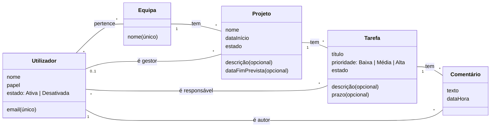
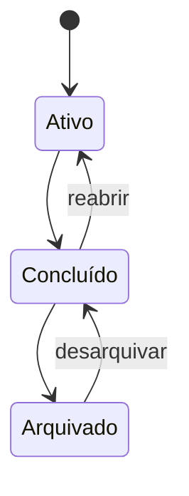

# Requisitos da Matriz

> **Versão:** 0.7 (conciliação com o âmbito da Ficha PL 03, exercício 1)
> **Estado:** em validação. Nada deste documento foi ainda confirmado pelo cliente, exceto o que está marcado com origem **C**.

## Como ler este documento

Cada requisito, regra ou objetivo indica a sua **origem**:

| Origem | Significado |
|:------:|-------------|
| **C** | Confirmado. Consta da descrição inicial do cliente ou do enunciado do projeto. |
| **D** | Decisão de análise. Escolha de âmbito feita pela equipa. Tem de ser validada pelo Product Owner. |
| **P** | Pressuposto sobre a realidade do cliente. Está registado em [constraints.md](constraints.md#2-pressupostos-assumidos). |

Prioridades (método MoSCoW):

| Prioridade | Significado | Fase |
|------------|-------------|------|
| **Must** | Sem isto a Matriz não cumpre o objetivo. | MVP |
| **Should** | Importante, mas a aplicação funciona sem isto. | Versão 1.1 |
| **Could** | Acrescenta valor, sem urgência. | Futuro |
| **Won't** | Fora de âmbito nesta fase. | Não planeado |

Documentos relacionados:

- [user-stories.md](user-stories.md): histórias do MVP e critérios de aceitação.
- [constraints.md](constraints.md): restrições, pressupostos, segurança e privacidade, decisões técnicas pendentes.
- [architecture.md](architecture.md): arquitetura, componentes e decisões técnicas (DA).
- [database.md](database.md): modelo de dados e decisões de modelação.

Em caso de conflito entre documentos, as **definições** (secção 2) e as **regras de negócio** (secção 6) deste ficheiro prevalecem. O conflito deve ser reportado e corrigido.

---

## 1. Visão e objetivos

### 1.1 Visão

A Matriz é uma aplicação de gestão de projetos e tarefas para as equipas de uma empresa, do mesmo tipo de ferramentas como Jira, Azure DevOps ou Trello. **(C, enunciado do projeto)**

A comparação serve só para situar o tipo de produto. Não traz funcionalidades dessas ferramentas para o âmbito.

Descrição inicial do cliente **(C)**:

> "Precisamos de uma aplicação onde as nossas equipas possam organizar projetos, gerir tarefas e acompanhar o progresso do trabalho."

### 1.2 Problema

A informação sobre o trabalho das equipas está dispersa (folhas de cálculo, email, reuniões). Ninguém sabe ao certo quem está a fazer o quê nem o que está atrasado. **(P01, P02)**

### 1.3 Objetivos

| ID | Objetivo | Origem |
|----|----------|:------:|
| O1 | Cada pessoa sabe que tarefas tem atribuídas e com que prazo. | D |
| O2 | O gestor de um projeto vê, a qualquer momento, o progresso e as tarefas atrasadas. | C, D |
| O3 | A direção acompanha o estado geral dos projetos sem pedir relatórios. | D |
| O4 | As equipas piloto deixam de usar folhas de cálculo para acompanhar o trabalho. | D, P09 |

Só a descrição do cliente está confirmada. O1 é uma interpretação de "gerir tarefas". O2 junta uma parte confirmada ("acompanhar o progresso") com interpretações: o gestor como destinatário e a noção de atraso.

### 1.4 Métricas de sucesso do produto

Estas métricas medem a adoção no piloto. **Não são critérios de aceitação** das funcionalidades.

| ID | Métrica | Origem |
|----|---------|:------:|
| M1 | As 2 equipas piloto usam a Matriz todas as semanas durante 8 semanas (valor provisório). | D, P09 |
| M2 | Um gestor cria um projeto com 10 tarefas atribuídas em menos de 15 minutos (valor provisório, a calibrar no piloto). | D |

---

## 2. Definições

Estas definições são usadas em todos os documentos. Qualquer critério de aceitação depende delas.

As definições só explicam o significado dos termos. As regras sobre esses termos estão na secção 6, com a respetiva origem. As definições de cálculo (tarefa atrasada, progresso) são decisões de análise (**D**).

| Termo | Definição |
|-------|-----------|
| **Equipa** | Grupo de utilizadores da organização. |
| **Pertencer a uma equipa** | Ter sido adicionado a essa equipa pelo Administrador. Não confundir com o papel Membro. |
| **Membro (papel)** | Papel de quem executa tarefas nos projetos das equipas a que pertence. Só os papéis Gestor e Membro pertencem a equipas (RN26). |
| **Projeto** | Conjunto de tarefas relativas a um trabalho de uma equipa. |
| **Tarefa** | Unidade de trabalho de um projeto. |
| **Responsável** | Utilizador associado a uma tarefa para a executar. Uma tarefa pode ter vários responsáveis. |
| **Sem responsável** | Situação de uma tarefa que não tem nenhum responsável. |
| **Gestor do projeto** | Utilizador com papel Gestor indicado no campo "Gestor" do projeto. |
| **Sem gestor** | Valor do campo "Gestor" quando o projeto não tem gestor válido (RN22). Não é um estado do projeto. |
| **Conta ativa** | Conta que não foi desativada. |
| **Data atual** | Dia de calendário no fuso horário da organização (P12). Nos testes: Europe/Lisbon. |
| **Tarefa aberta** | Tarefa com estado "Por fazer" ou "Em curso". |
| **Tarefa atrasada** | Tarefa aberta com prazo **anterior** à data atual. Uma tarefa com prazo igual à data atual **não** está atrasada. Uma tarefa sem prazo **nunca** está atrasada. |
| **Progresso do projeto** | (tarefas concluídas ÷ total de tarefas) × 100, **arredondado para baixo** à unidade. Só mostra 100% quando todas as tarefas estão concluídas. Um projeto sem tarefas mostra "Sem tarefas". |
| **Projetos visíveis** | Membro e Gestor: projetos das equipas a que pertencem. Administrador e Observador: todos os projetos. Os projetos eliminados nunca são visíveis. |
| **Eliminado** | Projeto ou tarefa que deixou de aparecer na aplicação, mas continua guardado (RN32). Para os utilizadores, é como se não existisse. |

---

## 3. Tipos de utilizador

| Papel | Quem é | O que precisa | Exemplo |
|-------|--------|---------------|---------|
| **Administrador** | Responsável interno pela ferramenta. | Criar contas e equipas e atribuir papéis. | A Ana cria a equipa "Logística Norte" e adiciona 8 pessoas. |
| **Gestor** | Líder de equipa ou responsável por projetos. | Criar projetos, distribuir tarefas, ver atrasos. | O Rui cria o projeto "Novo armazém" e atribui 15 tarefas. |
| **Membro** | Colaborador de uma equipa. | Saber o que tem para fazer e atualizar o estado. | A Marta abre "As minhas tarefas" e marca 2 como concluídas. |
| **Observador** | Direção ou outra parte interessada. | Ver o estado de todos os projetos sem os alterar. | O Carlos confirma que 3 de 12 projetos têm atrasos. |

Origem: **D** (os quatro papéis). Só existem utilizadores internos à organização (**D**, apoiada em P06, ver RF38).

**Decisão D (Ficha PL 02):** o papel Observador e o objetivo O3 não vêm do cliente, mas mantêm-se no MVP e na arquitetura. Continuam por validar com o Product Owner. Se forem rejeitados, saem o papel, a US15 e o pressuposto P13, e é preciso rever a matriz de permissões, as regras RN14, RN23 e RN26 e a [arquitetura](architecture.md).

### 3.1 Matriz de permissões

| Ação | Administrador | Gestor | Membro | Observador |
|------|:-------------:|:------:|:------:|:----------:|
| Gerir contas | ✔ | | | |
| Gerir equipas e quem lhes pertence | ✔ | | | |
| Ver quem pertence a cada equipa | Todas | Equipas a que pertence | Equipas a que pertence | Todas |
| Criar projeto | ✔ (qualquer equipa) | ✔ (equipas a que pertence) | | |
| Editar ou mudar o estado de um projeto | ✔ | ✔ (projetos que gere) | | |
| Eliminar um projeto | ✔ | ✔ (projetos que gere) | | |
| Mudar o gestor de um projeto | ✔ | | | |
| Criar, editar, apagar e atribuir tarefas | ✔ | ✔ (projetos que gere) | | |
| Mudar o estado de uma tarefa | ✔ | ✔ (projetos que gere e tarefas de que é responsável) | ✔ (tarefas de que é responsável) | |
| Comentar uma tarefa | ✔ | ✔ (projetos visíveis) | ✔ (projetos visíveis) | |
| Ver projetos, tarefas e comentários | Todos | Projetos visíveis | Projetos visíveis | Todos |

Quando o Administrador cria um projeto, indica como gestor um utilizador com papel Gestor e conta ativa que pertença à equipa do projeto (RN21, RN27). Num projeto "Sem gestor", as permissões do gestor passam para o Administrador (RN22).

As permissões aplicam-se dentro dos limites das regras de negócio. Por exemplo, ninguém altera um projeto arquivado (RN09), mas o projeto pode ser eliminado (RN31).

---

## 4. Modelo de domínio



Projetos e tarefas eliminados continuam guardados (RN32), mas ficam fora de todas as vistas.

### 4.1 Estados do projeto



"Sem gestor" não é um estado: é um valor do campo gestor e pode acontecer em qualquer estado do projeto.

Eliminar também não é um estado: um projeto pode ser eliminado em qualquer estado e deixa de aparecer (RN31).

### 4.2 Estados da tarefa

Três estados: **Por fazer**, **Em curso**, **Concluída**. Qualquer mudança entre eles é permitida, incluindo voltar atrás (RN12).

---

## 5. Requisitos funcionais

### 5.1 Acesso e utilizadores

| ID | Requisito | Justificação | Prior. | Origem |
|----|-----------|--------------|:------:|:------:|
| RF01 | Entrar e sair da aplicação com email e palavra-passe. | Sem identificação não há responsáveis nem permissões. | Must | D |
| RF02 | O Administrador vê a lista de contas, cria contas, edita o nome e o email, muda o papel, desativa e reativa contas, e dá ou repõe o acesso de uma conta (mecanismo em DA25). | Só há utilizadores internos e o controlo é centralizado. | Must | D |
| RF03 | Cada utilizador só vê e altera o que o seu papel permite (secção 3.1). | Cada equipa só vê os seus projetos. | Must | D |
| RF04 | Entrar com a conta da empresa. | Menos uma palavra-passe, mas exige integração. | Could | D |
| RF39 | Registo das ações do Administrador (contas, papéis, equipas, gestores), com autor, ação, data e hora, e forma de o consultar. | Rastreabilidade das ações com mais impacto. Fica fora do MVP porque exige definir quem o consulta e como (RGPD). | Should | D |

### 5.2 Equipas

| ID | Requisito | Justificação | Prior. | Origem |
|----|-----------|--------------|:------:|:------:|
| RF05 | O Administrador vê a lista de equipas, cria e edita equipas. | A equipa é a unidade de organização referida pelo cliente. | Must | C, D |
| RF06 | O Administrador adiciona pessoas a uma equipa e remove-as. | Define quem vê cada projeto. | Must | D |

### 5.3 Projetos

| ID | Requisito | Justificação | Prior. | Origem |
|----|-----------|--------------|:------:|:------:|
| RF07 | Criar e editar projetos. | Pedido do cliente: "organizar projetos". | Must | C |
| RF08 | Mudar o estado de um projeto e arquivá-lo. | Separa o trabalho ativo do terminado. | Must | D |
| RF09 | Ver a lista de projetos visíveis, com filtro por estado. Cada projeto mostra equipa, gestor, estado, data de fim prevista, progresso e nº de tarefas atrasadas. | Ponto de entrada para gestores e equipas. | Must | D |
| RF10 | Projetos partilhados entre várias equipas. | Necessidade provável, mas complica as permissões. | Could | D |
| RF11 | Marcos e fases num projeto. | Útil em projetos longos, dispensável no início. | Could | D |
| RF40 | Pesquisar projetos pelo nome, na lista de projetos (RN34). | Encontrar um projeto sem percorrer a lista. Vem do âmbito da Ficha PL 03. | Must | C, D |
| RF41 | Eliminar um projeto (RN31). | Retirar projetos criados por engano ou que deixaram de interessar. Vem do âmbito da Ficha PL 03. | Must | C, D |

### 5.4 Tarefas

| ID | Requisito | Justificação | Prior. | Origem |
|----|-----------|--------------|:------:|:------:|
| RF12 | Criar, editar e apagar tarefas. | Pedido do cliente: "gerir tarefas". | Must | C |
| RF13 | Associar um ou vários responsáveis a uma tarefa e remover cada associação. | Resolve "quem está a fazer o quê". Vários responsáveis por tarefa vêm do âmbito da Ficha PL 03. | Must | C, D |
| RF14 | Definir prazo e prioridade de uma tarefa. | Sem prazo não é possível identificar atrasos. A prioridade indica o que fazer primeiro entre tarefas com o mesmo prazo (O1, RN24). | Must | D |
| RF15 | Mudar o estado de uma tarefa. | Base do cálculo do progresso. | Must | D |
| RF16 | Ver a lista de tarefas de um projeto, com filtros por responsável, estado, prioridade e atraso. | Vista mínima para o gestor acompanhar o projeto. O filtro por prioridade vem do âmbito da Ficha PL 03. | Must | C, D |
| RF17 | Ver "As minhas tarefas": as tarefas de que o utilizador é responsável em todos os projetos ativos, com opção de incluir as concluídas (RN25). | Cada pessoa precisa de um único sítio para ver o seu trabalho. | Must | D |
| RF18 | Vista de quadro (colunas por estado). | Vista visual muito usada, mas a lista cobre a necessidade. | Should | D |
| RF19 | Adicionar e ver comentários numa tarefa, com autor e data e hora (RN30). | Reduz a troca de emails sobre uma tarefa. Entrou no MVP pelo âmbito da Ficha PL 03. | Must | C, D |
| RF20 | Histórico de alterações de cada tarefa. | Permite saber quem mudou o quê e quando. | Should | D |
| RF21 | Pesquisa por texto nas tarefas e nos comentários. | Necessária quando o volume de tarefas cresce. A pesquisa de projetos pelo nome é a RF40. | Should | D |
| RF22 | Anexos em tarefas. | Útil, mas implica armazenamento e regras de acesso. | Could | D |
| RF23 | Subtarefas. | Útil para dividir tarefas grandes. | Could | D |
| RF24 | Etiquetas. | Agrupamento livre de tarefas. | Could | D |
| RF25 | Dependências entre tarefas. | Complexo e só útil em planeamento avançado. | Could | D |
| RF26 | Registo de tempo gasto. | Não faz parte do pedido inicial. | Won't | D |

### 5.5 Acompanhamento do progresso

| ID | Requisito | Justificação | Prior. | Origem |
|----|-----------|--------------|:------:|:------:|
| RF27 | Mostrar o progresso de cada projeto (secção 2). | Pedido do cliente: "acompanhar o progresso". | Must | C, D |
| RF28 | Marcar as tarefas atrasadas e mostrar quantas existem por projeto. | Responde ao problema de falta de visibilidade. | Must | D |
| RF29 | Painel inicial com os projetos visíveis e as contagens de tarefas por estado, com acesso ao detalhe de cada projeto (RN33). | Necessário para Observadores e gestores com vários projetos. Entrou no MVP pelo âmbito da Ficha PL 03. | Must | C, D |
| RF30 | Vistas de calendário e cronograma. | Úteis, mas não essenciais. | Could | D |
| RF31 | Evolução do progresso ao longo do tempo. | Relatórios para a direção. | Could | D |
| RF32 | Exportar relatórios. | Pedido provável, sem urgência. | Could | D |

### 5.6 Notificações e integrações

| ID | Requisito | Justificação | Prior. | Origem |
|----|-----------|--------------|:------:|:------:|
| RF33 | Avisos dentro da aplicação (tarefa atribuída, prazo próximo). | Evita que tarefas passem despercebidas. | Should | D |
| RF34 | Avisos por email. | Alcança quem não abre a aplicação todos os dias. | Could | D |
| RF35 | Importar dados de folhas de cálculo. | Facilita a adoção por equipas com histórico. | Could | D |
| RF36 | Integração com calendário ou ferramentas de conversação. | Exige conhecer os sistemas do cliente. | Won't | D |
| RF37 | Aplicação móvel nativa. | A versão adaptada ao telemóvel é suficiente (RNF01). | Won't | D |
| RF38 | Acesso de utilizadores externos à organização. | Fora do pedido do cliente. | Won't | D |

---

## 6. Regras de negócio

Todas têm origem **D** e estão por validar com o Product Owner. RN02 depende também do pressuposto P03.

Os IDs não são renumerados. As regras novas são acrescentadas no fim.

| ID | Regra |
|----|-------|
| RN01 | Um projeto pertence a uma só equipa. |
| RN02 | Um utilizador pode pertencer a várias equipas. |
| RN03 | O nome de uma equipa é obrigatório e único na organização, sem distinguir maiúsculas (DA10). |
| RN04 | O email de uma conta é obrigatório e único, sem distinguir maiúsculas (DA10). Tem o formato nome@domínio: um único "@", texto antes e um domínio com pelo menos um ponto depois. Nome e papel também são obrigatórios. |
| RN05 | Um Gestor só cria projetos nas equipas a que pertence e só altera os projetos de que é gestor (ver também RN21). |
| RN06 | Projeto: nome, equipa e data de início são obrigatórios. Descrição e data de fim prevista são opcionais. A data de fim prevista não pode ser anterior à data de início. |
| RN07 | Um projeto novo fica no estado "Ativo". As transições permitidas estão na secção 4.1. |
| RN08 | Só projetos "Ativo" aceitam novas tarefas. |
| RN09 | Num projeto "Concluído" ou "Arquivado", nem o projeto nem as suas tarefas podem ser alterados. Exceções: a mudança de estado do projeto (secção 4.1), as alterações automáticas de RN16, RN17, RN22 e RN23, a mudança de gestor pelo Administrador (RN21) e a eliminação do projeto (RN31). |
| RN10 | Concluir um projeto com tarefas abertas é permitido, mas exige confirmação com o número de tarefas abertas. Arquivar um projeto concluído não pede confirmação. |
| RN11 | Tarefa: o título é obrigatório e tem 1 a 200 caracteres, depois de ignorar os espaços no início e no fim. Cada carácter conta como um, incluindo letras acentuadas e emojis simples: o texto é normalizado e conta-se cada código Unicode (DA11, LIM13). Descrição e prazo são opcionais. A prioridade existe sempre (Baixa, Média ou Alta): se não for indicada, fica "Média". |
| RN12 | Uma tarefa nova fica "Por fazer". Os estados podem mudar em qualquer direção. |
| RN13 | O prazo de uma tarefa não pode ser anterior à data atual. A validação só se aplica quando o prazo é definido ou mudado. Editar outros campos de uma tarefa já atrasada é permitido. Retirar o prazo é sempre permitido. |
| RN14 | Uma tarefa pode ter vários responsáveis ou nenhum ("Sem responsável"). Cada responsável tem de ter conta ativa, pertencer à equipa do projeto e ter papel Gestor ou Membro. A mesma pessoa não pode ser associada duas vezes à mesma tarefa. |
| RN15 | Qualquer responsável de uma tarefa pode mudar o seu estado, qualquer que seja o seu papel. Um utilizador com papel Membro só muda o estado das tarefas de que é responsável. |
| RN16 | Contas são desativadas, nunca apagadas. Ao desativar, a pessoa deixa de ser responsável pelas suas tarefas abertas (as que ficam sem nenhum responsável ficam "Sem responsável") e as tarefas concluídas mantêm o seu nome. |
| RN17 | Ao remover uma pessoa de uma equipa, a pessoa deixa de ser responsável pelas suas tarefas abertas nos projetos dessa equipa (as que ficam sem nenhum responsável ficam "Sem responsável"). |
| RN18 | Tem de existir sempre pelo menos um Administrador ativo. Não é possível desativar o último nem mudar o seu papel. Um Administrador pode desativar a própria conta se existir outro Administrador ativo. |
| RN19 | Apagar uma tarefa exige confirmação e é definitivo: a tarefa deixa de aparecer e não se recupera na aplicação. Os dados continuam guardados (RN32). |
| RN20 | Uma tarefa pertence sempre a um projeto. |
| RN21 | O gestor de um projeto tem de ter conta ativa, pertencer à equipa do projeto e ter papel Gestor. Só o Administrador muda o gestor de um projeto. A equipa de um projeto não pode ser mudada. |
| RN22 | Se o gestor de um projeto deixar de cumprir RN21 (conta desativada, removido da equipa ou papel mudado), o projeto fica "Sem gestor". Até haver novo gestor, só o Administrador edita ou elimina o projeto e cria, edita, apaga ou atribui as suas tarefas. Os responsáveis continuam a mudar o estado das suas tarefas (RN15). |
| RN23 | Ao mudar o papel de uma conta: se deixar de ser Gestor, os projetos que gere ficam "Sem gestor" (RN22). Se passar a Observador ou Administrador, deixa de pertencer às suas equipas (RN26) e aplica-se RN17. |
| RN24 | "As minhas tarefas" ordena por prazo, do mais próximo para o mais distante, com as tarefas sem prazo no fim. Em caso de empate, ordena por prioridade (Alta, Média, Baixa), depois por título, por ordem alfabética sem distinguir maiúsculas nem acentos, e por fim pela ordem de criação. |
| RN25 | "As minhas tarefas" mostra, por omissão, as tarefas abertas de que o utilizador é responsável em projetos "Ativo". O filtro "Incluir concluídas" acrescenta as tarefas concluídas desses projetos. As tarefas de projetos "Concluído" ou "Arquivado" não aparecem. A lista de projetos esconde, por omissão, os projetos "Arquivado". |
| RN26 | Só utilizadores com papel Gestor ou Membro pertencem a equipas. Contas desativadas não podem ser adicionadas a equipas. Um Gestor sem equipa não vê nenhum projeto. |
| RN27 | Quando um Gestor cria um projeto, fica gestor desse projeto. Quando o Administrador cria um projeto, tem de indicar o gestor (RN21). Uma equipa sem nenhum Gestor com conta ativa não pode ter projetos novos. |
| RN28 | O Administrador pode editar o nome e o email de uma conta (o email continua único, RN04) e reativar uma conta desativada. A conta reativada mantém o papel e as equipas. As tarefas que ficaram "Sem responsável" na desativação não voltam a ser atribuídas automaticamente. |
| RN29 | Comprimentos máximos, depois de ignorar os espaços no início e no fim: nome de pessoa 100, email 254, nome de equipa 100, nome de projeto 100, descrição de projeto 1000 e descrição de tarefa 2000 caracteres. Os nomes não podem ficar vazios. Os caracteres contam-se como na RN11. |
| RN30 | Comentários. Podem comentar uma tarefa o Administrador e as pessoas que pertencem à equipa do projeto (papéis Gestor e Membro, RN26). O Observador não comenta. O texto é obrigatório e tem 1 a 2000 caracteres, depois de ignorar os espaços no início e no fim, contados como na RN11. O autor é sempre quem está autenticado e a data e hora vêm do Relógio da organização (RNF06). Os comentários não se editam nem se apagam e aparecem do mais antigo para o mais recente. Projetos "Concluído" ou "Arquivado" não aceitam comentários (RN09). |
| RN31 | Eliminar um projeto. Podem eliminar o Administrador e o gestor do projeto; num projeto "Sem gestor", só o Administrador (RN22). É permitido em qualquer estado do projeto (exceção a RN09). Exige confirmação com o número de tarefas do projeto, no singular ou no plural. O projeto, as suas tarefas, os responsáveis e os comentários deixam de aparecer em todas as listas, contagens, no painel e em "As minhas tarefas". Não se recupera na aplicação. |
| RN32 | Nenhuma operação apaga dados da base de dados. Eliminar um projeto ou apagar uma tarefa marca o registo como eliminado, com a data e hora. Retirar uma pessoa de uma equipa ou retirar um responsável de uma tarefa marca a associação como removida, com a data e hora. Um registo eliminado ou uma associação removida é tratado como inexistente em todas as operações, listas, contagens, progresso e atrasos. Os responsáveis e os comentários de uma tarefa ou de um projeto eliminado continuam guardados, mas deixam de aparecer. |
| RN33 | O painel inicial mostra os mesmos projetos que a lista de projetos mostra por omissão (RN25: sem os "Arquivado"), pela mesma ordem. Para cada projeto, mostra o número de tarefas "Por fazer", "Em curso" e "Concluída". Mostra também os totais desses projetos. As contagens incluem todas as tarefas não eliminadas desses projetos. |
| RN34 | A pesquisa de projetos procura o texto em qualquer parte do nome, sem distinguir maiúsculas nem acentos, depois de ignorar os espaços no início e no fim. Combina-se com o filtro por estado. Uma pesquisa vazia mostra todos os projetos do filtro. Só devolve projetos visíveis. |

---

## 7. Requisitos não funcionais

Os requisitos de segurança e privacidade estão em [constraints.md, secção 3](constraints.md#3-requisitos-de-segurança-e-privacidade).

| ID | Categoria | Requisito | Como verificar | Origem |
|----|-----------|-----------|----------------|:------:|
| RNF01 | Acesso | A Matriz é usada num browser, em computador e em telemóvel. | Todas as páginas do MVP funcionam numa largura de ecrã de 360 px sem deslocamento horizontal. | D |
| RNF02 | Idioma | A interface está em português. | Revisão de todos os textos visíveis. | P10 |
| RNF03 | Capacidade | Suporta o volume de referência: 300 utilizadores, 20 equipas, 200 projetos e 10 000 tarefas. | Teste com dados fictícios neste volume. | P05 |
| RNF04 | Desempenho | Com o volume de RNF03 e 20 utilizadores em simultâneo, 95% dos pedidos às páginas do MVP respondem em menos de 2 segundos. | Teste de carga no ambiente de testes, com dados fictícios. | P05 |
| RNF05 | Integridade | Nenhuma operação apaga dados (RN32). As tarefas concluídas mantêm os responsáveis originais. | Testes de US14, US16 e US20. | D |
| RNF06 | Datas | Todas as regras de datas usam a data atual da organização (secção 2). | Testes de US05 e US10 com data fixa. | D |
| RNF07 | Verificabilidade | Cada critério de aceitação de [user-stories.md](user-stories.md) pode ser verificado por um teste automático. | Revisão dos testes antes de fechar cada história. | D |

---

## 8. Âmbito do MVP

### 8.1 Objetivo do MVP

Permitir que uma equipa substitua a folha de cálculo de acompanhamento por uma ferramenta onde cada pessoa vê as suas tarefas e o gestor vê, a qualquer momento, o que está atrasado.

### 8.2 Requisitos incluídos

20 requisitos **Must**: RF01, RF02, RF03, RF05, RF06, RF07, RF08, RF09, RF12, RF13, RF14, RF15, RF16, RF17, RF19, RF27, RF28, RF29, RF40, RF41.

O enunciado da Ficha PL 03 (origem **C**) define o âmbito mínimo da implementação. Para o cumprir, RF19 (comentários) e RF29 (painel inicial) passaram de Should para Must, entraram RF40 (pesquisar projetos) e RF41 (eliminar projeto), RF13 passou a aceitar vários responsáveis (RN14) e RF16 ganhou o filtro por prioridade. Nenhum requisito saiu do MVP.

Também fazem parte do MVP:

- todas as regras de negócio (RN01 a RN34);
- os requisitos não funcionais RNF01 a RNF07;
- os requisitos de segurança SEG01 a SEG09 e de privacidade PRIV01 a PRIV03 ([constraints.md, secção 3](constraints.md#3-requisitos-de-segurança-e-privacidade)).

### 8.3 Percurso principal

```
 Administrador        Gestor                     Membro                Gestor
 ─────────────        ──────                     ──────                ──────
 1. Cria equipa  ──►  2. Cria projeto      ──►  4. Abre "As     ──►  6. Vê progresso:
    e contas             "Novo armazém"            minhas tarefas"     60% concluído,
                      3. Cria 10 tarefas,       5. Muda estado        2 tarefas
                         atribui e define          para "Em curso"     atrasadas
                         prazos                    e "Concluída"
```

### 8.4 Critério de conclusão do MVP

O MVP está concluído quando:

1. todos os critérios de aceitação das histórias US01 a US22 ([user-stories.md](user-stories.md)) são verificados com sucesso;
2. os requisitos SEG e PRIV são verificados como indica a coluna "Verificação" de [constraints.md](constraints.md#3-requisitos-de-segurança-e-privacidade).

A US15 depende da validação do papel Observador (secção 3).

---

## 9. Fora do âmbito inicial

### 9.1 Versão 1.1 (Should)

| ID | Funcionalidade |
|----|----------------|
| RF18 | Vista de quadro |
| RF20 | Histórico de alterações |
| RF21 | Pesquisa por texto |
| RF39 | Registo das ações do Administrador |
| RF33 | Avisos dentro da aplicação |

### 9.2 Futuro (Could)

RF04, RF10, RF11, RF22, RF23, RF24, RF25, RF30, RF31, RF32, RF34, RF35.

### 9.3 Não planeado (Won't)

| ID | Funcionalidade | Motivo |
|----|----------------|--------|
| RF26 | Registo de tempo | Não faz parte do pedido inicial. |
| RF36 | Integrações com calendário ou conversação | Os sistemas do cliente são desconhecidos. |
| RF37 | Aplicação móvel nativa | A versão adaptada ao telemóvel é suficiente. |
| RF38 | Utilizadores externos | Fora do pedido do cliente. |

### 9.4 Resumo

| Fase | Nº de requisitos |
|------|:----------------:|
| MVP (Must) | 20 |
| Versão 1.1 (Should) | 5 |
| Futuro (Could) | 12 |
| Não planeado (Won't) | 4 |
| **Total** | **41** |
