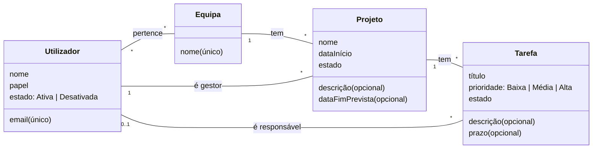
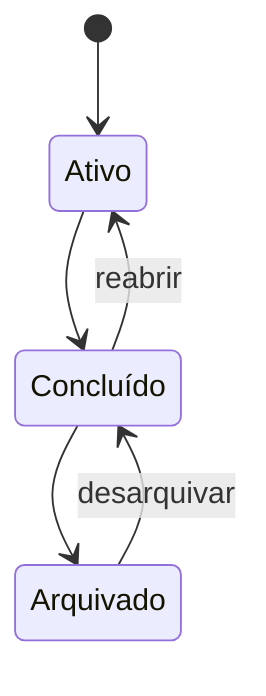

# Requisitos da Matriz

> **Versão:** 0.2 (revisão crítica 1, Ficha PL 01)
> **Estado:** em validação. Nada deste documento foi ainda confirmado pelo cliente, exceto o que está marcado com origem **C**.

## Como ler este documento

Cada requisito, regra ou objetivo indica a sua **origem**:

| Origem | Significado |
|:------:|-------------|
| **C** | Confirmado. Consta da descrição inicial do cliente ou do enunciado do projeto. |
| **D** | Decisão de análise. Escolha de âmbito feita pela equipa. Tem de ser validada pelo Product Owner. |
| **P** | Pressuposto sobre a realidade do cliente. Está registado em [constraints.md](constraints.md#2-pressupostos-assumidos). |

Prioridades (método MoSCoW):

| Prioridade | Significado | Fase |
|------------|-------------|------|
| **Must** | Sem isto a Matriz não cumpre o objetivo. | MVP |
| **Should** | Importante, mas a aplicação funciona sem isto. | Versão 1.1 |
| **Could** | Acrescenta valor, sem urgência. | Futuro |
| **Won't** | Fora de âmbito nesta fase. | Não planeado |

Documentos relacionados:

- [user-stories.md](user-stories.md): histórias do MVP e critérios de aceitação.
- [constraints.md](constraints.md): restrições, pressupostos, segurança e privacidade, decisões técnicas pendentes.

Em caso de conflito entre documentos, as **definições** (secção 2) e as **regras de negócio** (secção 6) deste ficheiro prevalecem. O conflito deve ser reportado e corrigido.

---

## 1. Visão e objetivos

### 1.1 Visão

A Matriz é uma aplicação de gestão de projetos e tarefas para as equipas de uma empresa, do mesmo tipo de ferramentas como Jira, Azure DevOps ou Trello. **(C)**

Descrição inicial do cliente **(C)**:

> "Precisamos de uma aplicação onde as nossas equipas possam organizar projetos, gerir tarefas e acompanhar o progresso do trabalho."

### 1.2 Problema

A informação sobre o trabalho das equipas está dispersa (folhas de cálculo, email, reuniões). Ninguém sabe ao certo quem está a fazer o quê nem o que está atrasado. **(P01, P02)**

### 1.3 Objetivos

| ID | Objetivo | Origem |
|----|----------|:------:|
| O1 | Cada pessoa sabe que tarefas tem atribuídas e com que prazo. | C, D |
| O2 | O gestor de um projeto vê, a qualquer momento, o progresso e as tarefas atrasadas. | C, D |
| O3 | A direção acompanha o estado geral dos projetos sem pedir relatórios. | D |
| O4 | As equipas piloto deixam de usar folhas de cálculo para acompanhar o trabalho. | D |

### 1.4 Métricas de sucesso do produto

Estas métricas medem a adoção no piloto. **Não são critérios de aceitação** das funcionalidades.

| ID | Métrica | Origem |
|----|---------|:------:|
| M1 | As 2 equipas piloto usam a Matriz todas as semanas durante 8 semanas. | D |
| M2 | Um gestor cria um projeto com 10 tarefas atribuídas em menos de 15 minutos (valor provisório, a calibrar no piloto). | D |

---

## 2. Definições

Estas definições são usadas em todos os documentos. Qualquer critério de aceitação depende delas.

As definições só explicam o significado dos termos. As regras sobre esses termos estão na secção 6, com a respetiva origem. As definições de cálculo (tarefa atrasada, progresso) são decisões de análise (**D**).

| Termo | Definição |
|-------|-----------|
| **Equipa** | Grupo de utilizadores da organização. |
| **Pertencer a uma equipa** | Ter sido adicionado a essa equipa pelo Administrador. Não confundir com o papel Membro. |
| **Membro (papel)** | Um dos quatro papéis da secção 3. Um utilizador com papel Gestor também pode pertencer a uma equipa. |
| **Projeto** | Conjunto de tarefas relativas a um trabalho de uma equipa. |
| **Tarefa** | Unidade de trabalho de um projeto. |
| **Responsável** | Utilizador que executa a tarefa. |
| **Gestor do projeto** | Utilizador com papel Gestor indicado no campo "Gestor" do projeto. |
| **Conta ativa** | Conta que não foi desativada. |
| **Data atual** | Dia de calendário no fuso horário da organização (P12). Nos testes: Europe/Lisbon. |
| **Tarefa aberta** | Tarefa com estado "Por fazer" ou "Em curso". |
| **Tarefa atrasada** | Tarefa aberta com prazo **anterior** à data atual. Uma tarefa com prazo igual à data atual **não** está atrasada. Uma tarefa sem prazo **nunca** está atrasada. |
| **Progresso do projeto** | (tarefas concluídas ÷ total de tarefas) × 100, **arredondado para baixo** à unidade. Só mostra 100% quando todas as tarefas estão concluídas. Um projeto sem tarefas mostra "Sem tarefas". |
| **Projetos visíveis** | Membro e Gestor: projetos das equipas a que pertencem. Administrador e Observador: todos os projetos. |

---

## 3. Tipos de utilizador

| Papel | Quem é | O que precisa | Exemplo |
|-------|--------|---------------|---------|
| **Administrador** | Responsável interno pela ferramenta. | Criar contas e equipas e atribuir papéis. | A Ana cria a equipa "Logística Norte" e adiciona 8 pessoas. |
| **Gestor** | Líder de equipa ou responsável por projetos. | Criar projetos, distribuir tarefas, ver atrasos. | O Rui cria o projeto "Novo armazém" e atribui 15 tarefas. |
| **Membro** | Colaborador de uma equipa. | Saber o que tem para fazer e atualizar o estado. | A Marta abre "As minhas tarefas" e marca 2 como concluídas. |
| **Observador** | Direção ou outra parte interessada. | Ver o estado de todos os projetos sem os alterar. | O Carlos confirma que 3 de 12 projetos têm atrasos. |

Origem: **D** (os quatro papéis). Só existem utilizadores internos à organização (**D**, apoiada em P06, ver RF38).

### 3.1 Matriz de permissões

| Ação | Administrador | Gestor | Membro | Observador |
|------|:-------------:|:------:|:------:|:----------:|
| Gerir contas | ✔ | | | |
| Gerir equipas e quem lhes pertence | ✔ | | | |
| Criar projeto | ✔ (qualquer equipa) | ✔ (equipas a que pertence) | | |
| Editar ou mudar o estado de um projeto | ✔ | ✔ (projetos que gere) | | |
| Mudar o gestor de um projeto | ✔ | | | |
| Criar, editar, apagar e atribuir tarefas | ✔ | ✔ (projetos que gere) | | |
| Mudar o estado de uma tarefa | ✔ | ✔ (projetos que gere e tarefas de que é responsável) | ✔ (tarefas de que é responsável) | |
| Ver projetos e tarefas | Todos | Projetos visíveis | Projetos visíveis | Todos |

Quando o Administrador cria um projeto, indica como gestor um utilizador com papel Gestor que pertença à equipa do projeto (RN21).

As permissões aplicam-se dentro dos limites das regras de negócio. Por exemplo, ninguém altera um projeto arquivado (RN09).

---

## 4. Modelo de domínio



### 4.1 Estados do projeto



### 4.2 Estados da tarefa

Três estados: **Por fazer**, **Em curso**, **Concluída**. Qualquer mudança entre eles é permitida, incluindo voltar atrás (RN12).

---

## 5. Requisitos funcionais

### 5.1 Acesso e utilizadores

| ID | Requisito | Justificação | Prior. | Origem |
|----|-----------|--------------|:------:|:------:|
| RF01 | Entrar e sair da aplicação com email e palavra-passe. | Sem identificação não há responsáveis nem permissões. | Must | D |
| RF02 | O Administrador vê a lista de contas, cria contas, muda o papel de uma conta e desativa contas. | Só há utilizadores internos e o controlo é centralizado. | Must | D |
| RF03 | Cada utilizador só vê e altera o que o seu papel permite (secção 3.1). | Cada equipa só vê os seus projetos. | Must | D |
| RF04 | Entrar com a conta da empresa. | Menos uma palavra-passe, mas exige integração. | Could | D |

### 5.2 Equipas

| ID | Requisito | Justificação | Prior. | Origem |
|----|-----------|--------------|:------:|:------:|
| RF05 | O Administrador vê a lista de equipas, cria e edita equipas. | A equipa é a unidade de organização referida pelo cliente. | Must | C, D |
| RF06 | O Administrador adiciona pessoas a uma equipa e remove-as. | Define quem vê cada projeto. | Must | D |

### 5.3 Projetos

| ID | Requisito | Justificação | Prior. | Origem |
|----|-----------|--------------|:------:|:------:|
| RF07 | Criar e editar projetos. | Pedido do cliente: "organizar projetos". | Must | C |
| RF08 | Mudar o estado de um projeto e arquivá-lo. | Separa o trabalho ativo do terminado. | Must | D |
| RF09 | Ver a lista de projetos visíveis, com filtro por estado, progresso e nº de tarefas atrasadas. | Ponto de entrada para gestores e equipas. | Must | D |
| RF10 | Projetos partilhados entre várias equipas. | Necessidade provável, mas complica as permissões. | Could | D |
| RF11 | Marcos e fases num projeto. | Útil em projetos longos, dispensável no início. | Could | D |

### 5.4 Tarefas

| ID | Requisito | Justificação | Prior. | Origem |
|----|-----------|--------------|:------:|:------:|
| RF12 | Criar, editar e apagar tarefas. | Pedido do cliente: "gerir tarefas". | Must | C |
| RF13 | Atribuir, mudar ou retirar o responsável de uma tarefa. | Resolve "quem está a fazer o quê". | Must | D |
| RF14 | Definir prazo e prioridade de uma tarefa. | Sem prazo não é possível identificar atrasos. A prioridade ordena as tarefas com o mesmo prazo (RN24). | Must | D |
| RF15 | Mudar o estado de uma tarefa. | Base do cálculo do progresso. | Must | D |
| RF16 | Ver a lista de tarefas de um projeto, com filtros por responsável, estado e atraso. | Vista mínima para o gestor acompanhar o projeto. | Must | D |
| RF17 | Ver "As minhas tarefas": todas as tarefas de que o utilizador é responsável, de todos os projetos. | Cada pessoa precisa de um único sítio para ver o seu trabalho. | Must | D |
| RF18 | Vista de quadro (colunas por estado). | Vista visual muito usada, mas a lista cobre a necessidade. | Should | D |
| RF19 | Comentários em tarefas. | Reduz a troca de emails sobre uma tarefa. | Should | D |
| RF20 | Histórico de alterações de cada tarefa. | Permite saber quem mudou o quê e quando. | Should | D |
| RF21 | Pesquisa por texto. | Necessária quando o volume de tarefas cresce. | Should | D |
| RF22 | Anexos em tarefas. | Útil, mas implica armazenamento e regras de acesso. | Could | D |
| RF23 | Subtarefas. | Útil para dividir tarefas grandes. | Could | D |
| RF24 | Etiquetas. | Agrupamento livre de tarefas. | Could | D |
| RF25 | Dependências entre tarefas. | Complexo e só útil em planeamento avançado. | Could | D |
| RF26 | Registo de tempo gasto. | Não faz parte do pedido inicial. | Won't | D |

### 5.5 Acompanhamento do progresso

| ID | Requisito | Justificação | Prior. | Origem |
|----|-----------|--------------|:------:|:------:|
| RF27 | Mostrar o progresso de cada projeto (secção 2). | Pedido do cliente: "acompanhar o progresso". | Must | C, D |
| RF28 | Marcar as tarefas atrasadas e mostrar quantas existem por projeto. | Responde ao problema de falta de visibilidade. | Must | D |
| RF29 | Painel geral com todos os projetos visíveis. | Necessário para Observadores e gestores com vários projetos. | Should | D |
| RF30 | Vistas de calendário e cronograma. | Úteis, mas não essenciais. | Could | D |
| RF31 | Evolução do progresso ao longo do tempo. | Relatórios para a direção. | Could | D |
| RF32 | Exportar relatórios. | Pedido provável, sem urgência. | Could | D |

### 5.6 Notificações e integrações

| ID | Requisito | Justificação | Prior. | Origem |
|----|-----------|--------------|:------:|:------:|
| RF33 | Avisos dentro da aplicação (tarefa atribuída, prazo próximo). | Evita que tarefas passem despercebidas. | Should | D |
| RF34 | Avisos por email. | Alcança quem não abre a aplicação todos os dias. | Could | D |
| RF35 | Importar dados de folhas de cálculo. | Facilita a adoção por equipas com histórico. | Could | D |
| RF36 | Integração com calendário ou ferramentas de conversação. | Exige conhecer os sistemas do cliente. | Won't | D |
| RF37 | Aplicação móvel nativa. | A versão adaptada ao telemóvel é suficiente (RNF01). | Won't | D |
| RF38 | Acesso de utilizadores externos à organização. | Fora do pedido do cliente. | Won't | D |

---

## 6. Regras de negócio

Todas têm origem **D** e estão por validar com o Product Owner. RN02 depende também do pressuposto P03.

Os IDs não são renumerados. As regras novas são acrescentadas no fim.

| ID | Regra |
|----|-------|
| RN01 | Um projeto pertence a uma só equipa. |
| RN02 | Um utilizador pode pertencer a várias equipas. |
| RN03 | O nome de uma equipa é obrigatório e único na organização. |
| RN04 | O email de uma conta é obrigatório e único. Nome e papel também são obrigatórios. |
| RN05 | Um Gestor só cria projetos nas equipas a que pertence e só altera os projetos de que é gestor (ver também RN21). |
| RN06 | Projeto: nome, equipa e data de início são obrigatórios. Descrição e data de fim prevista são opcionais. A data de fim prevista não pode ser anterior à data de início. |
| RN07 | Um projeto novo fica no estado "Ativo". As transições permitidas estão na secção 4.1. |
| RN08 | Só projetos "Ativo" aceitam novas tarefas. |
| RN09 | Num projeto "Concluído", as tarefas são só de leitura. Num projeto "Arquivado", o projeto e as tarefas são só de leitura. Em ambos, a única alteração permitida é a mudança de estado do projeto (secção 4.1). |
| RN10 | Concluir um projeto com tarefas abertas é permitido, mas exige confirmação com o número de tarefas abertas. |
| RN11 | Tarefa: título obrigatório (1 a 200 caracteres). Descrição, prazo e prioridade são opcionais. A prioridade por omissão é "Média". |
| RN12 | Uma tarefa nova fica "Por fazer". Os estados podem mudar em qualquer direção. |
| RN13 | O prazo de uma tarefa não pode ser anterior à data atual. A validação só se aplica quando o prazo é definido ou mudado. Editar outros campos de uma tarefa já atrasada é permitido. |
| RN14 | Uma tarefa tem no máximo um responsável. O responsável tem de ter conta ativa, pertencer à equipa do projeto e ter papel Gestor ou Membro. |
| RN15 | O responsável de uma tarefa pode mudar o seu estado, qualquer que seja o seu papel. Um utilizador com papel Membro só muda o estado das tarefas de que é responsável. |
| RN16 | Contas são desativadas, nunca apagadas. Ao desativar, as tarefas abertas da pessoa ficam "Sem responsável" e as concluídas mantêm o seu nome. |
| RN17 | Ao remover uma pessoa de uma equipa, as suas tarefas abertas nos projetos dessa equipa ficam "Sem responsável". |
| RN18 | Tem de existir sempre pelo menos um Administrador ativo. Não é possível desativar o último nem mudar o seu papel. |
| RN19 | Apagar uma tarefa exige confirmação e é definitivo. |
| RN20 | Uma tarefa pertence sempre a um projeto. |
| RN21 | O gestor de um projeto tem de pertencer à equipa do projeto e ter papel Gestor. Só o Administrador muda o gestor de um projeto. A equipa de um projeto não pode ser mudada. |
| RN22 | Se o gestor de um projeto deixar de cumprir RN21 (conta desativada, removido da equipa ou papel mudado), o projeto fica "Sem gestor". Até o Administrador indicar um novo gestor, só o Administrador altera esse projeto. |
| RN23 | Ao mudar o papel de uma conta: se deixar de ser Gestor, os projetos que gere ficam "Sem gestor" (RN22); se passar a Observador ou Administrador, as suas tarefas abertas ficam "Sem responsável" (RN14). |
| RN24 | "As minhas tarefas" ordena por prazo, do mais próximo para o mais distante, com as tarefas sem prazo no fim. Em caso de empate, ordena por prioridade (Alta, Média, Baixa) e depois por título, por ordem alfabética. |

---

## 7. Requisitos não funcionais

Os requisitos de segurança e privacidade estão em [constraints.md, secção 3](constraints.md#3-requisitos-de-segurança-e-privacidade).

| ID | Categoria | Requisito | Como verificar | Origem |
|----|-----------|-----------|----------------|:------:|
| RNF01 | Acesso | A Matriz é usada num browser, em computador e em telemóvel. | Todas as páginas do MVP funcionam numa largura de ecrã de 360 px sem deslocamento horizontal. | D |
| RNF02 | Idioma | A interface está em português. | Revisão de todos os textos visíveis. | P10 |
| RNF03 | Capacidade | Suporta o volume de referência: 300 utilizadores, 20 equipas, 200 projetos e 10 000 tarefas. | Teste com dados fictícios neste volume. | P05 |
| RNF04 | Desempenho | Com o volume de RNF03 e 20 utilizadores em simultâneo, 95% dos pedidos às páginas do MVP respondem em menos de 2 segundos. | Teste de carga no ambiente de testes, com dados fictícios. | P05 |
| RNF05 | Integridade | Nenhuma operação apaga contas. O histórico de tarefas concluídas mantém o responsável original. | Testes de US14. | D |
| RNF06 | Datas | Todas as regras de datas usam a data atual da organização (secção 2). | Testes de US05 e US10 com data fixa. | D |
| RNF07 | Verificabilidade | Cada critério de aceitação de [user-stories.md](user-stories.md) pode ser verificado por um teste automático. | Revisão dos testes antes de fechar cada história. | D |

---

## 8. Âmbito do MVP

### 8.1 Objetivo do MVP

Permitir que uma equipa substitua a folha de cálculo de acompanhamento por uma ferramenta onde cada pessoa vê as suas tarefas e o gestor vê, a qualquer momento, o que está atrasado.

### 8.2 Requisitos incluídos

16 requisitos **Must**: RF01, RF02, RF03, RF05, RF06, RF07, RF08, RF09, RF12, RF13, RF14, RF15, RF16, RF17, RF27, RF28.

Também fazem parte do MVP:

- todas as regras de negócio (RN01 a RN24);
- os requisitos não funcionais RNF01 a RNF07;
- os requisitos de segurança SEG01 a SEG10 e de privacidade PRIV01 a PRIV03 ([constraints.md, secção 3](constraints.md#3-requisitos-de-segurança-e-privacidade)).

### 8.3 Percurso principal

```
 Administrador        Gestor                     Membro                Gestor
 ─────────────        ──────                     ──────                ──────
 1. Cria equipa  ──►  2. Cria projeto      ──►  4. Abre "As     ──►  6. Vê progresso:
    e contas             "Novo armazém"            minhas tarefas"     60% concluído,
                      3. Cria 10 tarefas,       5. Muda estado        2 tarefas
                         atribui e define          para "Em curso"     atrasadas
                         prazos                    e "Concluída"
```

### 8.4 Critério de conclusão do MVP

O MVP está concluído quando todos os critérios de aceitação das histórias US01 a US18 ([user-stories.md](user-stories.md)) são verificados com sucesso.

---

## 9. Fora do âmbito inicial

### 9.1 Versão 1.1 (Should)

| ID | Funcionalidade |
|----|----------------|
| RF18 | Vista de quadro |
| RF19 | Comentários |
| RF20 | Histórico de alterações |
| RF21 | Pesquisa por texto |
| RF29 | Painel geral |
| RF33 | Avisos dentro da aplicação |

### 9.2 Futuro (Could)

RF04, RF10, RF11, RF22, RF23, RF24, RF25, RF30, RF31, RF32, RF34, RF35.

### 9.3 Não planeado (Won't)

| ID | Funcionalidade | Motivo |
|----|----------------|--------|
| RF26 | Registo de tempo | Não faz parte do pedido inicial. |
| RF36 | Integrações com calendário ou conversação | Os sistemas do cliente são desconhecidos. |
| RF37 | Aplicação móvel nativa | A versão adaptada ao telemóvel é suficiente. |
| RF38 | Utilizadores externos | Fora do pedido do cliente. |

### 9.4 Resumo

| Fase | Nº de requisitos |
|------|:----------------:|
| MVP (Must) | 16 |
| Versão 1.1 (Should) | 6 |
| Futuro (Could) | 12 |
| Não planeado (Won't) | 4 |
| **Total** | **38** |
