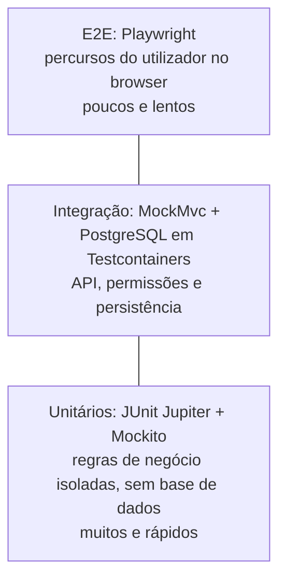

# Plano de testes da Matriz

> **Versão:** 0.4 (Ficha PL 05: cenários de entrega e configuração, secção 4.4)
> **Estado:** concluído para a Ficha PL 04. Todos os testes marcados "Novo" estão no repositório e passam. Os resultados das execuções ficam em [verification.md](verification.md), secção 13.

Documentos relacionados:

- [requirements.md](requirements.md): matriz de permissões (secção 3.1) e regras de negócio.
- [user-stories.md](user-stories.md): critérios de aceitação e casos excecionais (E).
- [constraints.md](constraints.md): requisitos de segurança (SEG).
- [architecture.md](architecture.md): estratégia de testes (DA31, DA37) e convenções de erro (DA17).
- [../openapi.yaml](../openapi.yaml): contrato da API.
- [quality-security-review.md](quality-security-review.md): Code Review e Security Review (Ficha PL 04, exercício 5).

---

## 1. Objetivo e âmbito

Definir os testes das tarefas e das suas permissões a partir dos requisitos, e não do comportamento atual da implementação. O resultado esperado de cada cenário vem das regras de negócio, das histórias e do contrato.

Âmbito: criar, consultar, editar, mudar o estado e apagar tarefas, responsáveis e comentários, com as permissões de requirements.md, secção 3.1. Fora deste plano: contas, equipas e projetos, que já têm os testes de [verification.md](verification.md), secções 3 e 12.

---

## 2. Níveis de teste (DA37)

| Nível | O que verifica | Ferramentas | Onde | Comando |
|-------|----------------|-------------|------|---------|
| Unitário | Uma regra de negócio, com as dependências substituídas por mocks. Classes `*RulesTests`. | JUnit Jupiter, Mockito | `backend/src/test/java` | `./mvnw test -Dtest='*RulesTests'` (sem Docker) |
| Integração | Pedido HTTP real à API, Spring Security e PostgreSQL. Códigos HTTP, corpo, permissões e o que fica gravado. | MockMvc, Testcontainers (DA31) | `backend/src/test/java` | `./mvnw verify` (com Docker) |
| E2E | Percurso completo pela interface, com o backend e a base de dados reais, no computador e num ecrã de 360 px (RNF01). | Playwright com TypeScript (Chromium) | `frontend/e2e` | `npm run test:e2e` (com a aplicação a correr) |
| Cobertura | Que partes do código os testes executam. Indicação, não prova de requisitos. | JaCoCo | `backend/target/site/jacoco` | Só unitários: `./mvnw clean test -Dtest='*RulesTests' jacoco:report`. Total: no fim de `./mvnw verify` |

Regras para todos os níveis:

- Cada teste prepara os seus dados e não depende de outro teste nem de execuções anteriores. Os testes de integração limpam a base de dados antes de cada teste (`ApiTestSupport`). Os E2E criam dados com um nome único e apagam-nos no fim.
- A data atual é fixa nos testes do backend: 10/11/2026 às 10:00, hora de Lisboa (RNF06, DA24).
- Quando um teste falha, regista-se se é um defeito da aplicação, um problema do teste ou uma limitação do ambiente.
- A cobertura de código não prova que os requisitos estão certos. As asserções verificam o resultado esperado de cada cenário.

---

## 3. Como se fez a matriz

1. A matriz foi pedida a um agente de IA separado, que leu só requirements.md, user-stories.md, constraints.md e openapi.yaml, sem acesso ao código. Assim, os resultados esperados vêm dos requisitos e não da implementação (pergunta do slide do Módulo 4 sobre a mesma IA gerar o código e os testes).
2. A proposta tinha 30 cenários, os valores-limite do título e 9 ambiguidades.
3. Cada cenário foi revisto contra a documentação (DA11, DA17, P13) e contra os testes que já existem. As correções e as decisões estão na secção 6.
4. Os três cenários essenciais da ficha ficam marcados com **Essencial**: título inválido (CT05 a CT08), criação e consulta (CT01 a CT03) e acesso sem autorização (CT12 a CT21).

---

## 4. Cenários

Pessoas e projetos de partida de [user-stories.md](user-stories.md): Rui gere o Novo armazém (Logística Norte), Tiago gere Fornecedores (Compras), Sofia é Gestor da Logística Norte sem gerir o Novo armazém, Marta e Pedro são Membros da Logística Norte, João é Membro de Compras, Carlos é Observador e Ana é Administrador. O Armazém Sul está arquivado.

Estado: **Existe** (teste já no repositório), **Novo** (teste acrescentado na Ficha PL 04 ou na Ficha PL 05, com o exercício ou o passo) ou **Não automatizado** (com o motivo na secção 7).

### 4.1 Criação e consulta

| ID | Cenário | Quem | Entrada | Resultado esperado | Nível | Teste | Origem |
|----|---------|------|---------|--------------------|-------|-------|--------|
| CT01 | **Essencial.** Criar tarefa válida | Rui | `POST /api/projects/{novo}/tasks` com título, prazo 15/11/2026 e prioridade Alta | 201 com `Location`. Estado "Por fazer", sem responsáveis, não atrasada, versão 0. Fica gravada na base de dados. | Integração | Existe: `TaskApiTests.managerCreatesATaskThatCanBeReadLater`. Novo (Ex. 3): `TaskApiTests.createdTaskIsStoredAndReturnedByTheApi`, com a verificação na base de dados. | US05, RN11, RN12 |
| CT02 | **Essencial.** Consultar a tarefa criada noutro pedido | Rui e Pedro | `GET` ao endereço do `Location` | 200 com os mesmos valores. | Integração | Existe: o mesmo teste de CT01. Novo (Ex. 3): o mesmo teste novo de CT01. | US05, US16 |
| CT03 | **Essencial.** Criar a tarefa e vê-la na lista | Rui, na interface | Entrar, abrir o Novo armazém, criar a tarefa | A tarefa aparece na lista do projeto, "Por fazer" e "Sem responsável", sem recarregar. | E2E | Novo (Ex. 4): `frontend/e2e/create-task.spec.ts` | US05, US11 |
| CT04 | Prioridade omitida e título aparado | Rui | `{title: "  Rever contrato  "}` | Criada com prioridade Média e título "Rever contrato". | Unitário | Existe (integração): `TaskApiTests.priorityDefaultsToMediumAndTitleIsTrimmed`. Novo (Ex. 2): `TaskTitleRulesTests` | RN11 |
| CT09 | Prazo no passado e prazo igual à data atual | Rui | Prazo 09/11/2026 e 10/11/2026 | 400 `VALIDATION_ERROR` no campo `dueDate` para o primeiro; 201 para o segundo. | Integração | Existe: `TaskApiTests.dueDateCannotBeInThePast` | RN13, RNF06 |
| CT10 | Criar tarefa num projeto arquivado | Rui | `POST /api/projects/{sul}/tasks` | 409 `PROJECT_NOT_ACTIVE`. | Integração | Existe: `TaskApiTests.onlyTheManagerOrTheAdministratorCreateTasksAndOnlyInActiveProjects` | RN08 |
| CT22 | Tarefa apagada ou de projeto eliminado | Rui | `GET` e `PATCH /api/tasks/{apagada}` | 404 `NOT_FOUND`, "A tarefa não existe.". | Integração | Existe: `TaskApiTests.deletedTaskDisappearsButIsKept`, `ProjectApiTests.deletingKeepsTheDataButHidesTheProjectAndItsTasks`. Novo (Ex. 3): tarefa que nunca existiu, no teste de CT05. | RN19, RN31, RN32 |
| CT33 | Fluxo completo do slide do Módulo 4 | Rui, na interface | Criar projeto, criar tarefa, mudar o estado, abrir o painel | As contagens do painel mostram a tarefa no novo estado. | E2E | Novo (Ex. 4): `frontend/e2e/project-flow.spec.ts` | US04, US05, US07, US21 |
| CT36 | Percurso do Membro (passos 4 e 5 do percurso principal) | Marta, responsável, na interface | Abrir "As minhas tarefas", abrir a tarefa, mudar o estado para "Em curso" | A tarefa aparece com o projeto; depois de mudar, a lista mostra "Em curso". | E2E | Novo (passo 2b): `frontend/e2e/member-flow.spec.ts` | US08, US07, RN15 |

### 4.2 Título inválido (RN11)

| ID | Cenário | Quem | Entrada | Resultado esperado | Nível | Teste | Origem |
|----|---------|------|---------|--------------------|-------|-------|--------|
| CT05 | **Essencial.** Título vazio, só com espaços ou em falta | Rui | `""`, `"   "`, sem `title` | 400 `VALIDATION_ERROR`, erro no campo `title`, "O título é obrigatório e tem no máximo 200 caracteres.". Nada fica gravado. | Unitário e integração | Existe (integração): `TaskApiTests.invalidTitlesAreRefused`. Novo (Ex. 2): `TaskTitleRulesTests`. Novo (Ex. 3): `TaskApiTests.invalidTitleStoresNothingAndUnknownTaskIsNotFound` | RN11, E21 |
| CT06 | **Essencial.** Título com 201 caracteres | Rui | "a" ×201, "é" ×201 | Igual a CT05. | Unitário | Existe (integração): `TaskApiTests.invalidTitlesAreRefused`. Novo (Ex. 2): `TaskTitleRulesTests` | RN11 |
| CT07 | **Essencial.** Valores-limite aceites | Rui | 1 carácter, 200 caracteres, 200 com acentos, emojis ou espaços nas pontas | Criada, com o título sem os espaços nas pontas. | Unitário | Novo (Ex. 2): `TaskTitleRulesTests` | RN11, DA11, LIM13 |
| CT08 | **Essencial.** Título inválido ao editar | Rui | `PATCH /api/tasks/{t}` com `{title: "   "}` | 400 `VALIDATION_ERROR` no campo `title`. A tarefa não muda. | Unitário | Novo (Ex. 2): `TaskTitleRulesTests` | RN11, US16 |

### 4.3 Permissões e acesso sem autorização

Os cenários CT12 a CT21, CT34 e CT35 são o cenário de autorização entre dois utilizadores de demonstração pedido pela ficha (IDOR / Broken Access Control): uma pessoa autenticada muda o identificador no pedido para chegar a uma tarefa de um projeto que não vê. Pela DA17, um recurso que existe mas não é visível dá 403, e a verificação de permissão vem antes da validação dos dados.

| ID | Cenário | Quem | Entrada | Resultado esperado | Nível | Teste | Origem |
|----|---------|------|---------|--------------------|-------|-------|--------|
| CT11 | Membro tenta criar tarefa | Marta | `POST /api/projects/{novo}/tasks` | 403 `FORBIDDEN`, "Não tem permissão para esta operação.". Nada fica gravado. | Integração | Existe: `TaskApiTests.onlyTheManagerOrTheAdministratorCreateTasksAndOnlyInActiveProjects` | US05, SEG02 |
| CT12 | **Essencial.** Ler tarefa de outra equipa | Pedro | `GET /api/tasks/{tarefa de Fornecedores}` | 403 `FORBIDDEN`, "Não tem acesso a esta página.", sem dados da tarefa. | Integração | Existe: `TaskApiTests.tasksOfOtherTeamsAreNotVisible` | SEG02, RF03 |
| CT13 | **Essencial.** Editar tarefa de outra equipa | Pedro | `PATCH /api/tasks/{tarefa de Fornecedores}` | 403. A tarefa não muda (confirmado na base de dados). | Integração | Novo (Ex. 5): `AccessControlApiTests` | SEG02, US16 |
| CT14 | **Essencial.** Mudar o estado de tarefa de outra equipa | João | `PUT /api/tasks/{tarefa do Novo armazém}/status` | 403. O estado mantém-se. | Integração | Novo (Ex. 5): `AccessControlApiTests` | SEG02, RN15 |
| CT15 | **Essencial.** Apagar tarefa de outra equipa | Tiago | `DELETE /api/tasks/{tarefa do Novo armazém}` | 403. A tarefa continua na lista. | Integração | Novo (Ex. 5): `AccessControlApiTests` | SEG02, RN19 |
| CT16 | **Essencial.** Trocar o projeto no pedido | Rui | `GET` e `POST /api/projects/{fornecedores}/tasks` | 403 nos dois. Nada fica gravado. | Integração | Existe (GET, com o Pedro): `TaskApiTests.tasksOfOtherTeamsAreNotVisible`. Novo (Ex. 5): `AccessControlApiTests` | SEG02, RN05 |
| CT17 | **Essencial.** Dados inválidos não revelam a validação | Pedro | `PATCH /api/tasks/{tarefa de Fornecedores}` com `{title: ""}` | 403, sem erros por campo (o 403 vem antes do 400, DA17). | Integração | Novo (Ex. 5): `AccessControlApiTests` | SEG02, DA17 |
| CT18 | **Essencial.** Comentários de tarefa de outra equipa | João | `GET` e `POST /api/tasks/{tarefa do Novo armazém}/comments` | 403 nos dois. Nenhum comentário gravado. | Integração | Novo (Ex. 5): `AccessControlApiTests` | RN30, SEG02 |
| CT19 | **Essencial.** Responsáveis de tarefa de outra equipa | Tiago | `PUT /api/tasks/{tarefa do Novo armazém}/assignees/{João}` | 403, e não 409 `INVALID_ASSIGNEE` (DA17). | Integração | Novo (Ex. 5): `AccessControlApiTests` | SEG02, US06 |
| CT20 | **Essencial.** Abrir pelo endereço um projeto de outra equipa | Pedro, na interface | Abrir `/projetos/{fornecedores}` diretamente | "Não tem acesso a esta página.", sem dados do projeto. | E2E | Novo (Ex. 4): `frontend/e2e/direct-access.spec.ts` | US12, SEG02 |
| CT21 | **Essencial.** Pedido sem sessão | Sem sessão | `GET /api/tasks/{t}` | 401 `UNAUTHENTICATED`. | Integração | Existe (noutro endereço): `SessionApiTests.requestWithoutSessionIsRefused`. Novo (Ex. 5): `AccessControlApiTests` | SEG01 |
| CT23 | Gestor da mesma equipa que não gere o projeto | Sofia | `GET` e `PATCH /api/tasks/{tarefa do Novo armazém}` | 200 no GET, 403 no PATCH. | Integração | Existe (PATCH): `TaskApiTests.managerEditsAndOldVersionIsRefused` | 3.1, US16 |
| CT24 | Observador lê mas não altera | Carlos | `GET /api/tasks/{tarefa de Fornecedores}` e `PUT .../status` | 200 no GET, 403 no PUT. | Integração | Existe: `TaskApiTests.tasksOfOtherTeamsAreNotVisible`, `TaskApiTests.assigneesManagersAndAdministratorsChangeTheStatus` | US15, P13 |
| CT25 | Membro muda o estado de tarefa de que não é responsável | Marta | `PUT /api/tasks/{t}/status` | 403. O estado mantém-se. | Integração | Existe: `TaskApiTests.assigneesManagersAndAdministratorsChangeTheStatus` | RN15, E7 |
| CT26 | Responsável muda o estado e reabre | Marta e Rui | `PUT /api/tasks/{t}/status` | 200, versão mais 1. Reabrir faz descer o progresso. | Integração | Existe: `TaskApiTests.assigneesManagersAndAdministratorsChangeTheStatus` | US07, RN12, E12 |
| CT27 | Membro tenta editar os campos da tarefa | Marta | `PATCH /api/tasks/{t}` | 403. | Integração | Existe: `TaskApiTests.managerEditsAndOldVersionIsRefused` | 3.1, US16 |
| CT28 | Projeto fechado | Marta | `PUT /api/tasks/{tarefa do Armazém Sul}/status` | 409 `PROJECT_CLOSED`. | Integração | Existe: `TaskApiTests.closedProjectAndOldVersionAreRefused` | RN09 |
| CT29 | Versão antiga | Marta, depois do Rui | `PUT /api/tasks/{t}/status` com a versão anterior | 409 `VERSION_CONFLICT`. O estado fica igual. | Integração | Existe: `TaskApiTests.closedProjectAndOldVersionAreRefused` | DA05, E30 |
| CT30 | Responsável inválido ou repetido | Rui | `PUT /api/tasks/{t}/assignees/{João}` e a Marta duas vezes | 409 `INVALID_ASSIGNEE` e 409 `DUPLICATE_ASSIGNEE`. | Integração | Existe: `CollaborationApiTests.invalidAssigneesAreRefused`, `CollaborationApiTests.theSamePersonIsNotAssignedTwice` | RN14, E40 |
| CT31 | Campos a mais ao criar (mass assignment) | Rui | `POST /api/projects/{novo}/tasks` com `status`, `projectId` ou `assignees` | Os campos a mais não têm efeito. O contrato diz `additionalProperties: false` (resposta 400): o comportamento real confirma-se no exercício 5. | Integração | Novo (Ex. 5): `AccessControlApiTests` | SEG02, openapi.yaml |
| CT32 | Pedido de alteração sem token CSRF | Rui | `POST /api/projects/{novo}/tasks` sem `X-XSRF-TOKEN` | 403 em Problem Details. Nada fica gravado. | Integração | Novo (Ex. 5): `AccessControlApiTests` | DA04, SEG |
| CT34 | Responsáveis de tarefa de outra equipa não se descobrem | Pedro | `DELETE /api/tasks/{tarefa de Fornecedores}/assignees/{João}` (responsável) e `.../{Marta}` (não responsável) | 403 nos dois, sem revelar quem é responsável. A associação mantém-se. | Integração | Novo (Ex. 5, regressão de F1): `AccessControlApiTests.memberOfAnotherTeamCannotFindOutWhoIsAssigned` | SEG02, 3.1 |
| CT35 | Pessoas de outra equipa não se descobrem | Pedro | `DELETE /api/teams/{compras}/members/{João}` (pertence) e `.../{Rui}` (não pertence) | 403 nos dois, sem revelar quem pertence. A equipa fica igual. | Integração | Novo (Ex. 5, regressão de F2): `TeamApiTests.memberCannotFindOutWhoBelongsToAnotherTeam` | SEG02, 3.1 |

### 4.4 Entrega e configuração (Ficha PL 05)

Cenários da imagem Docker, do ambiente publicado e das correções F5, F6, F13 e F14 ([quality-security-review.md](quality-security-review.md)). Decisões em DA38 a DA40.

| ID | Cenário | Quem | Entrada | Resultado esperado | Nível | Teste | Origem |
|----|---------|------|---------|--------------------|-------|-------|--------|
| CT37 | Saúde da aplicação para o Docker, a pipeline e o alojamento | Sem sessão | `GET /actuator/health`, `/actuator/health/liveness` e `/actuator/health/readiness`; `GET /actuator`, `/actuator/env`, `/actuator/beans`, `/actuator/configprops` e `/actuator/loggers` | Os três primeiros: 200 com `status` "UP" e sem pormenores dos componentes. Os outros não chegam ao Actuator: nenhum devolve configuração, beans, níveis de log nem a lista de endpoints. | Integração | Novo (Ficha PL 05, passo 2): `HealthEndpointTests` | DA38 |
| CT38 | Dois Administradores desativam-se um ao outro ao mesmo tempo | Ana e Bruno, Administradores ativos | Dois `PUT /api/users/{id}/status` com `DEACTIVATED`, em paralelo, 10 vezes | Em cada vez: um 200, o outro recusado (409 `LAST_ADMINISTRATOR`, ou 401 se a conta de quem pede já estiver desativada, DA35) e um Administrador ativo no fim. | Integração | Novo (Ficha PL 05, passo 4, regressão de F5): `LastAdministratorConcurrencyTests` | RN18, F5 |
| CT39 | Cookies seguros atrás do proxy com HTTPS | Rui, com `MATRIZ_COOKIE_SECURE=true` e `MATRIZ_FORWARD_HEADERS=native` | Pedidos HTTP reais a `/api/session` com `X-Forwarded-Proto: https` | Resposta com `Strict-Transport-Security`; cookie `XSRF-TOKEN` com `Secure`; ao entrar, `JSESSIONID` com `Secure`, `HttpOnly` e `SameSite=Lax`. | Integração | Novo (Ficha PL 05, passo 4, regressão de F6): `ProxyConfigurationTests.behindTheHttpsProxyTheCookiesAreSecureAndHstsIsSent` | SEG07, F6 |
| CT40 | Limite de tentativas por pessoa atrás do proxy | Rui, com `MATRIZ_FORWARD_HEADERS=native` | 5 entradas erradas com `X-Forwarded-For: 203.0.113.10`; depois a palavra-passe certa desse endereço e de `203.0.113.20` | 401 nas 5 falhas; 429 no mesmo endereço; 200 no outro endereço. | Integração | Novo (Ficha PL 05, passo 4, regressão de F13): `ProxyConfigurationTests.loginAttemptsAreCountedPerClientAddressAndNotPerProxy` | SEG09, DA26, F13 |
| CT41 | Content Security Policy | Sem sessão | Pedidos HTTP reais `GET` e `HEAD` a `/`, `/projetos/1` e `/api/session` (a página inicial é servida por reencaminhamento, que o MockMvc não executa) | Cabeçalho `Content-Security-Policy` com a política de `SecurityConfiguration`, mais `X-Content-Type-Options: nosniff` e `X-Frame-Options: DENY`, em todos. Os percursos E2E continuam a passar contra a imagem. | Integração | Novo (Ficha PL 05, passo 4): `SecurityConfigurationTests.frontendAndApiResponsesCarryTheSecurityHeaders` | SEG06 |
| CT42 | Sem utilizador em memória criado pelo Spring Boot | | Contexto da aplicação | Nenhum `UserDetailsService`; o log de arranque não mostra uma palavra-passe gerada. | Integração | Novo (Ficha PL 05, passo 4, regressão de F14): `SecurityConfigurationTests.noInMemoryUserIsCreated` | F14 |

---

## 5. Valores-limite do título (RN11)

O título conta-se depois de retirar os espaços nas pontas e de normalizar o texto em NFC (DA11). Cada código Unicode conta um.

| Entrada | Comprimento contado | Esperado |
|---------|---------------------|----------|
| Em falta (`null`) | | Recusado |
| `""` | 0 | Recusado |
| `"   "` | 0 depois de retirar os espaços | Recusado |
| `"a"` | 1 | Aceite |
| "a" ×200 | 200 | Aceite |
| "é" ×200 | 200 | Aceite |
| "e" seguido do acento combinado (U+0301), ×200 | 200 depois de normalizar em NFC | Aceite |
| Emoji simples ×200 | 200 | Aceite |
| Dois espaços, "a" ×200, dois espaços | 200 | Aceite, gravado sem os espaços |
| "a" ×201 | 201 | Recusado |
| "é" ×201 | 201 | Recusado |
| Bandeira 🇵🇹 ×101 (dois códigos cada, LIM13) | 202 | Recusado |

---

## 6. Revisão das sugestões da IA

| # | Sugestão ou pressuposto | Decisão | Motivo |
|---|-------------------------|---------|--------|
| 1 | Os 30 cenários, com os resultados esperados tirados do contrato. | Aceite, com os ajustes desta tabela. | Confirmados contra os testes existentes e o código (secção 4). |
| 2 | CT04 e CT09 como testes unitários. | CT04 aceite. CT09 fica em integração. | CT09 já tem um teste de integração com o Relógio fixo. Repeti-lo como unitário não acrescenta verificação. |
| 3 | CT08 (título inválido ao editar) como teste de integração. | Corrigido para unitário. | A edição usa a mesma regra da criação. O contrato do erro já está coberto em integração por CT05. |
| 4 | Ambiguidade: 403 ou 404 para recursos não visíveis. O 404 vem antes do 403, por isso dá para saber se um identificador existe. | Mantém-se o 403 (DA17). | Decisão documentada: não há projetos confidenciais (P13). O risco de enumeração é analisado no exercício 5. |
| 5 | Ambiguidade: o 403 vem antes do 400 (CT17). | Aceite, com teste. | Confirmado na leitura do código: `TaskService` verifica a permissão antes de validar. Um JSON mal formado é recusado pela framework antes do controlo de acesso; analisa-se no exercício 5. |
| 6 | Ambiguidade: forma de normalização Unicode não definida. | Corrigido. | A DA11 define NFC. Entra o valor-limite com o acento combinado. |
| 7 | Ambiguidade: campos a mais ao criar. | Novo cenário CT31. | Na leitura do código, `CreateTaskRequest` ignora campos desconhecidos, mas o contrato diz `additionalProperties: false`. A divergência analisa-se no exercício 5. |
| 8 | Ambiguidade: pedido sem `X-XSRF-TOKEN`. | Novo cenário CT32. | O contrato não define o código da resposta. |
| 9 | Ambiguidade: tarefa de um projeto eliminado. | Coberto por CT22. | RN31 e RN32: as tarefas do projeto eliminado ficam eliminadas e dão 404. |
| 10 | Ambiguidade: mudar o estado para o mesmo valor. | Não entra no plano. | Os requisitos não o definem. Fica como pergunta para o Product Owner. |
| 11 | Exemplos dos slides e dos anexos: `POST /tasks`, `PATCH /tasks/{id}` para o estado, `GET /api/tasks/42`. | Corrigido para o contrato real. | A Matriz usa `POST /api/projects/{projectId}/tasks` e `PUT /api/tasks/{taskId}/status` (DA19). |
| 12 | Exemplo da Aula 02: título de 3 a 150 caracteres. | Rejeitado. | Mantém-se RN11 (1 a 200), como na Ficha PL 03 (implementation-plan.md, G8). |
| 13 | Slide do Módulo 3: o Membro cria tarefas. | Rejeitado. | Só o gestor do projeto e o Administrador criam tarefas (requirements.md, secção 3.1). CT11 verifica a recusa. |

---

## 7. Cenários não automatizados

| Cenário | Motivo |
|---------|--------|
| Mudar o estado para o mesmo valor | Comportamento não definido nos requisitos (secção 6, linha 10). |
| Testes de carga e tempo de resposta (RNF03, RNF04) | Fora do âmbito da Ficha PL 04. |
| Readiness com a base de dados parada | Verificação manual com `docs/verification/incidente-bd.sh` (Ficha PL 05): a readiness passa a 503 e a liveness continua 200; feita em 16/11/2026 ([troubleshooting.md](troubleshooting.md), incidente 001). |
| E2E noutros browsers além do Chromium | Um browser chega para o percurso da ficha. Os outros ficam por verificar. O ecrã de 360 px está coberto desde o passo 2b. |

---

## 8. Testes unitários das regras (passo 2b)

Depois da entrega da Ficha PL 04, os testes unitários passaram a cobrir todas as branches das regras de negócio do backend, sem base de dados nem Spring (DA37). Os resultados esperados vêm das regras (RN), das histórias e das decisões indicadas em cada classe. A cobertura medida está em [verification.md](verification.md), secção 14.

| Classe | Testes | Regras |
|--------|:------:|--------|
| `TaskTitleRulesTests` | 15 | RN11, DA11, LIM13 (CT04 a CT08) |
| `TaskServiceRulesTests` | 64 | Tarefas: permissões (3.1, RN15, RN22), validações (RN11, RN13, RN29), estados do projeto (RN08, RN09), versão (DA05), responsáveis (RN14), atrasos, filtros (US11), "As minhas tarefas" (RN25), regras automáticas (RN16, RN17), regressão de F1 |
| `CommentServiceRulesTests` | 16 | RN30, E43, RN09 |
| `ProjectsRulesTests` | 75 | Visibilidade e gestão (3.1, RN05, RN22, RN26), pesquisa (RN25, RN34), criar (RN06, RN21, RN27), editar (RN09, DA05), estado (RN07), gestor (RN21), eliminar (RN31, RN32) |
| `AutomaticManagerRulesTests` | 9 | RN22, RN23 |
| `ProgressRulesTests` | 6 | Progresso (requirements.md secção 2, US09, E1) |
| `AccountAdministrationRulesTests` | 41 | RF02, RN04, RN18, RN23, RN28, DA25, DA26, eventos de US14 e US18 |
| `AccountsRulesTests` | 9 | RN04, DA10, SEG04, SEG05, DA25 |
| `FirstAdministratorRulesTests` | 8 | DA25, RN18 |
| `SessionRulesTests` | 11 | US01, SEG04, SEG05, SEG09, DA25, DA26 |
| `LoginAttemptsRulesTests` | 7 | SEG09, DA26 |
| `TeamsRulesTests` | 26 | RF05, RF06, RN03, RN26, RN27, RN17, regressão de F2 |
| `AutomaticTeamRulesTests` | 4 | RN23, RN26 |

