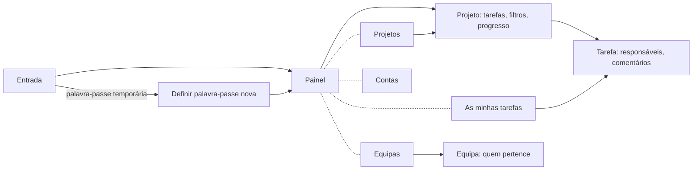

# Interface da Matriz

> **Versão:** 0.6 (Ficha PL 03, incremento I6: estado dos ecrãs)
> **Estado:** proposta. As decisões deste documento têm origem **D** e têm de ser validadas pelo Product Owner.

| Ficheiro | O que é |
|----------|---------|
| [wireframe.png](wireframe.png) | Wireframe de baixa fidelidade da lista de projetos. Atualizado na Ficha PL 03: menu com Painel e pesquisa pelo nome. |
| [wireframe.html](wireframe.html) | Fonte do wireframe. É um desenho estático, não é código do frontend. Abre-se no browser e serve para gerar de novo a imagem. |
| [design/](design/) | Designs dos ecrãs do MVP, feitos com o Claude Design na Ficha PL 03: 7 ficheiros de ecrãs ("Ecrãs 1 - Entrada" a "Ecrãs 7 - Estados comuns"), um por componente da secção 5 e o `support.js` que os mostra no browser. Definem o estilo visual (DA36). São desenhos, não são código do frontend. |

Os dados do wireframe são simulados, com base nas pessoas e nos projetos de partida de [user-stories.md](../user-stories.md). A data atual é 10/11/2026.

---

## 1. Ecrã escolhido

**Lista de projetos.** Mostra o progresso e os atrasos que o cliente pediu ("acompanhar o progresso do trabalho"). Usa os campos de `GET /projects` ([openapi.yaml](../../openapi.yaml)).

Na Ficha PL 02, a ficha sugeria o dashboard, mas o painel geral (RF29) era Should. Por isso o wireframe mostra a lista de projetos (RF09). Na Ficha PL 03, o painel passou a Must ([requirements.md, secção 8.2](../requirements.md#82-requisitos-incluídos)) e é a página inicial (DA21). O painel e os restantes ecrãs estão descritos na secção 9. Os designs de todos os ecrãs estão em [design/](design/), com o estilo visual de DA36.

---

## 2. Navegação (DA21)

| Menu | Papéis | Fonte |
|------|--------|-------|
| Painel (página inicial) | Todos | RF29, US21 |
| Projetos | Todos | RF09, RF40 |
| As minhas tarefas | Gestor, Membro | RF17. O Administrador e o Observador não podem ser responsáveis (RN14), por isso não têm esta página. |
| Equipas | Todos. O Administrador gere. Os outros só consultam: o Observador vê todas, o Gestor e o Membro veem as suas. | RF05, RF06, requirements.md §3.1 |
| Contas | Administrador | RF02 |
| Sair | Todos | RF01, SEG07 |

Depois de entrar com uma palavra-passe temporária, a pessoa vai primeiro para a página "Definir palavra-passe nova" e só depois para o painel (DA25, US01).

As linhas a tracejado são o menu. Todas as páginas exceto a de entrada exigem sessão (SEG01).

---

## 3. Legenda do wireframe

| Nº | Elemento | Fonte |
|:--:|----------|-------|
| 1 | Menu de acordo com o papel (secção 2). O Rui, Gestor, vê Painel, Projetos, As minhas tarefas e Equipas. | DA21 |
| 2 | Nome e papel de quem entrou, e o botão Sair. | US01, SEG07 |
| 3 | "+ Novo projeto": só para o Gestor e o Administrador. O Pedro, Membro, não o vê. Esconder o botão é conforto: a API recusa o pedido na mesma. | RN05, US04, SEG02 |
| 4 | Filtro por estado. Por omissão, Ativo e Concluído; Arquivado fica desligado. Corresponde ao parâmetro `status` de `GET /projects`. | RF09, RN25, US12 |
| 5 | Lista ordenada por nome, como devolve a API. | DA27, `GET /projects` |
| 6 | Progresso com barra e texto: "60% (6 de 10 concluídas)". Sem tarefas, mostra "Sem tarefas". O texto garante que a informação não depende só da barra. | RF27, US09, E1 |
| 7 | Atrasos: "Sem atrasos", "1 tarefa atrasada" ou "N tarefas atrasadas". Quando há atrasos, o texto fica destacado com contorno, não só com cor. | RF28, US10 |
| 8 | O nome do projeto abre o detalhe do projeto. | `GET /projects/{projectId}` |
| 9 | Telemóvel com 360 px: cartões em vez de tabela e menu recolhido. Não há deslocamento horizontal. | RNF01, DA22 |
| 10 | A carregar. | |
| 11 | Lista vazia: "Não há projetos para mostrar". Com pesquisa sem resultados: "Nenhum projeto corresponde à pesquisa". | US12, US22, E26, E49 |
| 12 | Erro ao carregar, com o botão "Tentar de novo". | |
| 13 | Pesquisa pelo nome. Combina-se com o filtro de estado. Corresponde ao parâmetro `q` de `GET /projects`. | RF40, RN34, US22 |

Sem sessão válida (401), a aplicação mostra a página de entrada com a mensagem "A sessão terminou. Entre de novo." (SEG01, DA16).

---

## 4. Correspondência com a API

Cada elemento da lista vem de um campo de `ProjectSummary` em `openapi.yaml`. O ecrã não precisa de nenhum dado que a API não devolva.

| Campo da API | Elemento | Valor vazio |
|--------------|----------|-------------|
| `name` | Nome | |
| `team.name` | Equipa | |
| `manager.name` | Gestor | `null`: "Sem gestor" (RN22) |
| `status` | Estado: Ativo, Concluído, Arquivado | |
| `expectedEndDate` | Fim previsto | `null`: "Sem data" |
| `progress` | Progresso | `percentage` `null`: "Sem tarefas" |
| `overdueTaskCount` | Atrasos | 0: "Sem atrasos" |

Os filtros enviam `status` (repetido) e `q`.

---

## 5. Componentes reutilizáveis

Os nomes seguem DA08 (inglês no código). Servem todos os ecrãs da secção 9.

| Componente | Responsabilidade | Onde se reutiliza |
|------------|------------------|-------------------|
| `AppNavBar` | Menu de acordo com o papel, nome e Sair. | Todas as páginas |
| `StatusFilter` | Caixas de seleção de estados. | Projetos; tarefas do projeto (US11) |
| `SearchBox` | Campo de pesquisa com etiqueta. | Projetos (US22) |
| `ProjectList` | Tabela no computador, cartões no telemóvel. | Projetos |
| `StatusTag` | Estado traduzido para português. | Projetos, tarefas |
| `PriorityTag` | Prioridade traduzida para português. | Tarefas |
| `ProgressBar` | Barra e texto do progresso. | Projetos, detalhe do projeto, painel |
| `OverdueBadge` | Contagem de atrasos, ou "Atrasada" numa tarefa. | Projetos, tarefas (US10) |
| `TaskCounts` | Contagens "Por fazer", "Em curso" e "Concluída": cartões grandes para os totais e uma linha compacta em cada projeto. | Painel (US21): totais e cartão de cada projeto |
| `AssigneePicker` | Escolher responsáveis entre as pessoas elegíveis e remover cada um. | Detalhe da tarefa (US06) |
| `CommentList`, `CommentForm` | Comentários com autor e data e hora; novo comentário. | Detalhe da tarefa (US19) |
| `ConfirmDialog` | Pergunta de confirmação com Confirmar e Cancelar. | Eliminar projeto, apagar tarefa, concluir projeto (RN10, RN19, RN31) |
| `FormField` | Etiqueta, campo e mensagem de erro junto do campo. | Todos os formulários |
| `LoadingState`, `EmptyState`, `ErrorState` | Estados a carregar, vazio e erro. | Todas as listas |

---

## 6. Decisões de interface

Todas têm origem **D**.

| ID | Decisão | Porquê |
|----|---------|--------|
| DA21 | A página inicial é o painel inicial (RF29), para todos os papéis. O menu depende do papel (secção 2). Na Ficha PL 02, a página inicial era a lista de projetos; mudou na Ficha PL 03, quando o painel entrou no MVP. | A Ficha PL 03 pede um painel inicial com o utilizador, os projetos acessíveis e as contagens. Cada papel só vê o que pode usar (RF03). |
| DA22 | As listas aparecem em tabela no computador e em cartões no telemóvel. O ponto de mudança é 720 px: abaixo dessa largura, as listas passam a cartões e o menu recolhe atrás do botão Menu. Fixado na Ficha PL 03 (incremento I2). | Uma tabela com 7 colunas não cabe em 360 px sem deslocamento horizontal (RNF01). Com 720 px ou mais, a tabela da lista de projetos cabe sem cortar colunas. |
| DA23 | As datas aparecem no formato dd/mm/aaaa e a data e hora no formato dd/mm/aaaa hh:mm, no fuso da organização (DA24). Estados, papéis e prioridades aparecem em português. | RNF02. A API usa datas ISO e os nomes técnicos de DA08. |
| DA34 | O endereço da API está num único módulo do frontend (`src/api`) e é sempre o caminho relativo `/api`. Em desenvolvimento, o servidor do Vite reencaminha `/api` para o backend (DA02). | A Ficha PL 03 pede a configuração do endereço do backend centralizada. Com a mesma origem não é preciso CORS. |
| DA36 | Estilo visual da interface, definido com o Claude Design e guardado em [design/](design/). Fundo cinzento claro (#f4f4f5) e cartões brancos com contorno de 1 px (#e4e4e7) e cantos de 8 px; botões e campos com cantos de 6 px. Letra IBM Plex Sans, com IBM Plex Mono nas datas e nos números. Destaque âmbar (#f5a000) com texto escuro nos botões principais e no item ativo do menu, que fica sublinhado; âmbar escuro (#9a5200) no contorno de foco e nas ligações ao passar o rato. Texto #1c1a17 e neutros cinzentos (#3f3f46, #52525b e #71717a; contornos #e4e4e7 e #d4d4d8). Vermelho (#b3261e) só nas ações que eliminam ou apagam. Estados e prioridades em etiquetas com fundo suave; atrasos com contorno âmbar. Caminho (breadcrumb) no detalhe e nos formulários; no detalhe do projeto, cartão Resumo à direita, que no telemóvel fica por cima das tarefas. As fontes vão com a aplicação (pacotes `@fontsource`), sem pedidos a outros sites. As cores e as medidas estão como variáveis num único ficheiro, `frontend/src/assets/main.css`. | A Ficha PL 03 (exercício 7) pede uma interface consistente e responsiva. Com as cores e as medidas num só sítio, todos os ecrãs ficam iguais. A cor nunca é a única informação: o texto acompanha sempre a etiqueta, a barra e o destaque (secção 7). |

---

## 7. Acessibilidade

Os requisitos formais ficam para DP12. O wireframe e os ecrãs seguem estas regras:

- as listas no computador são tabelas com cabeçalhos;
- os filtros e a pesquisa têm etiqueta;
- progresso, atrasos e contagens têm sempre texto, não só barra ou cor;
- as mensagens de erro ficam junto do campo e são anunciadas;
- a confirmação recebe o foco e fecha com Cancelar ou com a tecla Esc;
- o botão Menu do telemóvel tem nome acessível;
- tudo funciona com o teclado.

---

## 8. Validação face ao MVP

| Verificação | Resultado |
|-------------|-----------|
| Todos os campos de RF09 aparecem: equipa, gestor, estado, data de fim prevista, progresso, nº de tarefas atrasadas. | Sim |
| Textos de US09, US10, US12 e US22 usados tal como estão nas histórias. | Sim |
| Arquivados escondidos por omissão (RN25). | Sim, filtro 4 |
| Pesquisa pelo nome (RF40). | Sim, campo 13 |
| "+ Novo projeto" só para quem pode criar projetos (RN05). | Sim, comparar Rui e Pedro |
| Telemóvel com 360 px sem deslocamento horizontal (RNF01). | Sim. Medido no wireframe: o conteúdo tem a largura do ecrã. |
| Nenhuma funcionalidade fora do MVP: quadro (RF18), pesquisa nas tarefas (RF21), avisos (RF33), exportar (RF32). | Nenhuma aparece |

**Mensagens propostas** (não estão nas histórias): "A carregar projetos...", "Não foi possível carregar os projetos.", "Tentar de novo", "Sem data".

---

## 9. Ecrãs do MVP

A Ficha PL 03 (exercício 7) pede estes ecrãs. Os ecrãs de gestão (Equipas e Contas) completam o MVP no fim.

Estado na Ficha PL 03 (incremento I6): estão implementados a Entrada, Definir palavra-passe nova, o Painel inicial, Projetos, o detalhe do projeto (sem mudar o estado nem o gestor) e o detalhe da tarefa. As minhas tarefas, Equipas e Contas aparecem no menu com a página "Esta página chega num próximo incremento." e ficam para o I7.

| Ecrã | Conteúdo e ações | API | Histórias |
|------|------------------|-----|-----------|
| Entrada | Email, palavra-passe, Entrar. Mensagens de US01. | `POST /session` | US01 |
| Definir palavra-passe nova | Palavra-passe nova e confirmação. Não deixa abrir outras páginas antes. | `PUT /session/password` | US01 |
| Painel inicial | Nome e papel de quem entrou. Projetos visíveis com as contagens por estado e os totais. O nome abre o detalhe do projeto. | `GET /session`, `GET /dashboard` | US21 |
| Projetos | Pesquisa, filtro por estado, lista. Criar (Gestor e Administrador). O nome abre o detalhe. | `GET /projects`, `POST /projects` | US04, US12, US15, US22 |
| Detalhe do projeto | Dados, progresso e atrasos. Editar, mudar o estado e eliminar (com confirmação), conforme o papel. Lista de tarefas com filtros por responsável, estado, prioridade e atraso. Formulário para criar tarefa. | `GET`, `PATCH` e `DELETE /projects/{id}`, `PUT /projects/{id}/status`, `PUT /projects/{id}/manager`, `GET` e `POST /projects/{id}/tasks` | US05, US09, US10, US11, US13, US17, US20 |
| Detalhe da tarefa | Dados, estado, prioridade e prazo. Editar e apagar (com confirmação). Responsáveis: associar e remover. Comentários: ler e escrever. | `GET`, `PATCH` e `DELETE /tasks/{id}`, `PUT /tasks/{id}/status`, `PUT` e `DELETE /tasks/{id}/assignees/{userId}`, `GET /teams/{id}/members`, `GET` e `POST /tasks/{id}/comments` | US06, US07, US16, US19 |
| As minhas tarefas | Lista ordenada (RN24), com "Incluir concluídas". A tarefa abre o detalhe. | `GET /me/tasks` | US08 |
| Equipas | Lista de equipas e quem pertence. O Administrador cria, muda o nome, adiciona e remove pessoas. | `/teams`, `/teams/{id}/members` | US03 |
| Contas | Lista de contas. O Administrador cria, edita, muda o papel, desativa, reativa e repõe o acesso. | `/users` | US02, US14, US18 |

---

## 10. Comportamento comum dos ecrãs

Aplica-se a todos os ecrãs da secção 9. Vem do exercício 7 da Ficha PL 03 e da tabela de estados da interface dos slides do Módulo 3.

| Situação | Comportamento |
|----------|---------------|
| A carregar | `LoadingState`. |
| Lista vazia | `EmptyState`, com o texto da história quando existe. |
| Erro ao carregar | `ErrorState`, com "Tentar de novo". |
| Dados inválidos | Mensagem junto de cada campo, com o `errors` do Problem Details (DA16). A validação do frontend ajuda, mas a que conta é a do backend (SEG06). |
| Submissão em curso | Botão desativado e indicador de progresso, para não haver submissões repetidas. |
| Sucesso | A interface usa a resposta da API (o registo confirmado pelo backend), sem criar registos locais duplicados. As listas, os filtros e as contagens afetados são pedidos de novo, sem recarregar a página. Os totais refletem todos os dados, não só os visíveis. |
| Erro ao gravar | Mensagem compreensível (`detail` da API). Os dados escritos no formulário mantêm-se. Nunca aparece mensagem de sucesso. |
| 401 | Página de entrada com "A sessão terminou. Entre de novo." |
| 403 `PASSWORD_CHANGE_REQUIRED` | Página "Definir palavra-passe nova". |
| 403 noutras situações | "Não tem acesso a esta página." ou "Não tem permissão para esta operação." (DA17). |
| 404 | "O projeto não existe." ou "A tarefa não existe." |
| 409 `VERSION_CONFLICT` | Mensagem de US07, US16 ou US17 e opção de abrir de novo o registo (DA05). |
| Texto escrito pelos utilizadores | Mostrado sempre como texto, nunca como HTML (SEG06). |
