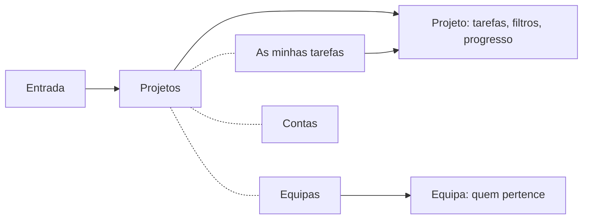

# Interface da Matriz

> **Versão:** 0.1 (Ficha PL 02, Exercício 4)
> **Estado:** proposta. As decisões deste documento têm origem **D** e têm de ser validadas pelo Product Owner.

| Ficheiro | O que é |
|----------|---------|
| [wireframe.png](wireframe.png) | Wireframe de baixa fidelidade da lista de projetos. |
| [wireframe.html](wireframe.html) | Fonte do wireframe. É um desenho estático, não é código do frontend. Abre-se no browser e serve para gerar de novo a imagem. |

Os dados do wireframe são simulados, com base nas pessoas e nos projetos de partida de [user-stories.md](../user-stories.md). A data atual é 10/11/2026.

---

## 1. Ecrã escolhido

**Lista de projetos.** É a página inicial de todos os papéis (DA21) e mostra o progresso e os atrasos que o cliente pediu ("acompanhar o progresso do trabalho"). Usa os campos de `GET /projects` ([openapi.yaml](../../openapi.yaml)).

A Ficha sugere o dashboard, mas o painel geral (RF29) é Should e não está no MVP. A lista de projetos (RF09) é o ecrã do MVP que cumpre esse papel.

---

## 2. Navegação (DA21)

| Menu | Papéis | Fonte |
|------|--------|-------|
| Projetos (página inicial) | Todos | RF09 |
| As minhas tarefas | Gestor, Membro | RF17. O Administrador e o Observador não podem ser responsáveis (RN14), por isso não têm esta página. |
| Equipas | Todos. O Administrador gere. Os outros só consultam: o Observador vê todas, o Gestor e o Membro veem as suas. | RF05, RF06, requirements.md §3.1 |
| Contas | Administrador | RF02 |
| Sair | Todos | RF01, SEG07 |

As linhas a tracejado são o menu. Todas as páginas exceto a de entrada exigem sessão (SEG01).

---

## 3. Legenda do wireframe

| Nº | Elemento | Fonte |
|:--:|----------|-------|
| 1 | Menu de acordo com o papel (secção 2). O Rui, Gestor, vê Projetos, As minhas tarefas e Equipas. | DA21 |
| 2 | Nome e papel de quem entrou, e o botão Sair. | US01, SEG07 |
| 3 | "+ Novo projeto": só para o Gestor e o Administrador. O Pedro, Membro, não o vê. Esconder o botão é conforto: a API recusa o pedido na mesma. | RN05, US04, SEG02 |
| 4 | Filtro por estado. Por omissão, Ativo e Concluído; Arquivado fica desligado. Corresponde ao parâmetro `status` de `GET /projects`. | RF09, RN25, US12 |
| 5 | Lista ordenada por nome, como devolve a API. | `GET /projects` |
| 6 | Progresso com barra e texto: "60% (6 de 10 concluídas)". Sem tarefas, mostra "Sem tarefas". O texto garante que a informação não depende só da barra. | RF27, US09, E1 |
| 7 | Atrasos: "Sem atrasos", "1 tarefa atrasada" ou "N tarefas atrasadas". Quando há atrasos, o texto fica destacado com contorno, não só com cor. | RF28, US10 |
| 8 | O nome do projeto abre o detalhe do projeto. | `GET /projects/{projectId}` (Ficha 03) |
| 9 | Telemóvel com 360 px: cartões em vez de tabela e menu recolhido. Não há deslocamento horizontal. | RNF01, DA22 |
| 10 | A carregar. | |
| 11 | Lista vazia: "Não há projetos para mostrar". | US12, E26 |
| 12 | Erro ao carregar, com o botão "Tentar de novo". | |

Sem sessão válida (401), a aplicação mostra a página de entrada com a mensagem "A sessão terminou. Entre de novo." (SEG01, DA16).

---

## 4. Correspondência com a API

Cada elemento da lista vem de um campo de `ProjectSummary` em `openapi.yaml`. O ecrã não precisa de nenhum dado que a API não devolva.

| Campo da API | Elemento | Valor vazio |
|--------------|----------|-------------|
| `name` | Nome | |
| `team.name` | Equipa | |
| `manager.name` | Gestor | `null`: "Sem gestor" (RN22) |
| `status` | Estado: Ativo, Concluído, Arquivado | |
| `expectedEndDate` | Fim previsto | `null`: "Sem data" |
| `progress` | Progresso | `percentage` `null`: "Sem tarefas" |
| `overdueTaskCount` | Atrasos | 0: "Sem atrasos" |

---

## 5. Componentes reutilizáveis

Os nomes seguem DA08 (inglês no código). Servem também os outros ecrãs.

| Componente | Responsabilidade | Onde se reutiliza |
|------------|------------------|-------------------|
| `AppNavBar` | Menu de acordo com o papel, nome e Sair. | Todas as páginas |
| `StatusFilter` | Caixas de seleção de estados. | Projetos; tarefas do projeto (US11) |
| `ProjectList` | Tabela no computador, cartões no telemóvel. | Projetos |
| `StatusTag` | Estado traduzido para português. | Projetos, tarefas |
| `ProgressBar` | Barra e texto do progresso. | Projetos, detalhe do projeto |
| `OverdueBadge` | Contagem de atrasos, ou "Atrasada" numa tarefa. | Projetos, tarefas (US10) |
| `LoadingState`, `EmptyState`, `ErrorState` | Estados a carregar, vazio e erro. | Todas as listas |

---

## 6. Decisões de interface

Todas têm origem **D**.

| ID | Decisão | Porquê |
|----|---------|--------|
| DA21 | A página inicial é a lista de projetos, para todos os papéis. O menu depende do papel (secção 2). | RF09 é o ponto de entrada indicado nos requisitos. Cada papel só vê o que pode usar (RF03). |
| DA22 | As listas aparecem em tabela no computador e em cartões no telemóvel. O ponto de mudança define-se na Ficha 03. | Uma tabela com 7 colunas não cabe em 360 px sem deslocamento horizontal (RNF01). |
| DA23 | As datas aparecem no formato dd/mm/aaaa. Estados, papéis e prioridades aparecem em português. | RNF02. A API usa datas ISO e os nomes técnicos de DA08. |

---

## 7. Acessibilidade

Os requisitos formais ficam para DP12. O wireframe já segue estas regras:

- a lista no computador é uma tabela com cabeçalhos;
- o filtro usa caixas de seleção com etiqueta;
- progresso e atrasos têm sempre texto, não só barra ou cor;
- o botão Menu do telemóvel tem nome acessível;
- tudo funciona com o teclado.

---

## 8. Validação face ao MVP

| Verificação | Resultado |
|-------------|-----------|
| Todos os campos de RF09 aparecem: equipa, gestor, estado, data de fim prevista, progresso, nº de tarefas atrasadas. | Sim |
| Textos de US09, US10 e US12 usados tal como estão nas histórias. | Sim |
| Arquivados escondidos por omissão (RN25). | Sim, filtro 4 |
| "+ Novo projeto" só para quem pode criar projetos (RN05). | Sim, comparar Rui e Pedro |
| Telemóvel com 360 px sem deslocamento horizontal (RNF01). | Sim. Medido no wireframe: o conteúdo tem a largura do ecrã. |
| Nenhuma funcionalidade fora do MVP: painel geral (RF29), pesquisa (RF21), quadro (RF18), avisos (RF33), exportar (RF32). | Nenhuma aparece |

**Mensagens propostas** (não estão nas histórias): "A carregar projetos...", "Não foi possível carregar os projetos.", "Tentar de novo", "Sem data".
